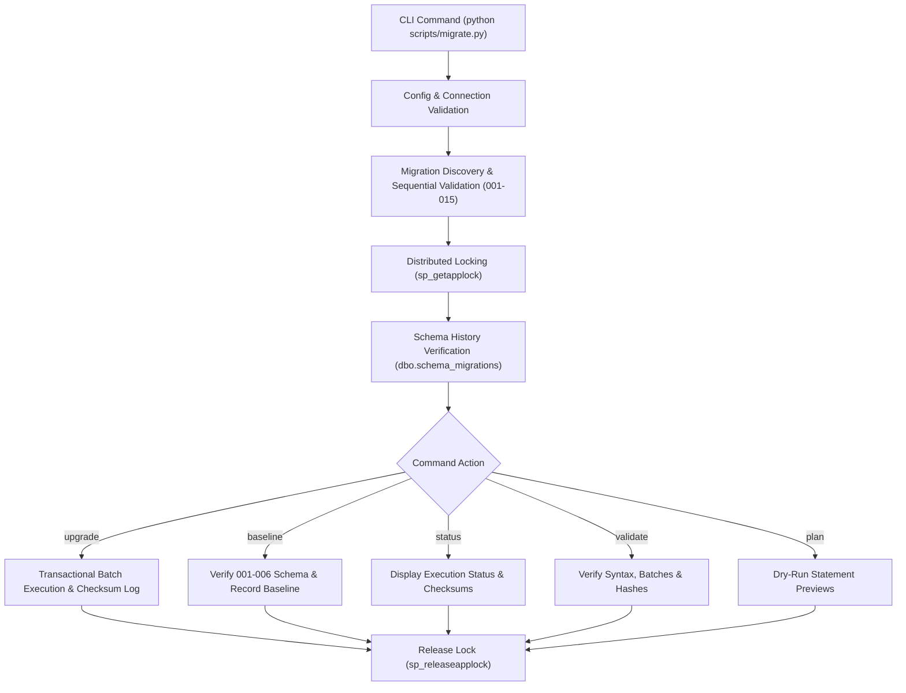

# CeylonGo — SQL Server Migration Management & Execution Guide

## 1. Executive Summary & Architecture Overview

CeylonGo utilizes a centralized, version-controlled, production-grade migration runner tailored for **Microsoft SQL Server (2017+)**. The runner operates independently of third-party migration frameworks (such as Alembic or Flyway) to guarantee full compatibility with T-SQL batch constructs, distributed application locks, transactional DDL, and line-ending invariant checksum tracking.

### System Architecture



### Core Architecture Components

1. **Standalone T-SQL Lexer (`split_sql_batches`)**:
   - Parses Transact-SQL scripts into discrete client execution batches on `GO` boundaries.
   - Robustly respects string literals (`'...'` and `''` escapes), single-line comments (`-- ...`), and multi-line nested comments (`/* ... */`).
   - Supports `GO [count]` execution repetition and inline comments (`GO -- comment`).
   - Prevents accidental tokenization when `GO` appears within table names, column values, or cities (e.g., `'CeylonGo'`, `'Galle'`).

2. **Deterministic Checksum Verification (`calculate_checksum`)**:
   - SHA-256 hash calculated over normalized content.
   - Normalizes line endings (`\r\n` -> `\n`, `\r` -> `\n`) to ensure identical hashes across Windows, Linux, and macOS checkouts.
   - Guards against unauthorized post-deployment modification or file tampering.

3. **Concurrency Protection (`sp_getapplock` / `sp_releaseapplock`)**:
   - Prevents race conditions during multi-instance or CI/CD deployment pipelines.
   - Acquires an exclusive session lock (`CeylonGo_Migrations_Lock`) with a configurable timeout (default: 15,000 ms).

4. **Transactional Batch Management**:
   - Each migration file executes inside an isolated transaction.
   - If any batch fails, the entire migration rolls back immediately, leaving the database in its prior consistent state.
   - Record in `dbo.schema_migrations` is written and committed only upon 100% successful execution of all batches.

5. **Target Database Validation**:
   - Inspects `SELECT DB_NAME()` on the live connection before executing any operation.
   - Aborts execution immediately if connected to an unexpected database (e.g. `master`, `tempdb`, or an unapproved environment).

---

## 2. Tracking Table Specification (`dbo.schema_migrations`)

The migration tracking table is automatically created by the runner on first execution if not already present.

```sql
IF NOT EXISTS (
    SELECT 1 FROM sys.tables
    WHERE name = 'schema_migrations'
      AND schema_id = SCHEMA_ID('dbo')
)
BEGIN
    CREATE TABLE dbo.schema_migrations (
        version VARCHAR(50) NOT NULL,
        filename VARCHAR(255) NOT NULL,
        checksum VARCHAR(64) NOT NULL,
        applied_at DATETIME2 NOT NULL DEFAULT GETUTCDATE(),
        execution_time_ms INT NOT NULL,
        execution_method VARCHAR(20) NOT NULL,

        CONSTRAINT PK_schema_migrations PRIMARY KEY CLUSTERED (version),
        CONSTRAINT CK_schema_migrations_method CHECK (execution_method IN ('executed', 'verified_baseline'))
    );

    CREATE NONCLUSTERED INDEX IX_schema_migrations_applied_at
        ON dbo.schema_migrations (applied_at);
END;
```

### Column Dictionary

| Column | Type | Description |
| :--- | :--- | :--- |
| `version` | `VARCHAR(50)` | Numeric sequence identifier (e.g., `'001'`, `'015'`). Primary Key. |
| `filename` | `VARCHAR(255)` | Filename of the migration script (e.g., `'015_add_homestay_provider_profile.sql'`). |
| `checksum` | `VARCHAR(64)` | Normalized SHA-256 hash of the migration script content. |
| `applied_at` | `DATETIME2` | UTC timestamp of execution or baseline registration. |
| `execution_time_ms`| `INT` | Total wall-clock execution time in milliseconds (0 for baseline). |
| `execution_method` | `VARCHAR(20)` | `'executed'` (run live by the runner) or `'verified_baseline'` (pre-existing schema verified). |

---

## 3. Environment Setup & Prerequisites

### Required Software & Drivers
- **Python**: 3.10+ (tested on Python 3.12).
- **Microsoft ODBC Driver**: `ODBC Driver 18 for SQL Server` or `ODBC Driver 17 for SQL Server`.
- **Database Engine**: Microsoft SQL Server 2017+ / Azure SQL / SQL Server Express.
- **Python Libraries**: `pyodbc`, `SQLAlchemy`, `pydantic`.

### Configuration (`.env`)
The runner reads database connection settings from `.env` in the repository root or parameters passed via CLI flags:

```ini
DB_SERVER=.\SQLEXPRESS
DB_NAME=CeylonGoDB
DB_DRIVER=ODBC Driver 18 for SQL Server
DB_TRUST_CERTIFICATE=yes
# Optional SQL Authentication:
# DB_USER=sa
# DB_PASSWORD=YourStrongPassword!
```

### Database User Permissions
The database user executing migrations requires:
- `db_ddladmin` (to create, alter, drop tables, constraints, and indexes)
- `db_datareader` (to read data and schema catalogs)
- `db_datawriter` (to insert and update records, including `dbo.schema_migrations` and backfills)
- `sp_getapplock` execution permissions (granted by default in `public` within user databases).

---

## 4. CLI Command Reference

All commands are executed from the `CeylonGo-Backend` directory:

```bash
cd CeylonGo-Backend
```

### 4.1 Check Status (`status`)
Inspects applied migrations, pending migrations, execution timestamps, and checksum validity against the live database:

```bash
python scripts/migrate.py status
```

**Sample Output:**
```
===============================================================================================
 CEYLONGO SQL SERVER MIGRATION STATUS — Database: CeylonGoDB on .\SQLEXPRESS
===============================================================================================
Version  Filename                               Status             Applied At (UTC)     Checksum
-----------------------------------------------------------------------------------------------
001      001_create_password_resets.sql         Applied (baseline) 2026-11-17 12:00:00  [OK] Valid
002      002_add_google_sign_in_to_users.sql    Applied (baseline) 2026-11-17 12:00:00  [OK] Valid
...
007      007_create_homestay_tables.sql         PENDING            -                    [Pending]
...
015      015_add_homestay_provider_profile.sql  PENDING            -                    [Pending]
===============================================================================================
Total Discovered: 15 | Applied/Baseline: 6 | Pending: 9
```

### 4.2 Validate Migrations (`validate`)
Performs syntax parsing, sequential gap detection, duplicate checking, and checksum verification without applying changes:

```bash
# Validate files only (offline mode, no database connection):
python scripts/migrate.py validate --no-db

# Validate files and verify applied migration checksums against live DB:
python scripts/migrate.py validate
```

### 4.3 Plan / Dry-Run (`plan`)
Displays a detailed dry-run showing exactly which migrations would execute, their parsed batches, and statement previews without executing DDL:

```bash
# Preview all pending migrations:
python scripts/migrate.py plan

# Preview up to a target version:
python scripts/migrate.py plan --target 010
```

### 4.4 Record Baseline (`baseline`)
Verifies that the live schema matches migrations `001`–`006` and records them in `dbo.schema_migrations` with `execution_method = 'verified_baseline'`:

```bash
python scripts/migrate.py baseline --yes
```

> [!NOTE]
> The `--yes` flag is mandatory. If omitted, the command aborts to prevent accidental baseline registration.

### 4.5 Execute Upgrade (`upgrade`)
Applies pending migrations sequentially in isolated transactions:

```bash
# Apply all pending migrations (requires --yes):
python scripts/migrate.py upgrade --yes

# Apply pending migrations up to a specific version:
python scripts/migrate.py upgrade --target 011 --yes

# Verbose execution with batch-by-batch progress:
python scripts/migrate.py upgrade --yes -v
```

---

## 5. Baseline Registration Workflow for Existing `CeylonGoDB`

In the development and test environments, tables corresponding to migrations `001`–`006` were provisioned during earlier feature phases before centralized runner tracking was introduced. 

The baseline command verifies that all required schema elements exist before recording them:
1. `001`: `dbo.password_resets` table and `token_hash` column.
2. `002`: `dbo.users` table and `google_sub` column.
3. `003`: `dbo.provider_profiles` table, `provider_type`, and `UQ_provider_profiles_user_id`.
4. `004`: `dbo.provider_email_otps`, `dbo.provider_registration_authorizations`, and `nic_number`.
5. `005`: `dbo.provider_registration_drafts` table.
6. `006`: `dbo.provider_profiles` personal details (`date_of_birth`, `gender`, `permanent_landmark`).

### Step-by-Step Baseline Execution:
```bash
# Step 1: Confirm status
python scripts/migrate.py status

# Step 2: Validate integrity
python scripts/migrate.py validate

# Step 3: Run baseline verification and registration
python scripts/migrate.py baseline --yes

# Step 4: Verify status confirms 001-006 recorded as baseline
python scripts/migrate.py status
```

---

## 6. Fresh Database Setup Protocol (Scratch Initialization)

### The Missing `dbo.users` Table Prerequisite
In the repository, migrations `001` and `002` reference and alter `dbo.users`, assuming the table exists. When spinning up a brand new staging or production database, `dbo.users` **must be created first** before running `scripts/migrate.py upgrade`.

### Required Initial `dbo.users` DDL
Execute the following script on the empty database:

```sql
USE [CeylonGoDB];
GO

IF OBJECT_ID('dbo.users', 'U') IS NULL
BEGIN
    CREATE TABLE dbo.users (
        id INT IDENTITY(1,1) NOT NULL,
        full_name NVARCHAR(150) NOT NULL,
        email NVARCHAR(255) NOT NULL,
        password_hash NVARCHAR(255) NULL,
        role NVARCHAR(30) NOT NULL DEFAULT 'traveler',
        is_active BIT NOT NULL DEFAULT 1,
        google_sub NVARCHAR(255) NULL,
        created_at DATETIME2 NOT NULL DEFAULT SYSUTCDATETIME(),

        CONSTRAINT PK_users PRIMARY KEY CLUSTERED (id),
        CONSTRAINT UQ_users_email UNIQUE (email)
    );

    CREATE UNIQUE NONCLUSTERED INDEX UQ_users_google_sub
        ON dbo.users (google_sub)
        WHERE google_sub IS NOT NULL;

    PRINT 'Table dbo.users created successfully.';
END
GO
```

### Complete Fresh Database Setup Sequence:
1. Create database: `CREATE DATABASE CeylonGoDB;`
2. Execute the `dbo.users` DDL above.
3. Apply all migrations from 001 through 015:
   ```bash
   python scripts/migrate.py upgrade --yes
   ```
4. Verify all 15 migrations are applied:
   ```bash
   python scripts/migrate.py status
   ```

---

## 7. Database Backup & Disaster Recovery Protocol

### Pre-Migration Backup Protocol
Always take a verified full database backup immediately prior to running `upgrade` in staging or production environments:

```sql
-- Take full backup with checksum and compression
BACKUP DATABASE [CeylonGoDB]
TO DISK = N'C:\Backups\CeylonGoDB_PreMigration_Phase03.bak'
WITH FORMAT, INIT,
     NAME = N'CeylonGoDB-PreMigration Full Backup',
     SKIP, NOREWIND, NOUNLOAD, COMPRESSION, CHECKSUM, STATS = 10;
GO

-- Verify backup media integrity
RESTORE VERIFYONLY
FROM DISK = N'C:\Backups\CeylonGoDB_PreMigration_Phase03.bak'
WITH CHECKSUM;
GO
```

### Disaster Recovery & Point-in-Time Restore
If an unrecoverable hardware or systemic failure occurs during an upgrade:

```sql
USE master;
GO

-- Terminate active sessions and restore from pre-migration backup
ALTER DATABASE [CeylonGoDB]
SET SINGLE_USER WITH ROLLBACK IMMEDIATE;
GO

RESTORE DATABASE [CeylonGoDB]
FROM DISK = N'C:\Backups\CeylonGoDB_PreMigration_Phase03.bak'
WITH REPLACE, RECOVERY, STATS = 10;
GO

ALTER DATABASE [CeylonGoDB]
SET MULTI_USER;
GO
```

---

## 8. Staging Rehearsal Procedure

Before running migrations on the live production database:
1. Create a shadow database: `CREATE DATABASE CeylonGoDB_Rehearsal;`
2. Restore production backup to `CeylonGoDB_Rehearsal`.
3. Point `.env` to `DB_NAME=CeylonGoDB_Rehearsal`.
4. Run `python scripts/migrate.py baseline --yes`.
5. Run `python scripts/migrate.py plan`.
6. Run `python scripts/migrate.py upgrade --yes -v`.
7. Verify all 15 tables and relations:
   ```sql
   SELECT TABLE_NAME FROM INFORMATION_SCHEMA.TABLES WHERE TABLE_TYPE = 'BASE TABLE' ORDER BY TABLE_NAME;
   ```
8. Run automated end-to-end integration tests against `CeylonGoDB_Rehearsal`.
9. Once verified, schedule the production execution window.

---

## 9. Rules for Authoring New Migrations

1. **Naming Convention**:
   - Files must reside in `CeylonGo-Backend/migrations/`.
   - Pattern: `NNN_action_description.sql` (e.g. `016_create_tours_table.sql`).
   - Sequence numbers must be strictly sequential (3 digits minimum).

2. **Idempotency**:
   - Always guard table creation: `IF OBJECT_ID('dbo.my_table', 'U') IS NULL ...`
   - Always guard column addition: `IF COL_LENGTH('dbo.my_table', 'my_col') IS NULL ...`
   - Always guard constraints & indexes: `IF NOT EXISTS (SELECT 1 FROM sys.indexes ...)`

3. **Batch Separation (`GO`)**:
   - Place `GO` on its own line between DDL batches.
   - Do not combine DDL and data manipulation in the same batch if the DDL introduces columns used in the query.

4. **Foreign Key Deletion Rules**:
   - Avoid `ON DELETE CASCADE` on provider listings or financial tables.
   - Use `ON DELETE NO ACTION` (default) to ensure referential integrity and audit trails.

5. **Local Verification**:
   - Run `python scripts/migrate.py validate --no-db` to verify batch parsing.
   - Run `pytest tests/test_migration_runner.py` to ensure all runner unit tests pass.
