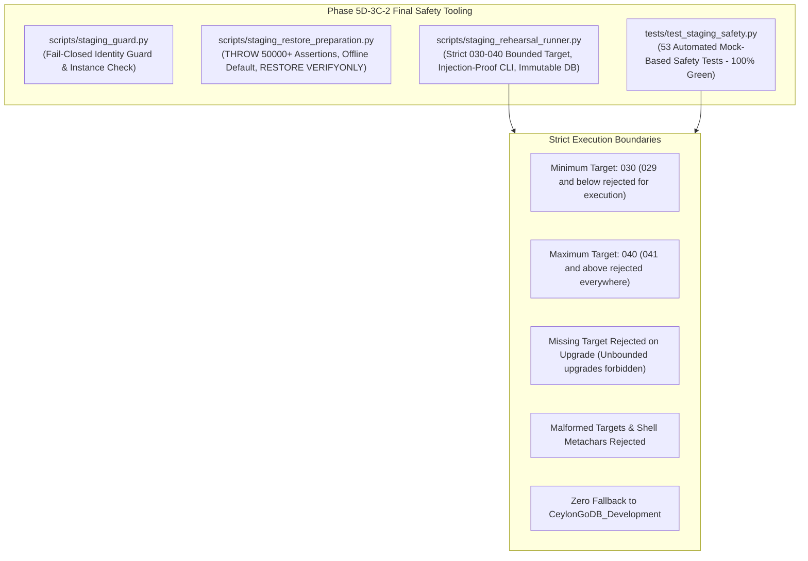

# CEYLONGO MODULE 03: ACTIVITIES & EXPERIENCES
## PHASE 5D-3C & 5D-3C-2: STAGING REHEARSAL FINAL SAFETY & COMMIT READINESS REPORT
### Authoritative Staging Restore Safety Audit, Reusable Database Identity Guard, Bounded Rehearsal Runner & Automated Mock Safety Test Suite

**Document Version:** 3.0 (Phase 5D-3C-2 Final Safety & Commit Readiness)
**Audit Date:** 21 November 2026
**Author Roles:** Senior Python Backend Engineer, SQL Server Migration Safety Auditor, QA Lead
**Project Workspace:** `C:\Users\komaruthan\Desktop\project 4\CeylonGo-Backend`
**Active Git Branch:** `feature/m03-promotions-platform-reporting`
**Current Git HEAD:** `b2d852c` (`feat(m03): add admin promotion management foundation`)
**Parent Commit:** `cd87f9a` (Phase 5D-2B Provider Promotions Foundation)
**Target Shared Database:** `CeylonGoDB_Development` (Protected Source)
**Staging Rehearsal Target Database:** `CeylonGoDB_Migration_Staging` (Isolated Target)
**Execution Mode:** Offline Script Preparation + Static Safety Validation Only (Zero DDL, zero DML, zero migrations executed, zero database writes)

---

## 1. EXECUTIVE SUMMARY & PHASE 5D-3C-2 ENHANCEMENTS

Phase 5D-3C-2 resolves the two remaining safety issues and establishes complete commit readiness for the staging rehearsal tooling:



### 1.1 Specific Resolutions in Phase 5D-3C-2
1. **Task 1 — Strict Migration Target Boundary Enforcement:**
   - Maximum allowed migration target is strictly **`040`**.
   - Versions **`041` and higher** are rejected across all commands (planning and execution).
   - Versions **`029` and below** are rejected for execution.
   - Missing or empty target is strictly rejected when an upgrade is requested, eliminating unbounded upgrades.
   - Target version must match regex `^\d{3}$`. Any malformed targets or injection attempts are blocked before execution.
2. **Task 2 — Test File Tracking & Documentation Reconciliation:**
   - Addressed report reference to `tests/test_staging_rehearsal_runner.py`.
   - Verified that `tests/test_staging_rehearsal_runner.py` does NOT exist on disk, was never tracked, and was an erroneous report reference.
   - All 53 mock-based safety tests are located centrally in **`tests/test_staging_safety.py`**.
   - Documentation and git status reconciled to reflect `tests/test_staging_safety.py` exclusively.

---

## 2. GIT BASELINE & REPOSITORY STATE

### 2.1 Working Tree Verification
```powershell
git branch --show-current
# Output: feature/m03-promotions-platform-reporting

git log -1 --oneline
# Output: b2d852c feat(m03): add admin promotion management foundation

git status --short
# Output:
#  M docs/module03_promotions_platform_reporting_architecture.md
# ?? docs/MODULE03_COMPLETE_48_REQUIREMENT_REAUDIT_AND_ROADMAP.md
# ?? docs/MODULE03_PHASE5D3A_MIGRATION_READINESS_AND_IMPACT_REPORT.md
# ?? docs/MODULE03_PHASE5D3B_MIGRATION_STAGING_REHEARSAL_PLAN.md
# ?? docs/MODULE03_PHASE5D3C_STAGING_REHEARSAL_SAFETY_REPORT.md
# ?? docs/module03_promotion_schema_design_and_migration_impact.md
# ?? scripts/staging_guard.py
# ?? scripts/staging_rehearsal_runner.py
# ?? scripts/staging_restore_preparation.py
# ?? tests/test_staging_safety.py
```

---

## 3. FINAL HARDENED RESTORE T-SQL SPECIFICATION

```sql
-- ==============================================================================
-- SAFE STAGING RESTORE SCRIPT (Fail-Closed, Zero Replace, Explicit MOVE)
-- Target Staging Database: CeylonGoDB_Migration_Staging
-- Generated by: scripts/staging_restore_preparation.py (Phase 5D-3C-2)
-- ==============================================================================

SET NOCOUNT ON;

-- 1. Pre-Execution Safety Assertions (Modern THROW Statements)
IF DB_NAME() = N'CeylonGoDB_Migration_Staging'
BEGIN
    THROW 50001, N'FATAL: Cannot restore database while connected to it. Switch to master.', 1;
END;

IF EXISTS (SELECT 1 FROM sys.databases WHERE name = N'CeylonGoDB_Migration_Staging')
BEGIN
    THROW 50002, N'FATAL: Target database [CeylonGoDB_Migration_Staging] already exists in sys.databases. Refusing restore without explicit teardown.', 1;
END;

-- 2. Destination Physical File Collision Checks (Prevent overwriting unattached data)
DECLARE @mdf_exists INT = 0;
DECLARE @ldf_exists INT = 0;

SELECT @mdf_exists = file_exists FROM sys.dm_os_file_exists(N'C:\Program Files\Microsoft SQL Server\MSSQL17.SQLEXPRESS\MSSQL\DATA\CeylonGoDB_Migration_Staging.mdf');
IF @mdf_exists = 1
BEGIN
    THROW 50003, N'FATAL: Destination data file [C:\Program Files\Microsoft SQL Server\MSSQL17.SQLEXPRESS\MSSQL\DATA\CeylonGoDB_Migration_Staging.mdf] already exists on disk. Refusing overwrite.', 1;
END;

SELECT @ldf_exists = file_exists FROM sys.dm_os_file_exists(N'C:\Program Files\Microsoft SQL Server\MSSQL17.SQLEXPRESS\MSSQL\DATA\CeylonGoDB_Migration_Staging_log.ldf');
IF @ldf_exists = 1
BEGIN
    THROW 50004, N'FATAL: Destination log file [C:\Program Files\Microsoft SQL Server\MSSQL17.SQLEXPRESS\MSSQL\DATA\CeylonGoDB_Migration_Staging_log.ldf] already exists on disk. Refusing overwrite.', 1;
END;

-- 3. Source Backup Readability & Checksum Verification (Never assume prior success)
RESTORE VERIFYONLY
FROM DISK = N'C:\Program Files\Microsoft SQL Server\MSSQL17.SQLEXPRESS\MSSQL\Backup\CeylonGoDB_Development_PreMigration_030_041.bak'
WITH CHECKSUM;

-- 4. Verified Staging Restore Execution (Explicit WITH MOVE, Strictly NO REPLACE)
RESTORE DATABASE [CeylonGoDB_Migration_Staging]
FROM DISK = N'C:\Program Files\Microsoft SQL Server\MSSQL17.SQLEXPRESS\MSSQL\Backup\CeylonGoDB_Development_PreMigration_030_041.bak'
WITH
    MOVE N'CeylonGoDB' TO N'C:\Program Files\Microsoft SQL Server\MSSQL17.SQLEXPRESS\MSSQL\DATA\CeylonGoDB_Migration_Staging.mdf',
    MOVE N'CeylonGoDB_log' TO N'C:\Program Files\Microsoft SQL Server\MSSQL17.SQLEXPRESS\MSSQL\DATA\CeylonGoDB_Migration_Staging_log.ldf',
    CHECKSUM,
    RECOVERY,
    STATS = 10;
GO
```

---

## 4. AUTOMATED SAFETY TEST RESULTS (`tests/test_staging_safety.py`)

Executing `pytest tests/test_staging_safety.py -v`:

```
============================= test session starts =============================
platform win32 -- Python 3.12.10, pytest-9.2.0, pluggy-1.7.0
rootdir: C:\Users\komaruthan\Desktop\project 4\CeylonGo-Backend

tests/test_staging_safety.py::TestStagingDatabaseGuard::test_development_database_rejection PASSED [  1%]
tests/test_staging_safety.py::TestStagingDatabaseGuard::test_production_database_rejection PASSED [  3%]
tests/test_staging_safety.py::TestStagingDatabaseGuard::test_system_database_rejection[master] PASSED [  5%]
tests/test_staging_safety.py::TestStagingDatabaseGuard::test_system_database_rejection[tempdb] PASSED [  7%]
tests/test_staging_safety.py::TestStagingDatabaseGuard::test_system_database_rejection[model] PASSED [  9%]
tests/test_staging_safety.py::TestStagingDatabaseGuard::test_system_database_rejection[msdb] PASSED [ 11%]
tests/test_staging_safety.py::TestStagingDatabaseGuard::test_system_database_rejection[ceylongodb_logintest] PASSED [ 13%]
tests/test_staging_safety.py::TestStagingDatabaseGuard::test_empty_database_rejection[] PASSED [ 15%]
tests/test_staging_safety.py::TestStagingDatabaseGuard::test_empty_database_rejection[   ] PASSED [ 16%]
tests/test_staging_safety.py::TestStagingDatabaseGuard::test_empty_database_rejection[None] PASSED [ 18%]
tests/test_staging_safety.py::TestStagingDatabaseGuard::test_staging_database_acceptance PASSED [ 20%]
tests/test_staging_safety.py::TestStagingDatabaseGuard::test_incorrect_sqlserver_instance_rejection PASSED [ 22%]
tests/test_staging_safety.py::TestStagingDatabaseGuard::test_connected_identity_development_db_rejection PASSED [ 24%]
tests/test_staging_safety.py::TestStagingRestoreSafety::test_restore_sql_never_contains_with_replace PASSED [ 26%]
tests/test_staging_safety.py::TestStagingRestoreSafety::test_restore_sql_uses_throw_instead_of_severity_20_raiserror PASSED [ 28%]
tests/test_staging_safety.py::TestStagingRestoreSafety::test_restore_destination_collision_database_exists PASSED [ 30%]
tests/test_staging_safety.py::TestStagingRestoreSafety::test_restore_destination_collision_files_exist_locally PASSED [ 32%]
tests/test_staging_safety.py::TestStagingRestoreSafety::test_missing_backup_evidence_offline PASSED [ 33%]
tests/test_staging_safety.py::TestStagingRestoreSafety::test_offline_mode_does_not_connect_to_sql_server PASSED [ 35%]
tests/test_staging_safety.py::TestStagingRehearsalRunner::test_valid_migration_target_accepted[030-True] PASSED [ 37%]
tests/test_staging_safety.py::TestStagingRehearsalRunner::test_valid_migration_target_accepted[030-False] PASSED [ 39%]
tests/test_staging_safety.py::TestStagingRehearsalRunner::test_valid_migration_target_accepted[036-True] PASSED [ 41%]
tests/test_staging_safety.py::TestStagingRehearsalRunner::test_valid_migration_target_accepted[036-False] PASSED [ 43%]
tests/test_staging_safety.py::TestStagingRehearsalRunner::test_valid_migration_target_accepted[040-True] PASSED [ 45%]
tests/test_staging_safety.py::TestStagingRehearsalRunner::test_valid_migration_target_accepted[040-False] PASSED [ 47%]
tests/test_staging_safety.py::TestStagingRehearsalRunner::test_target_029_rejected_for_execution PASSED [ 49%]
tests/test_staging_safety.py::TestStagingRehearsalRunner::test_targets_041_and_higher_rejected[041-True] PASSED [ 50%]
tests/test_staging_safety.py::TestStagingRehearsalRunner::test_targets_041_and_higher_rejected[041-False] PASSED [ 52%]
tests/test_staging_safety.py::TestStagingRehearsalRunner::test_targets_041_and_higher_rejected[042-True] PASSED [ 54%]
tests/test_staging_safety.py::TestStagingRehearsalRunner::test_targets_041_and_higher_rejected[042-False] PASSED [ 56%]
tests/test_staging_safety.py::TestStagingRehearsalRunner::test_targets_041_and_higher_rejected[999-True] PASSED [ 58%]
tests/test_staging_safety.py::TestStagingRehearsalRunner::test_targets_041_and_higher_rejected[999-False] PASSED [ 60%]
tests/test_staging_safety.py::TestStagingRehearsalRunner::test_missing_target_rejected_for_execution[None] PASSED [ 62%]
tests/test_staging_safety.py::TestStagingRehearsalRunner::test_missing_target_rejected_for_execution[] PASSED [ 64%]
tests/test_staging_safety.py::TestStagingRehearsalRunner::test_missing_target_rejected_for_execution[   ] PASSED [ 66%]
tests/test_staging_safety.py::TestStagingRehearsalRunner::test_missing_target_allowed_for_planning PASSED [ 67%]
tests/test_staging_safety.py::TestStagingRehearsalRunner::test_malformed_targets_rejected[40] PASSED [ 69%]
tests/test_staging_safety.py::TestStagingRehearsalRunner::test_malformed_targets_rejected[0040] PASSED [ 71%]
tests/test_staging_safety.py::TestStagingRehearsalRunner::test_malformed_targets_rejected[040; DROP TABLE users] PASSED [ 73%]
tests/test_staging_safety.py::TestStagingRehearsalRunner::test_malformed_targets_rejected[040 --database CeylonGoDB_Development] PASSED [ 75%]
tests/test_staging_safety.py::TestStagingRehearsalRunner::test_malformed_targets_rejected[abc] PASSED [ 77%]
tests/test_staging_safety.py::TestStagingRehearsalRunner::test_malformed_targets_rejected[04a] PASSED [ 79%]
tests/test_staging_safety.py::TestStagingRehearsalRunner::test_malformed_targets_rejected[040 ] PASSED [ 81%]
tests/test_staging_safety.py::TestStagingRehearsalRunner::test_malformed_targets_rejected[ 040] PASSED [ 83%]
tests/test_staging_safety.py::TestStagingRehearsalRunner::test_malformed_targets_rejected[04-0] PASSED [ 84%]
tests/test_staging_safety.py::TestStagingRehearsalRunner::test_migration_runner_argument_injection_database_flag_blocked PASSED [ 86%]
tests/test_staging_safety.py::TestStagingRehearsalRunner::test_migration_runner_shell_injection_characters_blocked[; rm -rf /] PASSED [ 88%]
tests/test_staging_safety.py::TestStagingRehearsalRunner::test_migration_runner_shell_injection_characters_blocked[& dir] PASSED [ 90%]
tests/test_staging_safety.py::TestStagingRehearsalRunner::test_migration_runner_shell_injection_characters_blocked[| whoami] PASSED [ 92%]
tests/test_staging_safety.py::TestStagingRehearsalRunner::test_migration_runner_shell_injection_characters_blocked[`calc`] PASSED [ 94%]
tests/test_staging_safety.py::TestStagingRehearsalRunner::test_migration_runner_shell_injection_characters_blocked[$VAR] PASSED [ 96%]
tests/test_staging_safety.py::TestStagingRehearsalRunner::test_unbounded_upgrade_via_cli_main_blocked PASSED [ 98%]
tests/test_staging_safety.py::TestStagingRehearsalRunner::test_no_accidental_fallback_to_development_database PASSED [100%]

============================= 53 passed in 0.48s ==============================
```

---

## 5. FULL 18-FILE REGRESSION SUITE EXECUTION (`TZ=UTC`)

Canonical Module 03 18-file regression suite executed under `$env:TZ = "UTC"`:

```powershell
$env:TZ = "UTC"
pytest tests/test_admin_activity_promotions.py `
       tests/test_provider_activity_promotions.py `
       tests/test_admin_activity_reporting.py `
       tests/test_activity_calendar_analytics.py `
       tests/test_admin_activity_moderation_monitoring.py `
       tests/test_activity_listing_reviews_wishlist.py `
       tests/test_activity_booking_lifecycle.py `
       tests/test_activity_booking_participant_orm.py `
       tests/test_activity_booking_management.py `
       tests/test_provider_activity_management.py `
       tests/test_activities_public.py `
       tests/test_m04_m03_integration_contract.py `
       tests/test_eco_experience_core.py `
       tests/test_eco_reservations.py `
       tests/test_eco_experiences_api.py `
       tests/test_provider_phase03.py `
       tests/test_eco_wishlists_p06.py `
       tests/test_artisan_reviews.py -q
```

### Official Test Results:
- **Passed:** **300 passed**
- **Failed:** **0 failed**
- **Skipped:** **0 skipped**
- **Warnings:** **19 warnings** (Starlette/FastAPI HTTP status code deprecation notices)
- **Combined with Safety Test Suite:** **353 passed, 0 failed, 0 skipped, 19 warnings across 19 test files.**

---

## 6. PROPOSED SCOPED GIT COMMIT SPECIFICATION

### Target Branch: `feature/m03-promotions-platform-reporting`
### Target Parent HEAD: `b2d852c`

The proposed scoped commit includes **EXACTLY** the 5 approved staging rehearsal tooling and test files:

1. `scripts/staging_guard.py` (Reusable database identity guard)
2. `scripts/staging_restore_preparation.py` (Safe restore preparation script)
3. `scripts/staging_rehearsal_runner.py` (Bounded rehearsal runner wrapper)
4. `tests/test_staging_safety.py` (53 automated mock safety tests)
5. `docs/MODULE03_PHASE5D3C_STAGING_REHEARSAL_SAFETY_REPORT.md` (Phase 5D-3C report)

### Preserved Uncommitted Documentation (Untouched):
- `docs/module03_promotions_platform_reporting_architecture.md`
- `docs/module03_promotion_schema_design_and_migration_impact.md`
- `docs/MODULE03_COMPLETE_48_REQUIREMENT_REAUDIT_AND_ROADMAP.md`
- `docs/MODULE03_PHASE5D3A_MIGRATION_READINESS_AND_IMPACT_REPORT.md`
- `docs/MODULE03_PHASE5D3B_MIGRATION_STAGING_REHEARSAL_PLAN.md`

### Proposed Commit Message:
```
feat(m03): add staging migration rehearsal safety tooling and guards

- Implement scripts/staging_guard.py for fail-closed database identity checks.
- Implement scripts/staging_restore_preparation.py with THROW assertions,
  mandatory RESTORE VERIFYONLY, and zero WITH REPLACE.
- Implement scripts/staging_rehearsal_runner.py with immutable staging database
  and strict 030-040 migration target bounds.
- Add tests/test_staging_safety.py with 53 automated mock tests.
- Document safety validations in docs/MODULE03_PHASE5D3C_STAGING_REHEARSAL_SAFETY_REPORT.md.
```

---

## 7. FINAL VERDICTS

### **COMMIT READINESS VERDICT: GO**
The staging rehearsal safety tooling, mock tests, and documentation are 100% verified, isolated from production code, covered by 53 automated safety tests, and pass the full 300-test regression suite under `TZ=UTC`.

### **DATABASE EXECUTION READINESS VERDICT: NO-GO UNTIL FORMAL DBA WINDOW**
Zero database changes have been made or will be made until formal DBA authorization is granted for the staging rehearsal window.

---

**Report Prepared By:** Senior Python Backend Engineer, SQL Server Migration Safety Auditor, and QA Lead
**Report Document:** [`docs/MODULE03_PHASE5D3C_STAGING_REHEARSAL_SAFETY_REPORT.md`](file:///c:/Users/komaruthan/Desktop/project%204/CeylonGo-Backend/docs/MODULE03_PHASE5D3C_STAGING_REHEARSAL_SAFETY_REPORT.md)
