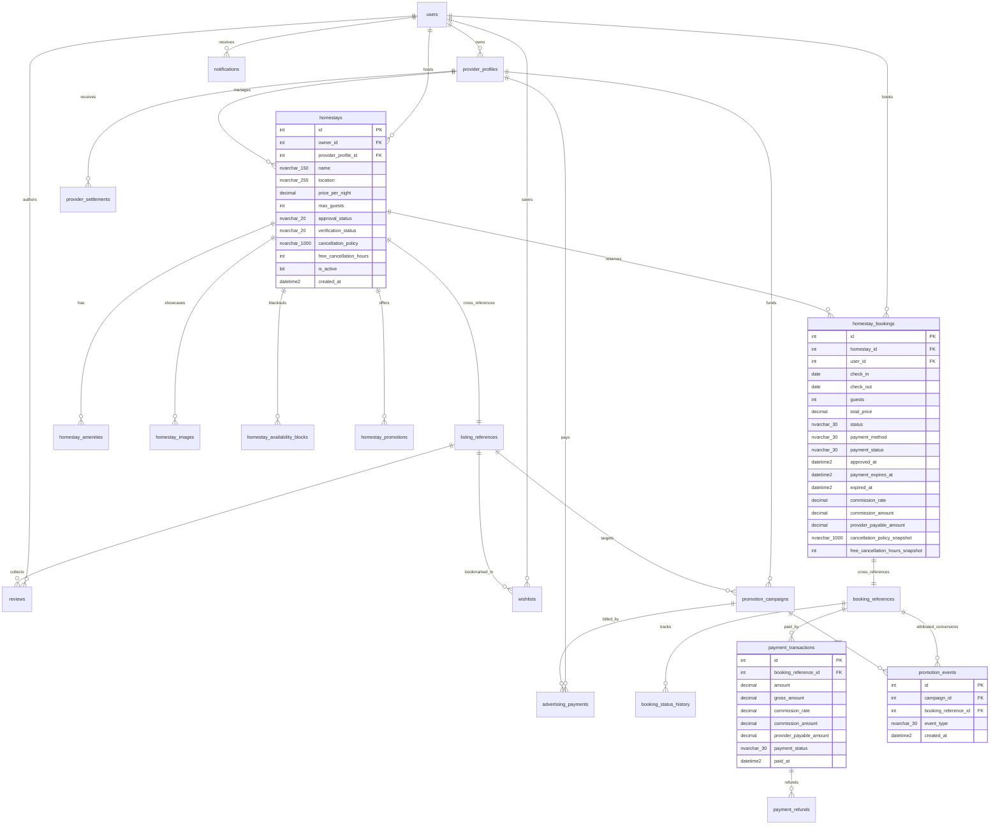

# CeylonGo Homestay Module — Complete Database Inventory & Schema Reference

**Repository:** `CeylonGo-Backend`  
**Database Engine:** Microsoft SQL Server (Transact-SQL)  
**Target Schema:** `dbo`  
**Database Baseline:** 88 tables | 32 applied migrations | 0 pending migrations  
**Audited Database Targets:** `CeylonGoDB` (Primary), `CeylonGoDB_Rehearsal_V2` (Staging Rehearsal), `CeylonGoDB_IntegrationTest` (Automated Test Suite)  

---

## 1. Architectural Overview & Table Classification

The CeylonGo database consists of 88 relational tables managed via strict forward-only, idempotent Transact-SQL migration scripts (001–032). The Homestay module operates across **6 dedicated homestay tables** and leverages **11 shared enterprise infrastructure tables** for cross-module booking synchronization, transaction processing, platform commission accounting, provider settlements, advertising tracking, notifications, reviews, and wishlists.

```
+---------------------------------------------------------------------------------------------------+
|                                CEYLONGO DATABASE (88 TABLES)                                      |
+---------------------------------------------------------------------------------------------------+
|  [6 Homestay Dedicated Tables]      |  [11 Shared Infrastructure Tables Used by Homestay]         |
|  - homestays                        |  - users                                                    |
|  - homestay_amenities                |  - provider_profiles                                        |
|  - homestay_images                  |  - listing_references                                       |
|  - homestay_bookings                |  - booking_references                                       |
|  - homestay_availability_blocks     |  - booking_status_history                                   |
|  - homestay_promotions              |  - payment_transactions                                     |
|                                     |  - payment_refunds                                          |
|                                     |  - provider_settlements                                     |
|                                     |  - advertising_payments                                     |
|                                     |  - promotion_campaigns                                      |
|                                     |  - promotion_packages                                       |
|                                     |  - promotion_events                                         |
|                                     |  - reviews                                                  |
|                                     |  - wishlists                                                |
|                                     |  - notifications                                            |
|                                     |  - admin_audit_logs                                         |
+-------------------------------------+-------------------------------------------------------------+
|  [71 Other Modular Subsystem Tables]                                                              |
|  - Artisan (7), Eco-Tourism (11), Activities (5), Tour Guides (9), Rentals (12),                  |
|    Community (9), AI Travel Planner (8), Auth Support (4), Migration System (1)                   |
+---------------------------------------------------------------------------------------------------+
```

---

## 2. Mermaid Entity Relationship Diagram (Homestay Domain)



---

## 3. Dedicated Homestay Tables (6 Tables)

### 3.1 `dbo.homestays`
- **Purpose:** Primary entity representing homestay accommodations listed by verified service providers.
- **SQLAlchemy Model:** `app.models.homestay.Homestay`
- **Associated Migrations:** 007 (initial table), 009 (owner_id), 015 (provider_profile_id), 023 (verification_status, cancellation policies, check-in/out times, GPS coordinates).

| Column Name | SQL Type | Nullable | Default | Keys & Constraints | Description |
| :--- | :--- | :---: | :--- | :--- | :--- |
| `id` | `INT` | NO | IDENTITY(1,1) | **PK** (`PK_homestays`) | Unique surrogate primary key |
| `owner_id` | `INT` | YES | NULL | **FK** -> `dbo.users(id)` | Host user account ID |
| `provider_profile_id` | `INT` | YES | NULL | **FK** -> `dbo.provider_profiles(id)` | Associated business profile |
| `name` | `NVARCHAR(150)` | NO | NULL | Index (`IX_homestays_discovery`) | Listing title / accommodation name |
| `description` | `NVARCHAR(MAX)` | YES | NULL | - | Detailed description and house rules |
| `location` | `NVARCHAR(255)` | NO | NULL | - | Location summary (e.g. "Kandy Central") |
| `address` | `NVARCHAR(500)` | YES | NULL | - | Street address |
| `city` | `NVARCHAR(100)` | YES | NULL | - | City name |
| `district` | `NVARCHAR(100)` | YES | NULL | Index (`IX_homestays_district`) | Administrative district |
| `province` | `NVARCHAR(100)` | YES | NULL | - | Administrative province |
| `latitude` | `DECIMAL(9,6)` | YES | NULL | Check (`CK_homestays_coords`) | Geographic latitude (-90 to +90) |
| `longitude` | `DECIMAL(9,6)` | YES | NULL | Check (`CK_homestays_coords`) | Geographic longitude (-180 to +180) |
| `price_per_night` | `DECIMAL(12,2)` | NO | NULL | Check (`CK_homestays_price` >= 0) | Base nightly rate in LKR |
| `max_guests` | `INT` | NO | NULL | Check (`CK_homestays_guests` > 0) | Maximum guest occupancy |
| `check_in_time` | `TIME(7)` | NO | `'14:00:00'` | - | Standard guest check-in time |
| `check_out_time` | `TIME(7)` | NO | `'11:00:00'` | - | Standard guest check-out time |
| `approval_status` | `NVARCHAR(20)` | NO | `'approved'` | Check (`CK_homestays_approval_status`) | `draft`, `pending`, `approved`, `rejected`, `suspended` |
| `verification_status`| `NVARCHAR(20)` | NO | `'unverified'`| Check (`CK_homestays_verification_status`)| `unverified`, `pending`, `verified`, `rejected`, `suspended` |
| `reviewed_by` | `INT` | YES | NULL | **FK** -> `dbo.users(id)`, Index | Admin ID who reviewed the listing |
| `reviewed_at` | `DATETIME2` | YES | NULL | - | Timestamp of admin review |
| `rejection_reason` | `NVARCHAR(1000)`| YES | NULL | - | Stored reason if rejected or suspended |
| `cancellation_policy`| `NVARCHAR(1000)`| YES | NULL | - | Policy name (`flexible`, `moderate`, `strict`) |
| `free_cancellation_hours`| `INT` | NO | `24` | Check (`CK_homestays_cancellation_hours` >= 0) | Minimum hours prior to check-in for full refund |
| `is_active` | `BIT` | NO | `1` | - | Active toggle (0 = soft-deleted) |
| `created_at` | `DATETIME2` | NO | `sysutcdatetime()` | - | Audit creation timestamp |
| `updated_at` | `DATETIME2` | NO | `sysutcdatetime()` | - | Audit update timestamp |

---

### 3.2 `dbo.homestay_amenities`
- **Purpose:** Stores specific facilities, features, and amenities offered by a homestay.
- **SQLAlchemy Model:** `app.models.homestay.HomestayAmenity`
- **Associated Migrations:** 008 (amenities foundation), 023 (unique constraint per homestay).

| Column Name | SQL Type | Nullable | Default | Keys & Constraints | Description |
| :--- | :--- | :---: | :--- | :--- | :--- |
| `id` | `INT` | NO | IDENTITY(1,1) | **PK** | Surrogate primary key |
| `homestay_id` | `INT` | NO | NULL | **FK** -> `dbo.homestays(id)` (ON DELETE CASCADE) | Parent homestay listing |
| `name` | `NVARCHAR(100)` | NO | NULL | Unique (`UQ_homestay_amenities_name`) | Amenity label (e.g., "WiFi", "Air Conditioning", "Kitchen") |

---

### 3.3 `dbo.homestay_images`
- **Purpose:** Photo gallery supporting reordering and designation of a primary cover photo.
- **SQLAlchemy Model:** `app.models.homestay.HomestayImage`
- **Associated Migrations:** 007, 023.

| Column Name | SQL Type | Nullable | Default | Keys & Constraints | Description |
| :--- | :--- | :---: | :--- | :--- | :--- |
| `id` | `INT` | NO | IDENTITY(1,1) | **PK** | Surrogate primary key |
| `homestay_id` | `INT` | NO | NULL | **FK** -> `dbo.homestays(id)` (ON DELETE CASCADE) | Parent homestay listing |
| `image_url` | `NVARCHAR(1000)`| NO | NULL | - | Public URL / storage path |
| `is_primary` | `BIT` | NO | `0` | - | Primary thumbnail flag (1 = cover photo) |

---

### 3.4 `dbo.homestay_bookings`
- **Purpose:** Central transaction ledger for traveler homestay reservations, payment window deadlines, commission snapshots, and cancellation tracking.
- **SQLAlchemy Model:** `app.models.booking.Booking`
- **Associated Migrations:** 010 (initial schema), 023 (cancellation snapshots), 030 (approval_at, payment_expires_at, commission_rate, commission_amount, provider_payable_amount).

| Column Name | SQL Type | Nullable | Default | Keys & Constraints | Description |
| :--- | :--- | :---: | :--- | :--- | :--- |
| `id` | `INT` | NO | IDENTITY(1,1) | **PK** (`PK_homestay_bookings`) | Unique booking ID |
| `homestay_id` | `INT` | NO | NULL | **FK** -> `dbo.homestays(id)`, Index | Booked accommodation |
| `user_id` | `INT` | NO | NULL | **FK** -> `dbo.users(id)`, Index | Traveler who requested booking |
| `check_in` | `DATE` | NO | NULL | Check (`CK_bookings_dates`) | Check-in calendar date |
| `check_out` | `DATE` | NO | NULL | Check (`CK_bookings_dates` > `check_in`) | Check-out calendar date |
| `guests` | `INT` | NO | NULL | Check (`CK_bookings_guests` > 0) | Number of guests |
| `total_price` | `DECIMAL(12,2)` | NO | NULL | Check (`CK_bookings_total_price` >= 0) | Final discounted booking price in LKR |
| `currency` | `NVARCHAR(3)` | NO | `'LKR'` | - | ISO-4217 currency |
| `status` | `NVARCHAR(30)` | NO | `'confirmed'` | Check (`CK_bookings_status`), Index | `pending`, `awaiting_payment`, `confirmed`, `in_progress`, `completed`, `cancelled`, `rejected`, `expired` |
| `payment_method` | `NVARCHAR(30)` | NO | `'pay_at_location'`| Check (`CK_bookings_payment_method`) | `online`, `pay_at_location` |
| `payment_status` | `NVARCHAR(30)` | NO | `'unpaid'` | Check (`CK_bookings_payment_status`) | `unpaid`, `pending`, `paid`, `refund_pending`, `refunded`, `failed` |
| `approved_at` | `DATETIME2` | YES | NULL | Filtered Index (`IX_..._approved_at`) | Timestamp host approved the reservation |
| `payment_expires_at`| `DATETIME2` | YES | NULL | Filtered Index (`IX_..._payment_expiry`)| Authoritative deadline for 30m online payment window |
| `expired_at` | `DATETIME2` | YES | NULL | - | Timestamp reservation expired if unpaid |
| `commission_rate` | `DECIMAL(5,2)` | YES | NULL | Check (`CK_homestay_bookings_commission`) | Platform commission percentage (10.00%) |
| `commission_amount`| `DECIMAL(12,2)`| YES | NULL | - | Platform commission share (10% of total) |
| `provider_payable_amount`| `DECIMAL(12,2)`| YES | NULL | - | Net earnings payable to host (90% of total) |
| `nightly_rate_snapshot`| `DECIMAL(12,2)`| YES | NULL | - | Price per night at time of reservation |
| `cancellation_policy_snapshot`| `NVARCHAR(1000)`| YES | NULL | - | Exact cancellation policy active at booking time |
| `free_cancellation_hours_snapshot`| `INT` | NO | `24` | Check (`CK_bookings_cancellation_hours_snapshot` >= 0) | Exact free hours window locked at booking time |
| `cancellation_reason`| `NVARCHAR(1000)`| YES | NULL | - | Reason provided upon cancellation |
| `cancelled_by` | `INT` | YES | NULL | **FK** -> `dbo.users(id)` | User who cancelled (traveler, host, admin) |
| `cancelled_at` | `DATETIME2` | YES | NULL | - | Timestamp of cancellation |
| `created_at` | `DATETIME2` | NO | `sysutcdatetime()` | - | Booking request creation timestamp |
| `updated_at` | `DATETIME2` | NO | `sysutcdatetime()` | - | Last modification timestamp |

---

### 3.5 `dbo.homestay_availability_blocks`
- **Purpose:** Host-defined blackout date blocks preventing booking requests during property maintenance, renovations, or personal use.
- **SQLAlchemy Model:** `app.models.homestay.HomestayAvailabilityBlock`
- **Associated Migrations:** 023.

| Column Name | SQL Type | Nullable | Default | Keys & Constraints | Description |
| :--- | :--- | :---: | :--- | :--- | :--- |
| `id` | `INT` | NO | IDENTITY(1,1) | **PK** | Surrogate primary key |
| `homestay_id` | `INT` | NO | NULL | **FK** -> `dbo.homestays(id)`, Index | Accommodation |
| `start_date` | `DATE` | NO | NULL | Check (`CK_..._dates`) | Blackout start date |
| `end_date` | `DATE` | NO | NULL | Check (`CK_..._dates` > `start_date`) | Blackout end date |
| `block_type` | `NVARCHAR(30)` | NO | `'maintenance'` | Check (`CK_..._type`) | `maintenance`, `owner_unavailable`, `renovation`, `seasonal_closure`, `admin_block`, `other` |
| `reason` | `NVARCHAR(500)` | YES | NULL | - | Host or admin explanatory note |
| `created_by` | `INT` | YES | NULL | **FK** -> `dbo.users(id)` | Actor who created block |
| `is_active` | `BIT` | NO | `1` | Index (`IX_..._active`) | Active toggle (0 = released block) |
| `created_at` | `DATETIME2` | NO | `sysutcdatetime()` | - | Creation audit timestamp |

---

### 3.6 `dbo.homestay_promotions`
- **Purpose:** Promotional discounts configured by hosts supporting either percentage discounts or fixed-amount LKR deductions.
- **SQLAlchemy Model:** `app.models.promotion.HomestayPromotion`
- **Associated Migrations:** 011, 030 (discount_type, discount_amount, mutually exclusive validation constraints).

| Column Name | SQL Type | Nullable | Default | Keys & Constraints | Description |
| :--- | :--- | :---: | :--- | :--- | :--- |
| `id` | `INT` | NO | IDENTITY(1,1) | **PK** | Surrogate primary key |
| `homestay_id` | `INT` | NO | NULL | **FK** -> `dbo.homestays(id)`, Index | Target homestay |
| `title` | `NVARCHAR(150)` | NO | NULL | - | Promotion name / headline |
| `description` | `NVARCHAR(2000)`| YES | NULL | - | Terms and promotional copy |
| `discount_type` | `NVARCHAR(20)` | NO | `'percentage'` | Check (`CK_..._type`) | `'percentage'` or `'fixed'` |
| `discount_percent`| `DECIMAL(5,2)` | YES | NULL | Check (`CK_..._discount_valid`) | 1.00% to 100.00% (mutually exclusive) |
| `discount_amount` | `DECIMAL(12,2)`| YES | NULL | Check (`CK_..._discount_valid`) | Positive fixed LKR deduction (mutually exclusive) |
| `start_date` | `DATE` | NO | NULL | Check (`CK_..._dates`) | Inclusive start date |
| `end_date` | `DATE` | NO | NULL | Check (`CK_..._dates` >= `start_date`)| Inclusive end date |
| `is_active` | `BIT` | NO | `1` | - | Active status toggle |
| `created_at` | `DATETIME2` | NO | `sysutcdatetime()` | - | Audit creation timestamp |

---

## 4. Shared Infrastructure Tables Utilized by Homestay (11 Tables)

### 4.1 `dbo.booking_references`
- **Purpose:** Unified cross-module tracking table that generates a collision-free public reference code (`BK-HOMESTAY-{id}`) for payments, history, and conversions.
- **SQLAlchemy Model:** `app.models.shared.BookingReference`
- **Associated Migrations:** 027 (Shared Infrastructure), 030.

| Column Name | SQL Type | Nullable | Default | Constraints & Indexes |
| :--- | :--- | :---: | :--- | :--- |
| `id` | `INT` | NO | IDENTITY(1,1) | **PK** |
| `booking_reference` | `NVARCHAR(50)` | NO | NULL | **Unique** (`UQ_booking_references_code`) |
| `module_type` | `NVARCHAR(30)` | NO | NULL | Check (`CK_..._type`: `'homestay'`, `'rental_vehicle'`, `'activity'`, `'tour_guide'`, `'artisan_reservation'`) |
| `target_booking_id`| `INT` | NO | NULL | **Unique** (`UQ_booking_references_target` on `module_type, target_booking_id`) |
| `user_id` | `INT` | NO | NULL | **FK** -> `dbo.users(id)`, Index |
| `provider_profile_id`| `INT` | NO | NULL | **FK** -> `dbo.provider_profiles(id)`, Index |
| `total_price` | `DECIMAL(12,2)`| NO | NULL | Check (`CK_..._price` >= 0) |
| `currency` | `NVARCHAR(3)` | NO | `'LKR'` | - |
| `booking_status` | `NVARCHAR(30)` | NO | `'pending'` | - |
| `payment_status` | `NVARCHAR(30)` | NO | `'unpaid'` | - |
| `created_at` | `DATETIME2` | NO | `sysutcdatetime()` | - |

---

### 4.2 `dbo.booking_status_history`
- **Purpose:** Complete immutable audit log of status transitions, cancellation actors, admin actions, and campaign attribution markers.
- **SQLAlchemy Model:** `app.models.shared.BookingStatusHistory`
- **Associated Migrations:** 027.

| Column Name | SQL Type | Nullable | Default | Constraints & Indexes |
| :--- | :--- | :---: | :--- | :--- |
| `id` | `INT` | NO | IDENTITY(1,1) | **PK** |
| `booking_reference_id`| `INT` | NO | NULL | **FK** -> `dbo.booking_references(id)` (ON DELETE CASCADE), Index |
| `from_status` | `NVARCHAR(30)` | YES | NULL | Previous state |
| `to_status` | `NVARCHAR(30)` | NO | NULL | Next state |
| `changed_by` | `INT` | YES | NULL | **FK** -> `dbo.users(id)` (NULL = system worker) |
| `notes` | `NVARCHAR(500)` | YES | NULL | Explanatory notes / campaign attribution tag |
| `created_at` | `DATETIME2` | NO | `sysutcdatetime()` | Transition timestamp |

---

### 4.3 `dbo.payment_transactions`
- **Purpose:** Stores online and promotional payment attempts, PayHere gateway references, and financial snapshots.
- **SQLAlchemy Model:** `app.models.shared.PaymentTransaction`
- **Associated Migrations:** 027, 030 (financial commission snapshots).

| Column Name | SQL Type | Nullable | Default | Constraints & Indexes |
| :--- | :--- | :---: | :--- | :--- |
| `id` | `INT` | NO | IDENTITY(1,1) | **PK** |
| `booking_reference_id`| `INT` | NO | NULL | **FK** -> `dbo.booking_references(id)`, Index |
| `user_id` | `INT` | NO | NULL | **FK** -> `dbo.users(id)`, Index |
| `gateway_name` | `NVARCHAR(50)` | NO | `'payhere'` | Gateway identifier |
| `gateway_transaction_id`| `NVARCHAR(100)`| YES| NULL | PayHere Payment ID |
| `amount` | `DECIMAL(12,2)`| NO | NULL | Net captured amount (Check >= 0) |
| `currency` | `NVARCHAR(3)` | NO | `'LKR'` | - |
| `payment_status` | `NVARCHAR(30)` | NO | `'pending'` | `pending`, `completed`, `failed`, `refunded`, `cancelled` |
| `payment_method` | `NVARCHAR(30)` | YES | NULL | `'online'`, `'card'`, `'promotional_discount'` |
| `gross_amount` | `DECIMAL(12,2)`| YES | NULL | Booking gross before commission |
| `commission_rate`| `DECIMAL(5,2)` | YES | NULL | Platform commission rate (10.00%) |
| `commission_amount`| `DECIMAL(12,2)`| YES | NULL | CeylonGo commission share (10%) |
| `provider_payable_amount`| `DECIMAL(12,2)`| YES| NULL | Net provider earnings (90%) |
| `paid_at` | `DATETIME2` | YES | NULL | Gateway confirmation timestamp |
| `created_at` | `DATETIME2` | NO | `sysutcdatetime()` | - |
| `updated_at` | `DATETIME2` | NO | `sysutcdatetime()` | - |

---

### 4.4 `dbo.payment_refunds`
- **Purpose:** Tracks traveler refund requests, late-payment reconciliation refunds, and admin approval workflows.
- **SQLAlchemy Model:** `app.models.shared.PaymentRefund`
- **Associated Migrations:** 027.

| Column Name | SQL Type | Nullable | Default | Constraints & Indexes |
| :--- | :--- | :---: | :--- | :--- |
| `id` | `INT` | NO | IDENTITY(1,1) | **PK** |
| `payment_transaction_id`| `INT` | NO | NULL | **FK** -> `dbo.payment_transactions(id)`, Index |
| `amount` | `DECIMAL(12,2)`| NO | NULL | Refund amount (Check >= 0) |
| `currency` | `NVARCHAR(3)` | NO | `'LKR'` | - |
| `refund_reason` | `NVARCHAR(1000)`| YES | NULL | Cancellation reason & policy snapshot audit |
| `refund_status` | `NVARCHAR(30)` | NO | `'pending'` | `pending`, `processed`, `failed`, `rejected` |
| `processed_by` | `INT` | YES | NULL | **FK** -> `dbo.users(id)` (Admin) |
| `processed_at` | `DATETIME2` | YES | NULL | Timestamp of review |
| `created_at` | `DATETIME2` | NO | `sysutcdatetime()` | - |

---

### 4.5 `dbo.provider_settlements`
- **Purpose:** Periodic settlement payout disbursements from CeylonGo platform to hosts.
- **SQLAlchemy Model:** `app.models.shared.ProviderSettlement`
- **Associated Migrations:** 027.

| Column Name | SQL Type | Nullable | Default | Constraints & Indexes |
| :--- | :--- | :---: | :--- | :--- |
| `id` | `INT` | NO | IDENTITY(1,1) | **PK** |
| `provider_profile_id`| `INT` | NO | NULL | **FK** -> `dbo.provider_profiles(id)`, Index |
| `period_start` | `DATE` | NO | NULL | Settlement cycle start (Check <= period_end) |
| `period_end` | `DATE` | NO | NULL | Settlement cycle end |
| `gross_amount` | `DECIMAL(12,2)`| NO | NULL | Total booking volume in period (Check >= 0) |
| `platform_fee` | `DECIMAL(12,2)`| NO | NULL | 10% platform commission retained |
| `net_payable` | `DECIMAL(12,2)`| NO | NULL | 90% net provider payout (Check >= 0) |
| `currency` | `NVARCHAR(3)` | NO | `'LKR'` | - |
| `settlement_status`| `NVARCHAR(30)`| NO | `'pending'` | `pending`, `approved`, `paid`, `on_hold` |
| `payout_reference`| `NVARCHAR(100)`| YES | NULL | External bank transfer reference (e.g. SLIPS) |
| `paid_at` | `DATETIME2` | YES | NULL | Execution timestamp |
| `created_at` | `DATETIME2` | NO | `sysutcdatetime()` | - |

---

### 4.6 `dbo.advertising_payments`
- **Purpose:** Dedicated ledger isolating advertising sponsorship fees paid by hosts from traveler booking revenues.
- **SQLAlchemy Model:** `app.models.shared.AdvertisingPayment`
- **Associated Migrations:** 030.

| Column Name | SQL Type | Nullable | Default | Constraints & Indexes |
| :--- | :--- | :---: | :--- | :--- |
| `id` | `INT` | NO | IDENTITY(1,1) | **PK** |
| `campaign_id` | `INT` | NO | NULL | **FK** -> `dbo.promotion_campaigns(id)`, Index |
| `provider_profile_id`| `INT` | NO | NULL | **FK** -> `dbo.provider_profiles(id)`, Index |
| `order_reference`| `NVARCHAR(100)`| NO | NULL | **Unique** (`UQ_advertising_payments_order`) |
| `gateway_transaction_id`| `NVARCHAR(100)`| YES| NULL | **Filtered Unique** (`UQ_..._gateway_tx`) |
| `amount` | `DECIMAL(12,2)`| NO | NULL | Advertising fee charged (Check > 0) |
| `currency` | `NVARCHAR(3)` | NO | `'LKR'` | - |
| `gateway_name` | `NVARCHAR(50)` | NO | `'payhere'` | - |
| `payment_status` | `NVARCHAR(30)` | NO | `'pending'` | `pending`, `completed`, `failed`, `refunded`, `cancelled` |
| `initiated_at` | `DATETIME2` | NO | `sysutcdatetime()` | - |
| `verified_at` | `DATETIME2` | YES | NULL | Gateway callback verification timestamp |
| `created_at` | `DATETIME2` | NO | `sysutcdatetime()` | - |
| `updated_at` | `DATETIME2` | NO | `sysutcdatetime()` | - |

---

### 4.7 `dbo.promotion_campaigns`
- **Purpose:** Host-created advertising campaigns linked directly to a specific homestay listing reference.
- **SQLAlchemy Model:** `app.models.shared.PromotionCampaign`
- **Associated Migrations:** 027, 030 (listing_reference_id), 031 (status check constraint expanded).

| Column Name | SQL Type | Nullable | Default | Constraints & Indexes |
| :--- | :--- | :---: | :--- | :--- |
| `id` | `INT` | NO | IDENTITY(1,1) | **PK** |
| `provider_profile_id`| `INT` | NO | NULL | **FK** -> `dbo.provider_profiles(id)`, Index |
| `listing_reference_id`| `INT` | YES | NULL | **FK** -> `dbo.listing_references(id)`, Filtered Index |
| `campaign_name` | `NVARCHAR(150)`| NO | NULL | - |
| `target_module` | `NVARCHAR(30)` | NO | NULL | Set to `'homestay'` |
| `budget` | `DECIMAL(12,2)`| NO | NULL | Campaign budget in LKR (Check >= 0) |
| `spent_amount` | `DECIMAL(12,2)`| NO | `0` | Spent amount in LKR (Check >= 0) |
| `currency` | `NVARCHAR(3)` | NO | `'LKR'` | - |
| `status` | `NVARCHAR(30)` | NO | `'draft'` | Check (`CK_..._status`: `draft`, `pending_approval`, `approved`, `active`, `paused`, `completed`, `cancelled`, `rejected`) |
| `starts_at` | `DATETIME2` | NO | NULL | Scheduled start (Check < ends_at) |
| `ends_at` | `DATETIME2` | NO | NULL | Scheduled completion |
| `created_at` | `DATETIME2` | NO | `sysutcdatetime()` | - |

---

### 4.8 `dbo.promotion_events`
- **Purpose:** Performance tracking for advertising campaigns (impressions, clicks, inquiries, bookings) with database-enforced conversion deduplication.
- **SQLAlchemy Model:** `app.models.shared.PromotionEvent`
- **Associated Migrations:** 027, 031 (`booking_reference_id` & `UQ_promotion_events_campaign_booking`).

| Column Name | SQL Type | Nullable | Default | Constraints & Indexes |
| :--- | :--- | :---: | :--- | :--- |
| `id` | `INT` | NO | IDENTITY(1,1) | **PK** |
| `campaign_id` | `INT` | NO | NULL | **FK** -> `dbo.promotion_campaigns(id)`, Index |
| `booking_reference_id`| `INT` | YES | NULL | **FK** -> `dbo.booking_references(id)`, Index |
| `event_type` | `NVARCHAR(30)` | NO | NULL | Check (`CK_..._type`: `'impression'`, `'click'`, `'inquiry'`, `'booking'`) |
| `user_id` | `INT` | YES | NULL | **FK** -> `dbo.users(id)` |
| `ip_address` | `NVARCHAR(45)` | YES | NULL | Client IP for abuse prevention |
| `created_at` | `DATETIME2` | NO | `sysutcdatetime()` | Event timestamp |

**Critical Filtered Unique Index:**  
`UQ_promotion_events_campaign_booking ON dbo.promotion_events(campaign_id, booking_reference_id) WHERE booking_reference_id IS NOT NULL`  
*Enforcement: Strictly prevents double-crediting the same booking reference to an advertising campaign at the database engine level.*

---

### 4.9 `dbo.listing_references`
- **Purpose:** Cross-module listing registry binding module-specific listings (`homestays`) to universal IDs for wishlists, reviews, and campaigns.
- **SQLAlchemy Model:** `app.models.shared.ListingReference`
- **Associated Migrations:** 027.

| Column Name | SQL Type | Nullable | Default | Constraints & Indexes |
| :--- | :--- | :---: | :--- | :--- |
| `id` | `INT` | NO | IDENTITY(1,1) | **PK** |
| `module_type` | `NVARCHAR(30)` | NO | NULL | Set to `'homestay'` |
| `target_id` | `INT` | NO | NULL | Target homestay ID (`dbo.homestays.id`) |
| `provider_profile_id`| `INT` | NO | NULL | **FK** -> `dbo.provider_profiles(id)`, Index |
| `title` | `NVARCHAR(255)`| NO | NULL | Listing title |
| `district` | `NVARCHAR(100)`| NO | NULL | District index |
| `city` | `NVARCHAR(100)`| YES | NULL | City |
| `latitude` | `DECIMAL(9,6)` | YES | NULL | GPS latitude |
| `longitude` | `DECIMAL(9,6)` | YES | NULL | GPS longitude |
| `is_active` | `BIT` | NO | `1` | Active listing flag |
| `created_at` | `DATETIME2` | NO | `sysutcdatetime()` | - |

---

### 4.10 `dbo.reviews`
- **Purpose:** Verified guest ratings and written reviews for completed homestay bookings.
- **SQLAlchemy Model:** `app.models.shared.Review`
- **Associated Migrations:** 027.

| Column Name | SQL Type | Nullable | Default | Constraints & Indexes |
| :--- | :--- | :---: | :--- | :--- |
| `id` | `INT` | NO | IDENTITY(1,1) | **PK** |
| `listing_reference_id`| `INT` | NO | NULL | **FK** -> `dbo.listing_references(id)`, Index |
| `booking_reference_id`| `INT` | YES | NULL | **FK** -> `dbo.booking_references(id)` |
| `user_id` | `INT` | NO | NULL | **FK** -> `dbo.users(id)`, Index |
| `rating` | `DECIMAL(3,2)` | NO | NULL | Check (`CK_reviews_rating` BETWEEN 1.00 AND 5.00) |
| `title` | `NVARCHAR(150)`| YES | NULL | Review headline |
| `comment` | `NVARCHAR(2000)`| YES| NULL | Written feedback |
| `is_verified_booking` | `BIT` | NO | `0` | Verified guest badge |
| `is_published` | `BIT` | NO | `1` | Public visibility toggle |
| `created_at` | `DATETIME2` | NO | `sysutcdatetime()` | - |
| `updated_at` | `DATETIME2` | NO | `sysutcdatetime()` | - |

---

### 4.11 `dbo.wishlists`
- **Purpose:** Traveler bookmarking of homestays for future trip planning.
- **SQLAlchemy Model:** `app.models.shared.Wishlist`
- **Associated Migrations:** 027.

| Column Name | SQL Type | Nullable | Default | Constraints & Indexes |
| :--- | :--- | :---: | :--- | :--- |
| `id` | `INT` | NO | IDENTITY(1,1) | **PK** |
| `user_id` | `INT` | NO | NULL | **FK** -> `dbo.users(id)`, Index |
| `listing_reference_id`| `INT` | NO | NULL | **FK** -> `dbo.listing_references(id)` |
| `notes` | `NVARCHAR(500)` | YES | NULL | Private traveler travel note |
| `created_at` | `DATETIME2` | NO | `sysutcdatetime()` | - |

**Unique Constraint:** `UQ_wishlists_user_listing ON dbo.wishlists(user_id, listing_reference_id)` prevents duplicate bookmarks.

---

## 5. Migration History & Database Baseline Audit

| Migration Number | File Name | Target Scope & Key Schema Operations | Verified Checksum (SHA-256) |
| :---: | :--- | :--- | :--- |
| **001–006** | `001_...` to `006_...` | Core Authentication, Provider Profiles, Registration Drafts & Verification | Verified Baseline |
| **007** | `007_create_homestay_tables.sql` | Created baseline `homestays` and `homestay_images` tables | Verified Match |
| **008** | `008_create_homestay_amenities.sql` | Created `homestay_amenities` table with cascade delete | Verified Match |
| **009** | `009_add_homestay_owner.sql` | Added `owner_id` column and foreign key to `dbo.users` | Verified Match |
| **010** | `010_create_homestay_bookings.sql` | Created baseline `homestay_bookings` with check-in/out date validation | Verified Match |
| **011** | `011_create_homestay_promotions.sql`| Created baseline `homestay_promotions` table | Verified Match |
| **015** | `015_add_homestay_provider_profile.sql`| Added `provider_profile_id` linking homestays to business profiles | Verified Match |
| **023** | `023_extend_homestay_module.sql` | Added coordinates, cancellation policies, `free_cancellation_hours`, `approval_status`, `verification_status`, and created `homestay_availability_blocks` | Verified Match |
| **027** | `027_create_shared_infrastructure.sql` | Created universal `booking_references`, `payment_transactions`, `payment_refunds`, `provider_settlements`, `listing_references`, `reviews`, `wishlists` | Verified Match |
| **030** | `030_extend_homestay_final_requirements.sql` | Added `commission_rate`, `payment_expires_at`, `approved_at`, `provider_payable_amount` to bookings and transactions; added discount types to promotions; created `advertising_payments` ledger | `6256f6...` (Verified) |
| **031** | `031_extend_promotion_booking_attribution.sql` | Added `booking_reference_id` to `promotion_events`, foreign key, filtered unique index `UQ_promotion_events_campaign_booking`, and campaign status constraints | `6a6820...` (Verified) |
| **032** | `032_enforce_tour_guide_coordinate_pairs.sql` | *(Tour Guide Module)* Validates latitude/longitude coordinate pair integrity in `tour_guides` and `tour_guide_packages`. Does not alter homestay tables. | Verified Match |

**Current Baseline Status:** 88 tables, 32 applied migrations, 0 pending migrations across `CeylonGoDB` and `CeylonGoDB_Rehearsal_V2`.
