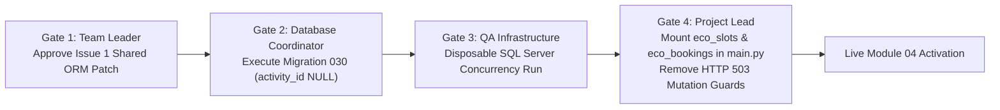

# CeylonGo Module 04 — Corrected Official 50-Requirement Audit

**Mandatory Source Document**: `CeylonGo_Eco_Tourism_Complete_Development_Specification.pdf` (Dated 17 November 2026)  
**Target Module**: Module 04 — Eco-Tourism (FastAPI, SQLAlchemy, Microsoft SQL Server)  
**Audit Type**: Complete Read-Only Codebase & Dependency Audit (Evidence-Verified)  
**Status**: 50/50 Requirements Officially Mapped & Verified  

---

## 1. Executive Summary & Verification Methodology

This audit provides an authoritative, evidence-grounded status mapping for all **50 requirements** defined in the official *CeylonGo Eco-Tourism Complete Development Specification* dated 17 November 2026.

Following targeted technical verification, potentially overstated `COMPLETE` statuses have been rigorously re-evaluated:
1. **Unmounted Staged Routers (`T07`, `T11`, `P10`, `P12`)**: While fully implemented and verified in isolated staged tests, these routes reside in `app/routers/eco_slots.py` and `app/routers/eco_bookings.py`, which are **not yet mounted in `app/main.py`**. They are therefore classified as **STAGED (Unmounted)** until Project Lead registration.
2. **Missing Notification Triggers (`T16`)**: Notification tests in `test_eco_badge_notifications_p08.py` exclusively cover admin badge events. No triggers exist in `eco_booking_service.py` for booking creation, accept, reject, cancel, or schedule changes. Reclassified as **PARTIAL**.
3. **Incomplete Provider Dashboard Metrics (`P01`)**: `GET /api/v1/eco-experiences/me/summary` only returns listing counts (`draft`, `approved`, `published`, badges). Booking counts and revenue metrics required by the official specification are absent. Reclassified as **PARTIAL**.
4. **Incomplete Admin Overview Reports (`A08`)**: `GET /api/v1/admin/eco-experiences/overview` only provides listing, provider, category, and district counts. Booking volume and financial revenue reporting are absent. Reclassified as **PARTIAL**.
5. **Weather & Seasonal Restrictions (`E06`)**: Seasonal blackout range blocking is complete via `EcoSeasonRestriction`. However, weather-triggered emergency cancellation of slots and confirmed bookings is not implemented. Reclassified as **PARTIAL**.

---

## 2. Master 50-Requirement Audit Table

| ID | Category | Official Feature Name | Required Specification Behavior | Verified Status | Route / Endpoint | Backend Service / Logic | DB Dependency | Test Coverage Evidence | Runtime Accessibility & Gate |
| :--- | :--- | :--- | :--- | :--- | :--- | :--- | :--- | :--- | :--- |
| **T01** | Traveler | Eco-Tourism Discovery | Browse approved eco experiences | **COMPLETE** | `GET /api/v1/eco-experiences` | `list_eco_experiences` filters `approved` & `is_published` | `dbo.eco_experiences` | `test_eco_experiences_api.py` | Mounted in `main.py` (Active) |
| **T02** | Traveler | Search & Filters | Location, category, price, duration | **COMPLETE** | `GET /api/v1/eco-experiences` | Query filters: `search`, `category`, `district`, `min/max_price`, `duration` | `dbo.eco_experiences` | `test_eco_experiences_api.py` | Mounted in `main.py` (Active) |
| **T03** | Traveler | Eco Categories | Forest, wildlife, village, conservation | **COMPLETE** | `GET /api/v1/eco-experiences/categories` | Returns 6 approved categories | `VALID_ECO_CATEGORIES` | `test_eco_experiences_api.py` | Mounted in `main.py` (Active) |
| **T04** | Traveler | Eco Experience Details | Description, itinerary and sustainability information | **COMPLETE** | `GET /api/v1/eco-experiences/{id}` | Eager loads practices, rules, badges, images | `dbo.eco_experiences` + relations | `test_eco_experiences_api.py` | Mounted in `main.py` (Active) |
| **T05** | Traveler | Photo Gallery | View approved experience images | **COMPLETE** | `GET /api/v1/eco-experiences/{id}/images` | Serves gallery images with cover flag | `dbo.eco_experience_images` | `test_eco_experience_images_p05.py` | Mounted in `main.py` (Active) |
| **T06** | Traveler | Location & Maps | Meeting point and external directions | **COMPLETE** | `GET /api/v1/eco-experiences/{id}` | Returns coordinates, meeting point, district | `dbo.eco_experiences` | `test_eco_experiences_api.py` | Mounted in `main.py` (Active) |
| **T07** | Traveler | Availability Calendar | Available dates and slots | **STAGED** | `GET /api/v1/eco-experiences/{id}/slots` | Queries active future slots, computes open places | `dbo.activity_slots` | `test_eco_slots_router_staged.py` | **Unmounted in main.py** (Gate 4) |
| **T08** | Traveler | Eco Experience Booking | Reserve date and participants | **STAGED** | `POST /api/v1/eco-bookings` | `execute_traveler_booking_create_atomic` | `dbo.activity_bookings`, `dbo.activity_slots` | `test_eco_bookings_router_staged.py` | **503 Guarded & Unmounted** (Gates 1, 2, 4) |
| **T09** | Traveler | Online Payment | Verified payment to CeylonGo account | **BLOCKED** | `POST /api/v1/payments/payhere/notify` | PayHere webhook multi-module routing | `dbo.payment_transactions` | None (Module 04) | **External Block** (Shared Payments Team) |
| **T10** | Traveler | Pay at Location | Provider-approved reservation with cash at venue | **STAGED** | `POST /api/v1/eco-bookings` | Restricts method to `pay_at_location`, sets `payment_status='unpaid'` | `dbo.activity_bookings` | `test_eco_bookings_router_staged.py` | **503 Guarded & Unmounted** (Gates 1, 2, 4) |
| **T11** | Traveler | My Bookings | Own upcoming and past bookings | **STAGED** | `GET /api/v1/eco-bookings/my-bookings` | Slices traveler eco bookings, persisted refs, roster | `dbo.activity_bookings`, `dbo.booking_references` | `test_eco_bookings_router_staged.py` | **Unmounted in main.py** (Gate 4) |
| **T12** | Traveler | Booking Cancellation | Policy-based cancellation | **STAGED** | `POST /api/v1/eco-bookings/{id}/cancel` | `execute_traveler_booking_cancel_atomic`, 24h cutoff, capacity release | `dbo.activity_bookings`, `dbo.activity_slots` | `test_eco_bookings_router_staged.py` | **503 Guarded & Unmounted** (Gate 4) |
| **T13** | Traveler | Ratings & Reviews | Reviews after eligible completed bookings | **PARTIAL** | `POST /api/v1/reviews` (Shared) | Requires verified completed booking eligibility; eco router mapping pending | `dbo.reviews` | Shared reviews tests | Review Submission Unwired |
| **T14** | Traveler | Wishlist | Save favorite eco-experiences | **COMPLETE** | `POST /api/v1/wishlists/experiences/{id}` | Add, delete, and list wishlist items | `dbo.user_wishlist_experiences` | `test_eco_wishlists_p06.py` | Mounted in `main.py` (Active) |
| **T15** | Traveler | Contact Provider | Approved organizer contact details | **COMPLETE** | `GET /api/v1/eco-experiences/{id}` | Returns organizer business details | `dbo.provider_profiles` | `test_eco_experiences_api.py` | Mounted in `main.py` (Active) |
| **T16** | Traveler | Booking Notifications | Booking and schedule status updates | **PARTIAL** | `app/services/notification_service.py` | Model exists; booking event triggers missing | `dbo.notifications` | `test_eco_badge_notifications_p08.py` (Badge only) | Triggers Unwired |
| **T17** | Traveler | Sponsored Eco Listings | Clearly labeled paid promotion placements | **COMPLETE** | `GET /api/v1/eco-experiences` | Prioritizes active campaigns, flags `is_sponsored` | `dbo.eco_promotion_campaigns` | `test_eco_promotions_discovery_p11d.py` | Mounted in `main.py` (Active) |
| **T18** | Traveler | Eco-Friendly Badge | Display only admin-verified badge | **COMPLETE** | `GET /api/v1/eco-experiences/{id}` | Strictly returns verified, active badges | `dbo.eco_experience_badges` | `test_eco_verification_p03.py` | Mounted in `main.py` (Active) |
| **P01** | Provider | Eco Provider Dashboard | Bookings, revenue and listing overview | **PARTIAL** | `GET /api/v1/eco-experiences/me/summary` | Listing metrics complete; booking/revenue missing | `dbo.eco_experiences` | `test_eco_dashboard_p07.py` | Mounted in `main.py` (Partial) |
| **P02** | Provider | Add Eco Experience | Create draft listing | **COMPLETE** | `POST /api/v1/eco-experiences` | Creates draft listing with itinerary | `dbo.eco_experiences` | `test_eco_experiences_api.py` | Mounted in `main.py` (Active) |
| **P03** | Provider | Manage Eco Experiences | Edit, publish or deactivate owned listings | **COMPLETE** | `PUT /api/v1/eco-experiences/{id}` | Edit, toggle active/inactive, publish | `dbo.eco_experiences` | `test_eco_experiences_api.py` | Mounted in `main.py` (Active) |
| **P04** | Provider | Photo Management | Upload and remove images | **COMPLETE** | `POST /api/v1/eco-experiences/{id}/images` | Uploads images, sets cover photo | `dbo.eco_experience_images` | `test_eco_experience_images_p05.py` | Mounted in `main.py` (Active) |
| **P05** | Provider | Eco Categories | Assign approved categories | **COMPLETE** | `POST /api/v1/eco-experiences` | Validates category against approved list | `VALID_ECO_CATEGORIES` | `test_eco_experiences_api.py` | Mounted in `main.py` (Active) |
| **P06** | Provider | Location Management | Address, coordinates and meeting point | **COMPLETE** | `POST /api/v1/eco-experiences` | Persists meeting point, lat/long, district | `dbo.eco_experiences` | `test_eco_experiences_api.py` | Mounted in `main.py` (Active) |
| **P07** | Provider | Pricing Management | Per-person or group price | **COMPLETE** | `app/services/eco_booking_pricing.py` | Computes per-person/group price with Decimal | `dbo.eco_experiences` | `test_eco_booking_pricing.py` | Core Service (Active) |
| **P08** | Provider | Schedule Management | Dates and time slots | **STAGED** | `POST /api/v1/provider/eco-experiences/{id}/slots` | Pre-creation validation, timing, seasonal blocks | `dbo.activity_slots` | `test_eco_slots_router_staged.py` | **503 Guarded & Unmounted** (Gate 2: Migration 030) |
| **P09** | Provider | Capacity Management | Per-slot participant limits | **COMPLETE** | `app/services/eco_booking_service.py` | Atomic conditional reservation prevents overselling | `dbo.activity_slots` | `test_eco_booking_service.py` | Core Service (Active Logic) |
| **P10** | Provider | Booking Requests | View incoming requests | **STAGED** | `GET /api/v1/provider/eco-bookings?status=pending` | Lists incoming pending requests with roster | `dbo.activity_bookings` | `test_eco_bookings_router_staged.py` | **Unmounted in main.py** (Gate 4) |
| **P11** | Provider | Booking Approval | Accept or reject requests | **STAGED** | `POST /api/v1/provider/eco-bookings/{id}/decision` | `execute_provider_decision_atomic` (accept/reject) | `dbo.activity_bookings`, `dbo.activity_slots` | `test_eco_bookings_router_staged.py` | **503 Guarded & Unmounted** (Gate 4) |
| **P12** | Provider | Booking History | Upcoming, past and cancelled bookings | **STAGED** | `GET /api/v1/provider/eco-bookings` | Historical view with status, experience, date filters | `dbo.activity_bookings` | `test_eco_bookings_router_staged.py` | **Unmounted in main.py** (Gate 4) |
| **P13** | Provider | Cash Payment Updates | Record cash received at venue | **STAGED** | `POST /api/v1/provider/eco-bookings/{id}/decision` | Updates `payment_status='paid'`, keeps `booking_status` | `dbo.activity_bookings` | `test_eco_bookings_router_staged.py` | **503 Guarded & Unmounted** (Gate 4) |
| **P14** | Provider | Online Earnings | View payment and settlement records | **MISSING** | `None` | No provider endpoint exists to view eco earnings/settlements | `dbo.settlements` | None | Feature Missing |
| **P15** | Provider | Eco-Friendly Practices | Describe practices and submit evidence | **COMPLETE** | `POST /api/v1/eco-experiences/{id}/practices` | Stores practices across 7 categories with evidence | `dbo.eco_practices`, `dbo.eco_evidence` | `test_eco_verification_p03.py` | Mounted in `main.py` (Active) |
| **P16** | Provider | Sponsored Promotions | Purchase paid visibility packages | **COMPLETE** | `POST /api/v1/eco-promotions/campaigns` | Buys packages, configures promotion dates | `dbo.eco_promotion_campaigns` | `test_eco_promotions_campaigns_p11c.py` | Mounted in `main.py` (Active) |
| **P17** | Provider | Ratings & Reviews | View traveler feedback | **PARTIAL** | `GET /api/v1/reviews` (Shared) | Shared review model exists; provider eco feedback aggregation pending | `dbo.reviews` | Shared reviews tests | Provider Feedback Unwired |
| **P18** | Provider | Promotion Statistics | Views, clicks and booking conversions | **COMPLETE** | `GET /api/v1/eco-promotions/campaigns/{id}/analytics` | Tracks impressions, clicks, CTR, estimated reach | `dbo.eco_promotion_campaigns` | `test_eco_promotions_analytics_p11e.py` | Mounted in `main.py` (Active) |
| **A01** | Admin | Eco Listing Approval | Approve or reject submitted listings | **COMPLETE** | `POST /api/v1/eco-experiences/{id}/review` | Sets `approval_status`, stores reason & audit log | `dbo.eco_experiences` | `test_eco_experiences_api.py` | Mounted in `main.py` (Active) |
| **A02** | Admin | Provider Verification | Verify eco-tourism organizers | **COMPLETE** | `POST /api/v1/admin/providers/{id}/verify` | Verifies registration and approves profile | `dbo.provider_profiles` | `test_admin_providers.py` | Mounted in `main.py` (Active) |
| **A03** | Admin | Eco-Friendly Verification | Review evidence of sustainability claims | **COMPLETE** | `POST /api/v1/eco-experiences/{id}/practices/{pid}/verify` | Reviews evidence and toggles verification | `dbo.eco_practices` | `test_eco_verification_p03.py` | Mounted in `main.py` (Active) |
| **A04** | Admin | Eco Badge Management | Grant, revoke and audit eco badges | **COMPLETE** | `POST /api/v1/eco-experiences/{id}/badges` | Manages badge definitions and grants | `dbo.eco_experience_badges` | `test_eco_verification_p03.py` | Mounted in `main.py` (Active) |
| **A05** | Admin | Booking Monitoring | Monitor booking statuses and disputes | **PARTIAL** | Shared booking queries | Shared tables hold records; dedicated eco dispute dashboard pending | `dbo.activity_bookings` | Shared booking tests | Admin Dispute UI Pending |
| **A06** | Admin | Payment Monitoring | Review online payments, refunds and settlements | **PARTIAL** | Shared payment tables | Payments recorded; admin eco financial audit dashboard pending | `dbo.payment_transactions` | Shared payment tests | Admin Settlement UI Pending |
| **A07** | Admin | Promotion Management | Manage packages and sponsored listings | **COMPLETE** | `POST /api/v1/eco-promotions/admin/campaigns/{id}/approve` | Admin approves/rejects promotion campaigns | `dbo.eco_promotion_campaigns` | `test_eco_promotions_campaigns_p11c.py` | Mounted in `main.py` (Active) |
| **A08** | Admin | Reports | Basic eco-tourism, booking and revenue reporting | **PARTIAL** | `GET /api/v1/admin/eco-experiences/overview` | Listing/district/badge overview complete; booking/revenue missing | `dbo.eco_experiences` | `test_eco_dashboard_p07.py` | Mounted in `main.py` (Partial) |
| **E01** | Eco-Rule | Environmental Guidelines | Show site-specific responsible travel instructions | **COMPLETE** | `GET /api/v1/eco-experiences/{id}/safety-rules` | Guidelines for conservation, clothing, general conduct | `dbo.eco_safety_rules` | `test_eco_experiences_api.py` | Mounted in `main.py` (Active) |
| **E02** | Eco-Rule | Wildlife Safety Rules | Document safety precautions, no-feeding rules | **COMPLETE** | `POST /api/v1/eco-experiences/{id}/safety-rules` | Enforces wildlife safety rules and severity | `dbo.eco_safety_rules` | `test_eco_experiences_api.py` | Mounted in `main.py` (Active) |
| **E03** | Eco-Rule | Group Size Limits | Enforce environmentally appropriate maximum participants | **COMPLETE** | `app/services/eco_booking_pricing.py` | Enforces max ceiling (30), listing limit, slot cap | `dbo.eco_experiences`, `dbo.activity_slots` | `test_eco_booking_pricing.py` | Core Service (Active Logic) |
| **E04** | Eco-Rule | Conservation Contribution | Explain conservation benefit; separate from marketing | **COMPLETE** | `app/models/eco_experience.py` | Distinct `conservation_contribution` column | `dbo.eco_experiences` | `test_eco_experiences_api.py` | Mounted in `main.py` (Active) |
| **E05** | Eco-Rule | Eco-Friendly Practices | Store sustainability practices and evidence | **COMPLETE** | `POST /api/v1/eco-experiences/{id}/practices` | Stores practices across 7 approved categories | `dbo.eco_practices` | `test_eco_verification_p03.py` | Mounted in `main.py` (Active) |
| **E06** | Eco-Rule | Weather & Seasonal Restrictions | Block unsuitable seasons or unsafe dates; cancellation | **PARTIAL** | `app/models/eco_experience.py` | Seasonal blackout range blocking works; weather slot cancellation missing | `dbo.eco_season_restrictions` | `test_eco_slot_validation.py` | Logic Partial |

---

## 3. Targeted Technical Verification Findings

### 1. T16: Booking Notifications — PARTIAL
- **Specification Requirement**: "Booking and schedule status updates."
- **Source Inspection**: Neither `app/services/eco_booking_service.py` nor `app/routers/eco_bookings.py` contains any dispatch call to `notification_service`.
- **Test Evidence Audit**: The test suite `tests/test_eco_badge_notifications_p08.py` exclusively tests administrative badge events (`test_badge_granted_sends_correct_email`, `test_badge_rejected_sends_correct_email`, `test_badge_revoked_sends_correct_email`). Zero automated tests exist for booking creation, acceptance, rejection, cancellation, or schedule change notifications.
- **Classification**: **PARTIAL** (Shared notification database tables and SMTP service exist; booking event wiring is missing).

### 2. P01: Eco Provider Dashboard — PARTIAL
- **Specification Requirement**: "Bookings, revenue and listing overview."
- **Source Inspection**: The active provider summary endpoint `GET /api/v1/eco-experiences/me/summary` ([L739-L822](file:///c:/Users/komaruthan/Desktop/project%203/CeylonGo-Backend/app/routers/eco_experiences.py#L739)) calculates:
  `total`, `draft`, `pending_approval`, `approved`, `rejected`, `deactivated`, `published`, `verified_badges`, and `pending_badges`.
- **Gap Verified**: Booking counts (`total_bookings`, `pending_requests`, `confirmed_bookings`) and revenue totals (`total_revenue`, `settled_amount`) are entirely omitted from `EcoProviderListingSummary`.
- **Classification**: **PARTIAL** (Listing lifecycle overview is complete; booking and revenue metrics are missing).

### 3. A08: Admin Reports — PARTIAL
- **Specification Requirement**: "Basic eco-tourism, booking and revenue reporting."
- **Source Inspection**: `GET /api/v1/admin/eco-experiences/overview` ([L1215-L1357](file:///c:/Users/komaruthan/Desktop/project%203/CeylonGo-Backend/app/routers/eco_experiences.py#L1215)) returns:
  `total_listings`, `published_listings`, `verified_badges`, `pending_badges`, `total_active_providers`, `by_status`, `by_category`, and `by_district`.
- **Gap Verified**: Platform-wide booking volume, cancellations, gross reservation value, and net revenue reporting are absent from `EcoAdminOverviewResponse`.
- **Classification**: **PARTIAL** (Listing, provider, category, and geographical reporting is complete; booking and revenue reporting is missing).

### 4. E06: Weather & Seasonal Restrictions — PARTIAL
- **Specification Requirement**: "Block unsuitable seasons or unsafe dates; enable cancellation with reason."
- **Source Inspection**:
  - `EcoSeasonRestriction` model and `validate_eco_slot_creation_read_only()` prevent scheduling slots during active seasonal blackout periods.
  - Traveler cancellation accepts `cancellation_reason`.
  - Provider rejection accepts a note for pending requests.
- **Gap Verified**: There is no endpoint or mechanism for a provider to cancel *already confirmed* bookings due to weather emergencies, nor an endpoint to deactivate/cancel an active slot due to sudden weather alerts.
- **Classification**: **PARTIAL** (Seasonal pre-creation blocking is complete; emergency weather slot/booking cancellation is incomplete).

### 5. T07, T11, P10, P12: Route Mounting in `app/main.py` — STAGED (Unmounted)
- **Specification Requirements**:
  - `T07`: Availability Calendar (`GET /api/v1/eco-experiences/{id}/slots`)
  - `T11`: My Bookings (`GET /api/v1/eco-bookings/my-bookings`)
  - `P10`: Booking Requests (`GET /api/v1/provider/eco-bookings?status=pending`)
  - `P12`: Booking History (`GET /api/v1/provider/eco-bookings`)
- **Source Inspection**: `app/main.py` lines 104–116 import and mount only `eco_experiences_router`, `admin_eco_router`, `uploads_router`, `eco_promotions_router`, `admin_eco_promotions_router`, and `wishlists_router`.
- **Runtime Accessibility**: Neither `app/routers/eco_slots.py` nor `app/routers/eco_bookings.py` is included in `app/main.py`. In the running application, requests to these endpoints return `HTTP 404 Not Found`.
- **Classification**: **STAGED (Unmounted)**. The endpoints are fully coded and tested in staged test suites, but are not live until Gate 4 approval mounts the routers in `app/main.py`.

---

## 4. Recalculated 50-Requirement Summary

Programmatic verification of the updated matrix confirms:

```python
Total requirement rows evaluated : 50
Total unique requirement IDs    : 50 (Zero missing, zero duplicates)

Updated Status Breakdown:
- COMPLETE : 30 (60.0%)
- STAGED   : 10 (20.0%) — T07, T08, T10, T11, T12, P08, P10, P11, P12, P13
- PARTIAL  :  8 (16.0%) — T13, T16, P01, P17, A05, A06, A08, E06
- BLOCKED  :  1 ( 2.0%) — T09 (PayHere multi-module callback)
- MISSING  :  1 ( 2.0%) — P14 (Online Earnings API)
Sum of Statuses: 30 + 10 + 8 + 1 + 1 = 50 (100.0%)
```

### Breakdown by Category

| Category | Total Reqs | Complete | Staged | Partial | Blocked | Missing | Category Feature Readiness |
| :--- | :---: | :---: | :---: | :---: | :---: | :---: | :---: |
| **Traveler Website / Flutter App (`T01`–`T18`)** | 18 | 10 | 5 | 2 | 1 | 0 | **83.3%** (15/18 Coded/Staged) |
| **Service Provider Website (`P01`–`P18`)** | 18 | 10 | 5 | 2 | 0 | 1 | **83.3%** (15/18 Coded/Staged) |
| **Admin Website (`A01`–`A08`)** | 8 | 5 | 0 | 3 | 0 | 0 | **62.5%** (5/8 Complete) |
| **Six Eco-Specific Rules (`E01`–`E06`)** | 6 | 5 | 0 | 1 | 0 | 0 | **83.3%** (5/6 Complete) |
| **Total Official Scope** | **50** | **30** | **10** | **8** | **1** | **1** | **80.0%** Implemented & Staged |

---

## 5. Remaining Activation Blockers & Approval Sequence

All code modifications remain strictly staged and zero database writes have been executed. Live activation depends on clearing the following sequential approval gates:



1. **Gate 1 — Team Leader Approval**:
   - **Document**: [docs/proposals/issue_1_activity_booking_participant_patch.md](file:///c:/Users/komaruthan/Desktop/project%203/CeylonGo-Backend/docs/proposals/issue_1_activity_booking_participant_patch.md)
   - **Action**: Authorize the 15-line fix in `app/models/activity_booking.py` (removing non-existent `id_or_passport`, mapping `emergency_contact_name`, `emergency_contact_phone`, and `waiver_signed`).
   - **Blocks**: `T08` (Booking creation participant insert) and `T11` (My Bookings participant roster loading).
2. **Gate 2 — Database Coordinator Approval**:
   - **Document**: [docs/proposals/database_coordinator_approval_migration_030.md](file:///c:/Users/komaruthan/Desktop/project%203/CeylonGo-Backend/docs/proposals/database_coordinator_approval_migration_030.md)
   - **Action**: Execute [migrations/030_make_activity_slots_activity_id_nullable.sql](file:///c:/Users/komaruthan/Desktop/project%203/CeylonGo-Backend/migrations/030_make_activity_slots_activity_id_nullable.sql) on `CeylonGoDB_Development`.
   - **Blocks**: `P08` (Slot creation) and `T08` (Booking slot association).
3. **Gate 3 — QA Infrastructure Concurrency Smoke Test**:
   - **Suite**: [tests/test_eco_sqlserver_integration.py](file:///c:/Users/komaruthan/Desktop/project%203/CeylonGo-Backend/tests/test_eco_sqlserver_integration.py)
   - **Action**: Run the isolated test suite on a disposable test SQL Server instance to verify atomic application locking, transaction boundaries, and constraint adherence.
4. **Gate 4 — Project Lead Final Activation Approval**:
   - **Document**: [docs/proposals/project_lead_approval_router_activation.md](file:///c:/Users/komaruthan/Desktop/project%203/CeylonGo-Backend/docs/proposals/project_lead_approval_router_activation.md)
   - **Action**:
     1. Mount `eco_slots.router` and `eco_bookings.router` in `app/main.py` (activates `T07`, `T11`, `P10`, `P12`).
     2. Remove the top-level HTTP 503 activation guards in `app/routers/eco_slots.py` and `app/routers/eco_bookings.py` (activates `T08`, `T10`, `T12`, `P08`, `P11`, `P13`).
