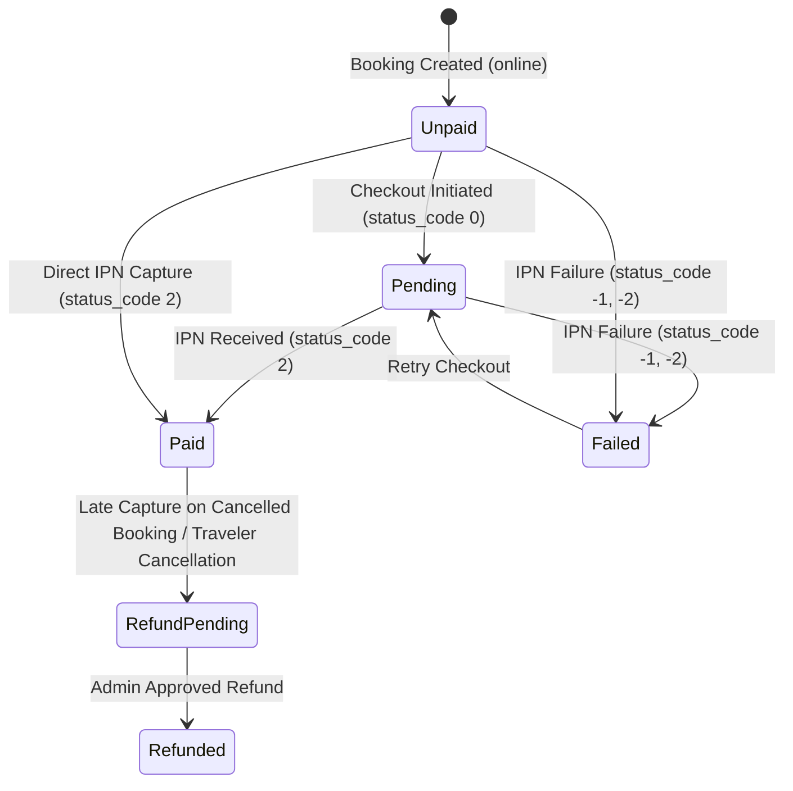

# CeylonGo Module 03: Activities & Experiences
## Phase 5F-1: PayHere Payment Gateway Integration (A09), Provider Payouts (B14) & Admin Payment Monitoring (C05) Gap Analysis

**Document Version:** 1.0
**Date:** 22 November 2026
**Author Roles:** Principal FastAPI Backend Engineer, Payment Gateway Architect, SQL Server Engineer, Security Auditor, QA Lead
**Active Branch:** `feature/m03-promotions-platform-reporting`
**Current Baseline Commit:** `c2f4fee`
**Target Requirements:**
- **A09:** PayHere Payment Integration
- **B14:** Provider Payouts (Readiness & Gap Analysis)
- **C05:** Admin Payment Monitoring (Readiness & Gap Analysis)

---

## 1. Executive Summary

Phase 5F-1 delivers the end-to-end backend foundation for **A09 PayHere Payment Integration** for Module 03 (Activities & Experiences) while ensuring strict architectural alignment and compatibility with **B14 Provider Payouts** and **C05 Admin Payment Monitoring**.

### 1.1 Invariants Enforced
1. **Zero Database Modifications or Migrations:** Utilizes existing physical SQL Server tables (`dbo.activity_bookings`, `dbo.booking_references`, `dbo.payment_transactions`, `dbo.payment_refunds`, `dbo.booking_status_history`). No unapplied migrations (`030`–`041`) were executed.
2. **Zero Live Payment / Outbound Network Calls:** Designed for safe offline sandbox simulation and mock verification. Real merchant secrets and sensitive credentials are never transmitted, logged, or hardcoded.
3. **Never Trust Browser Redirects:** Checkout hashes and redirect URLs serve only for user navigation. The server **never** marks an activity booking as confirmed or paid based on client return URLs. Only cryptographically validated server-to-server Instant Payment Notifications (IPN) execute state transitions.
4. **Fail-Closed & Idempotent Processing:** Duplicate or replayed webhook callbacks are detected and handled idempotently without duplicate balance increments or redundant state mutations.
5. **Out-of-Order / Late Capture Protection:** If an online payment is captured for an activity booking that was previously cancelled or rejected, the payment is preserved, the booking is **not** reactivated, and a `PaymentRefund` record is automatically queued for reconciliation.

---

## 2. A09 PayHere Integration Architecture

### 2.1 PayHere Cryptographic Specifications

PayHere Sri Lanka utilizes MD5-based cryptographic hashing for both client checkout redirection and server-side IPN verification.

#### Checkout Hash Generation
Generated on the server prior to returning the checkout form payload:
$$\text{SecretHash} = \text{MD5}(\text{merchant\_secret}).\text{upper}()$$
$$\text{RawString} = \text{merchant\_id} + \text{order\_id} + \text{formatted\_amount} + \text{currency} + \text{SecretHash}$$
$$\text{CheckoutHash} = \text{MD5}(\text{RawString}).\text{upper}()$$

- `formatted_amount` is strictly formatted to two decimal places (e.g., `"2500.00"`).
- `currency` is strictly `"LKR"`.

#### IPN Signature Verification
PayHere posts multipart/form-data to `/api/v1/payments/payhere/notify`. The server computes:
$$\text{RawString} = \text{merchant\_id} + \text{order\_id} + \text{payhere\_amount} + \text{payhere\_currency} + \text{status\_code} + \text{SecretHash}$$
$$\text{CalculatedSig} = \text{MD5}(\text{RawString}).\text{upper}()$$

Verification uses constant-time string comparison (`hmac.compare_digest(CalculatedSig, received_signature.upper())`) to mitigate timing attacks.

### 2.2 Payment API Endpoints

| Endpoint | Method | Role | Description |
| :--- | :--- | :--- | :--- |
| `/api/v1/payments/activities/bookings/{id}/initiate` | `POST` | Traveler / Admin | Validates booking ownership, slot status, and price; initiates online checkout session with PayHere hash. |
| `/api/v1/activity-bookings/{id}/initiate-payment` | `POST` | Traveler / Admin | Convenient alias route on activity bookings router. |
| `/api/v1/payments/payhere/notify` | `POST` | PayHere Webhook | Central IPN webhook listener. Routes `booking_ref.module_type == "activity"` to `handle_activity_payhere_callback`. |
| `/api/v1/payments/activities/bookings/{id}/status` | `GET` | Traveler / Provider / Admin | Retrieves payment status, gateway transaction ID, and paid timestamp. |
| `/api/v1/activity-bookings/{id}/payment-status` | `GET` | Traveler / Provider / Admin | Convenient alias route on activity bookings router. |

### 2.3 Webhook State Transitions

- **`status_code == '2'` (Success / Captured):**
  - Marks `PaymentTransaction.payment_status = 'paid'`.
  - Calculates 10% platform commission (`commission_rate = 10.00`, `commission_amount = amount * 0.10`).
  - Calculates 90% provider payable amount (`provider_payable_amount = amount - commission_amount`).
  - Transitions `ActivityBooking.booking_status = 'confirmed'` and `ActivityBooking.payment_status = 'paid'`.
  - Dispatches in-app confirmation notifications to traveler and activity provider.
- **`status_code in ('-1', '-2')` (Canceled / Failed):**
  - Marks `PaymentTransaction.payment_status = 'failed'`.
  - Transitions `ActivityBooking.payment_status = 'failed'` while keeping `booking_status` open for retry.
  - Dispatches failure notification to traveler.
- **`status_code == '0'` (Pending):**
  - Marks `PaymentTransaction.payment_status = 'pending'`.

---

## 3. B14 Provider Payouts Gap Analysis

Requirement **B14 — Provider Payouts** governs how activity providers receive disbursement of their accumulated earnings from online bookings.

### 3.1 Financial Breakdown Model
For every online activity booking captured:
$$\text{GrossAmount} = \text{Participants} \times \text{UnitPrice}$$
$$\text{PlatformCommission} = \text{GrossAmount} \times 10\%$$
$$\text{ProviderPayable} = \text{GrossAmount} - \text{PlatformCommission}$$

### 3.2 Implemented Shared Financial Abstraction
Implemented `get_activity_provider_earnings_components()` in `app/services/activity_payments.py` and hooked it directly into `calculate_provider_earnings_balances()` in `app/routers/payments.py`.

It aggregates:
- `total_gross`: Total captured online bookings.
- `completed_gross`: Gross earnings from bookings where `booking_status == 'completed'`.
- `completed_commission`: 10% platform fee on completed bookings.
- `completed_provider_payable`: 90% provider share available for disbursement upon activity completion.
- `pending_earnings`: 90% provider share on paid bookings still in `confirmed` / `pending` status.
- `verified_refunds`: Deductions for processed refunds (with commission reversal).

### 3.3 Remaining Gaps for B14 (Why B14 Remains BLOCKED / PARTIAL)
1. **Automated Payout Initiation (Bank / Direct Transfer):**
   - The platform does not currently connect to commercial banking rails (e.g., Commercial Bank, Sampath Bank, CEFTS, or PayHere Payouts API) for automated disbursement.
   - Payouts must be recorded manually via `POST /api/v1/payments/admin/settlements`.
2. **Provider Bank Account Storage & Verification:**
   - Physical table `dbo.provider_profiles` lacks structured bank routing columns (bank name, branch code, account number, beneficiary name) unless extended by future migrations.
3. **Settlement Approval Workflow:**
   - Multi-step settlement lifecycle (`pending` -> `approved` -> `disbursed`) is partially represented in `dbo.provider_settlements`.

---

## 4. C05 Admin Payment Monitoring Gap Analysis

Requirement **C05 — Admin Payment Monitoring** provides administrative oversight across platform transactions.

### 4.1 Implemented Oversight Capabilities
1. `GET /api/v1/payments/admin/transactions`: Lists all platform transactions (including activity payments) with pagination, gateway transaction ID, gross amount, commission rate, and provider payable amount.
2. `GET /api/v1/payments/admin/refunds`: Lists all refund requests and late-capture reconciliation items.
3. `POST /api/v1/payments/admin/refunds/{refund_id}/process`: Authorizes or rejects refund requests.
4. `GET /api/v1/admin/activity-bookings`: Provides granular filtering on activity bookings by `payment_status` (`unpaid`, `pending`, `paid`, `refund_pending`, `refunded`, `failed`) and `payment_method` (`online`, `pay_at_location`).

### 4.2 Remaining Gaps for C05
1. **Dedicated Module-Filtered Transaction Analytics:**
   - Administrative endpoint to aggregate fee volume specifically sliced by `module_type="activity"`.
2. **Automated Gateway Reconciliation Daemon:**
   - Background worker to poll PayHere server-side order inquiry endpoint to resolve un-notified transactions.

---

## 5. Security & Risk Audit

1. **Zero Secret Leakage:**
   - Masked `PayHereService.__repr__` to output `merchant_secret='***'`.
   - Added `sanitize_payment_log_dict()` to strip secrets, CVVs, and tokens prior to logging.
2. **Timing Attack Protection:**
   - Constant-time HMAC comparison implemented for IPN signature verification.
3. **Anti-Tampering:**
   - Verification of `merchant_id`, `order_id`, `payhere_amount`, and `payhere_currency`.
   - Any tampering results in `400 Bad Request` or signature rejection.
4. **Concurrency & Replay Safety:**
   - Table row locks (`lock_booking_resource`) serialize booking updates.
   - Gateway capture locks (`lock_capture`) reject conflicting duplicate payment IDs across different orders.

---

## 6. Requirement Status & External Blockers

| Requirement | Code | Current Status | Post-Phase 5F-1 Status | Reason |
| :--- | :--- | :--- | :--- | :--- |
| PayHere Payment Integration | A09 | BLOCKED | **BLOCKED** | Backend integration, signature verification, and mock adapter are complete. Status remains **BLOCKED** per requirements protocol until real PayHere production merchant credentials and webhook URL verification are active in staging/production. |
| Provider Payouts | B14 | BLOCKED | **BLOCKED** | Financial calculations and settlement interfaces are ready; actual automated disbursement rails and bank profile storage remain pending. |
| Admin Payment Monitoring | C05 | BLOCKED | **BLOCKED** | Transaction listing and refund management are functional; automated reconciliation daemon and production reporting remain pending. |
| Automatic Card Refunds | A12 | PARTIAL | **PARTIAL** | Queuing and reconciliation logic active; automated gateway refund API pending. |
| Notification Delivery | A16 | PARTIAL | **PARTIAL** | Asynchronous dispatch foundation ready; live carrier credentials pending. |
| Activity Discount Packages | B15 | PARTIAL | **PARTIAL** | Simulation and validation ready; migration 041 pending. |
| Activity Sponsored Campaigns | B16 | PARTIAL | **PARTIAL** | Simulation and validation ready; migration 030/041 pending. |

**Total Scorecard:** 41 COMPLETE, 4 PARTIAL, 0 MISSING, 3 BLOCKED (Total: 48 canonical requirements).
