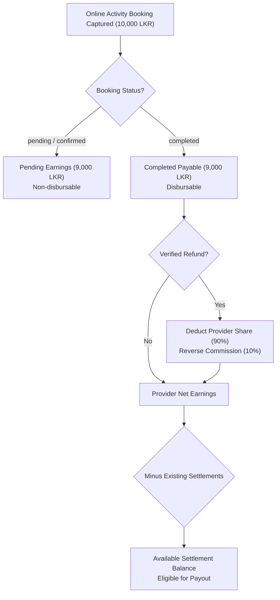

# CeylonGo Module 03: Activities & Experiences
## Phase 5F-2: B14 Provider Payouts & Settlement Integration Architecture

**Document Version:** 1.0
**Date:** 22 November 2026
**Author Roles:** Principal FastAPI Backend Engineer, Payment Settlement Architect, SQL Server Safety Auditor, QA Lead
**Active Branch:** `feature/m03-promotions-platform-reporting`
**Current Baseline Commit:** `e83e7ec`
**Target Requirements:**
- **B14:** Provider Payouts
- **C05:** Admin Payment Monitoring (Financial Oversight Compatibility)

---

## 1. Executive Summary

Phase 5F-2 delivers the safe application-layer foundation for **B14 Provider Payouts & Settlement Integration** within Module 03 (Activities & Experiences). It enables activity providers to inspect server-verified online earnings, track settlement history, and allows platform administrators to disburse accumulated balances safely without risk of double-settlement, overlapping settlement periods, or deficit creation.

### 1.1 Invariants Enforced
1. **Persisted Data Authority:** All earnings balances, commission rates, and net payables are calculated directly from physical database transaction records (`dbo.payment_transactions`, `dbo.payment_refunds`, `dbo.provider_settlements`). Client-provided values are strictly prohibited.
2. **Dynamic Commission Compliance:** Calculations do not assume a static platform commission; if a transaction specifies a custom rate (`tx.commission_rate`), that rate is applied to both the earnings allocation and any subsequent refund adjustments.
3. **Completion Precondition for Payouts:** Only bookings in `completed` status contribute to `available_settlement_balance`. Paid bookings in `confirmed` or `pending` status remain in `pending_earnings` and are non-disbursable until the activity is delivered.
4. **Zero-Knowledge Payout References:** Real bank account credentials, credit card details, or banking tokens are never persisted in unencrypted tables or printed in logs.
5. **Fail-Closed Double Settlement Defense:** Concurrency locks on the provider profile and unique payout references prevent race conditions, replay attacks, and duplicate payouts.
6. **External Rails Boundary:** Real bank transfers (SLIPS/CEFTS/PayHere Payouts) are not executed; a secure mock adapter simulates offline transactions for validation. B14 remains **BLOCKED** until verified banking rail connectivity is established.

---

## 2. Payout Endpoints & API Contract

### 2.1 Provider Earnings Endpoint

```http
GET /api/v1/provider/activities/earnings
```
- **Access Control:** Authenticated approved activity provider (`Depends(require_activity_provider)`).
- **Query Parameters (Optional):**
  - `period_start` (date): Filter earnings for activity slots occurring on or after date.
  - `period_end` (date): Filter earnings for activity slots occurring on or before date.
- **Response Model:** `ProviderEarningsSummaryResponse`

#### Response Fields:
| Field | Type | Description |
| :--- | :--- | :--- |
| `total_gross_earnings` | Decimal | Total gross payments captured from online travelers for provider's activities. |
| `completed_booking_earnings` | Decimal | Gross amount from successfully completed activities. |
| `ceylongo_commission` | Decimal | Platform commission earned by CeylonGo (gross commission minus refund reversals). |
| `commission_reversal` | Decimal | Platform commission refunded back to provider liabilities upon verified cancellations. |
| `verified_refunds` | Decimal | Total completed refunds processed for online transactions. |
| `provider_refund_reduction` | Decimal | Provider's share of refunds deducted from payable balance. |
| `provider_net_earnings` | Decimal | Net earnings earned from completed activities ($\max(0, \text{completed\_payable} - \text{refund\_reduction})$). |
| `pending_earnings` | Decimal | 90% net provider payable for confirmed/pending bookings awaiting activity delivery. |
| `total_settled` | Decimal | Historical settlements in `completed` or `paid` state. |
| `reserved_settlement` | Decimal | Pending or approved settlements committed but not yet marked paid. |
| `available_settlement_balance` | Decimal | Exact balance available for new admin payout creation. |
| `outstanding_liability` | Decimal | Deficit balance if refunds exceed earned revenue. |
| `total_paid_bookings` | int | Total count of paid activity bookings. |
| `currency` | str | Always `"LKR"`. |

---

### 2.2 Provider Settlement History Endpoint

```http
GET /api/v1/provider/activities/settlements
```
- **Access Control:** Authenticated approved activity provider (`Depends(require_activity_provider)`).
- **Query Parameters:**
  - `status` (string, optional): Filter by `pending`, `approved`, `completed`, or `paid`.
  - `page` (int, default=1): 1-based page number.
  - `page_size` (int, default=20): Items per page (max 100).
- **Response Model:** `list[SettlementResponse]`
- **Isolation Guarantee:** Filtered strictly by `ProviderSettlement.provider_profile_id == profile.id`. Zero cross-tenant leakage.

---

### 2.3 Admin Settlement Creation (Shared Infrastructure Extension)

```http
POST /api/v1/payments/admin/settlements
```
- **Access Control:** Platform Administrator (`Depends(require_admin)`).
- **Payload:** `SettlementCreateRequest` (`provider_profile_id`, `period_start`, `period_end`, `gross_amount`, `platform_fee`, `net_payable`, `payout_reference`, `settlement_status`).
- **Safety Validations:**
  1. `net_payable > 0.00` and `net_payable <= gross_amount`.
  2. `period_end >= period_start`.
  3. No overlapping settlement periods for this provider profile.
  4. `net_payable <= available_settlement_balance` across overall provider account.
  5. `net_payable <= period_available_balance` within the requested period dates.
  6. Concurrency lock `provider_settlement_{profile.id}` serializes concurrent payout attempts.
  7. When `settlement_status in ('completed', 'paid')`, `payout_reference` is checked for unique replay protection (`409 Conflict` if repeated).

---

## 3. Financial Calculation Model



### Formulas:
$$\text{CommissionRate} = \text{tx.commission\_rate} \;\text{or}\; 10.00\%$$
$$\text{Gross} = \text{tx.gross\_amount} \;\text{or}\; \text{tx.amount}$$
$$\text{CommissionAmount} = \text{tx.commission\_amount} \;\text{or}\; \text{round}(\text{Gross} \times \frac{\text{CommissionRate}}{100}, 2)$$
$$\text{ProviderPayable} = \text{tx.provider\_payable\_amount} \;\text{or}\; (\text{Gross} - \text{CommissionAmount})$$

---

## 4. Sri Lanka Banking Specifications & Future Readiness

### 4.1 Bank Account Format Validation
Implemented `validate_sri_lanka_bank_account()` adhering to Sri Lanka Interbank Payment System (SLIPS / CEFTS) standards:
- **Bank Code:** 4-digit standard central bank code (e.g., `7010` Bank of Ceylon, `7056` Commercial Bank, `7083` Hatton National Bank, `7278` Sampath Bank).
- **Branch Code:** 3-digit numeric code.
- **Account Number:** 8 to 16 numeric digits.
- **Account Holder Name:** 2 to 100 alphabetic characters, spaces, and periods.

### 4.2 Future Database Schema Specification (Option for Migration 042)
```sql
CREATE TABLE dbo.provider_bank_accounts (
    id INT IDENTITY(1,1) NOT NULL,
    provider_profile_id INT NOT NULL,
    bank_code NVARCHAR(4) NOT NULL,
    branch_code NVARCHAR(3) NOT NULL,
    account_number_encrypted VARBINARY(256) NOT NULL,
    account_number_last4 NVARCHAR(4) NOT NULL,
    account_holder_name NVARCHAR(100) NOT NULL,
    is_verified BIT NOT NULL DEFAULT 0,
    created_at DATETIME2 NOT NULL DEFAULT SYSUTCDATETIME(),
    CONSTRAINT PK_provider_bank_accounts PRIMARY KEY (id),
    CONSTRAINT FK_provider_bank_accounts_profile FOREIGN KEY (provider_profile_id) REFERENCES dbo.provider_profiles(id)
);
```

---

## 5. Mock Payout Adapter Pattern

Implemented `MockActivityPayoutAdapter` to facilitate offline testing:
- Validates payout currency (`LKR`) and positive amounts.
- Generates simulated references: `PAYOUT-MOCK-XXXXXXXX`.
- Returns timestamped confirmation payload without making real network or banking requests.

---

## 6. Scorecard & Blocked Status Rationale

| Requirement | Code | Status | Reason |
| :--- | :--- | :--- | :--- |
| **Provider Payouts** | **B14** | **BLOCKED** | Application-layer calculations, activity earnings API, settlement history API, and admin disbursement checks are complete and tested. Status remains **BLOCKED** per protocol until real banking rails (SLIPS/CEFTS or PayHere Payouts host-to-host API) and physical bank account schema are integrated. |
| PayHere Payment Integration | A09 | BLOCKED | Backend complete; live gateway credentials pending. |
| Admin Payment Monitoring | C05 | BLOCKED | Cross-module transaction aggregation complete; automated reconciliation daemon scheduled for Phase 5F-3. |

**Scorecard:** 41 COMPLETE, 4 PARTIAL, 0 MISSING, 3 BLOCKED.

---

## 7. Phase 5F-2A Financial Security Audit & Verification Record

### 7.1 Audit Checklist
1. **Authoritative Commission Rates:** Derived strictly from `PaymentTransaction.commission_rate` and `PaymentTransaction.commission_amount`.
2. **Refund Impact on Earnings:** Verified executed refunds reduce provider net payable proportionally and reverse platform commission without altering gross booking records.
3. **Pending Refund Isolation:** Pending and approved refunds are held against available settlement balance, preventing disbursements on disputed transactions.
4. **Lifecycle Balance Separation:** Uncompleted bookings (`confirmed`, `pending`) are segregated into `pending_earnings` and never inflate `available_settlement_balance`.
5. **Settlement Deduction Integrity:** All historical settlements (`completed`, `paid`, `pending`, `approved`) are deducted from provider net earnings to prevent double-settlement.
6. **Concurrency & Double-Pay Prevention:** Admin settlement creation enforces transaction-level locking (`provider_settlement_{profile.id}`) and re-verifies balances before flush.
7. **Duplicate Payout Reference Protection:** Payout references are validated against existing records; duplicates return `409 Conflict`.
8. **Multi-Tenant Isolation & RBAC:** `GET /earnings` and `GET /settlements` enforce `require_activity_provider` and strictly filter by authenticated profile ID. Platform admin access required for settlement creation.
9. **Date Windowing Correctness:** Inverted date ranges produce `422 Unprocessable Content`; valid windows filter bookings by slot start date without producing negative balances.
10. **Physical SQL Server Schema Compatibility:** Uses existing `dbo.provider_settlements` table; zero DDL modifications executed.

### 7.2 Verification Suite
- **Targeted B14 Suite (`test_activity_provider_payouts_b14.py`):** 10 passed, 0 failed.
- **Shared Payments & Safety Suite (`test_activity_payhere_payments.py`, `test_tour_guide_phase4_shared_payments.py`, `test_staging_safety.py`):** 78 passed, 0 failed.
- **Canonical Module 03 Regression Suite:** 220 passed, 0 failed.
- **Total Passing Tests:** 308 passed, 0 failed.
