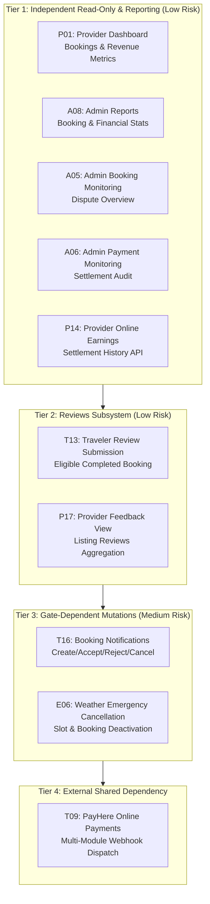

# CeylonGo Module 04 — Phase 5 Remaining Requirements Implementation Plan

**Reference Baseline**: Verified Official 50-Requirement Audit (`CeylonGo_Eco_Tourism_Complete_Development_Specification.pdf`, 17 Nov 2026)  
**Baseline Status**: 30 COMPLETE | 10 STAGED | 8 PARTIAL | 1 BLOCKED | 1 MISSING = 50 Total  
**Target Scope**: 8 PARTIAL (`T13`, `T16`, `P01`, `P17`, `A05`, `A06`, `A08`, `E06`), 1 MISSING (`P14`), and 1 BLOCKED (`T09`)  
**Status**: PLANNING ONLY — No code modifications, migrations, or database writes performed  

---

## 1. Executive Summary & Phased Delivery Strategy

Phase 4D successfully hardened all core transactional booking and slot routines, establishing strict outer transaction boundaries, generic error shielding, and SQL Server constraint adherence behind HTTP 503 guards.

The verified official audit reveals that the remaining gaps fall into three clean architectural categories:
1. **Tier 1: Independent Read-Only Reporting & Financial APIs** (Zero activation gate dependencies; zero mutation risks; can be implemented and tested immediately):
   - `P01`: Provider Dashboard Booking & Revenue Metrics
   - `A08`: Admin Overview Booking & Revenue Reporting
   - `A05`: Admin Booking Monitoring & Dispute Overview
   - `A06`: Admin Payment Monitoring & Settlement Audit
   - `P14`: Provider Online Earnings & Settlements API
2. **Tier 2: Review & Feedback Subsystems** (Uses existing `dbo.reviews` table; independent of booking mutation gates):
   - `T13`: Traveler Eco Experience Review Submission (requires verified completed booking check)
   - `P17`: Provider Eco Experience Review Feedback View
3. **Tier 3: Lifecycle Mutation & Event Triggers** (Tied to Phase 4D activation gates):
   - `T16`: Booking Lifecycle Notifications (Create, Accept, Reject, Cancel)
   - `E06`: Weather Emergency Slot & Booking Cancellation Workflow
4. **Tier 4: External Shared Platform Dependency**:
   - `T09`: PayHere Payment Gateway Multi-Module Webhook Routing (Shared Payments Team)



---

## 2. Detailed Requirement Plans: 8 PARTIAL Requirements

### 1. `P01` — Provider Dashboard Booking & Revenue Metrics (PARTIAL)
- **Official Specification**: "Bookings, revenue and listing overview."
- **Current State**: `GET /api/v1/eco-experiences/me/summary` only calculates listing counts (`draft`, `approved`, `published`, badges). Booking counts and revenue totals are absent.
- **Reusable Assets**:
  - Route: [app/routers/eco_experiences.py#L739](file:///c:/Users/komaruthan/Desktop/project%203/CeylonGo-Backend/app/routers/eco_experiences.py#L739) (`get_my_eco_experiences_summary`).
  - Schema: [app/schemas/eco_experience.py](file:///c:/Users/komaruthan/Desktop/project%203/CeylonGo-Backend/app/schemas/eco_experience.py) (`EcoProviderListingSummary`).
  - Models: `ActivityBooking` joined with `EcoExperience` via `eco_experience_id`.
- **Missing Functionality**:
  - Aggregating booking counts (`total_bookings`, `pending_requests`, `confirmed_bookings`, `cancelled_bookings`).
  - Aggregating revenue metrics (`total_revenue` from `payment_status='paid'`, `pending_cash` from `payment_method='pay_at_location'` and `payment_status='unpaid'`).
- **Proposed Endpoint & Files**:
  - Extend `app/schemas/eco_experience.py::EcoProviderListingSummary`:
    ```python
    total_bookings: int = 0
    pending_requests: int = 0
    confirmed_bookings: int = 0
    cancelled_bookings: int = 0
    total_revenue: Decimal = Decimal("0.00")
    pending_cash_revenue: Decimal = Decimal("0.00")
    ```
  - Update `get_my_eco_experiences_summary` in `app/routers/eco_experiences.py` to perform a single grouped aggregation query on `ActivityBooking` for the authenticated `provider_profile.id`.
- **Security & Authorization**: Enforces `require_approved_eco_provider`; strictly scoped to listings where `EcoExperience.provider_profile_id == provider_profile.id`.
- **Database Dependency**: `dbo.activity_bookings`, `dbo.eco_experiences` (Zero migrations required).
- **Test Strategy**: Add unit tests in `tests/test_eco_dashboard_p07.py` testing non-zero booking counts, revenue totals, and provider data isolation.
- **Gate Independence**: **100% Independent** of Phase 4D activation gates.
- **Effort Estimate**: 0.5 Days.

---

### 2. `A08` — Admin Booking & Revenue Reports (PARTIAL)
- **Official Specification**: "Basic eco-tourism, booking and revenue reporting."
- **Current State**: `GET /api/v1/admin/eco-experiences/overview` only returns listing counts by status, provider counts, categories, and districts. Financial and reservation volume reports are absent.
- **Reusable Assets**:
  - Route: [app/routers/eco_experiences.py#L1215](file:///c:/Users/komaruthan/Desktop/project%203/CeylonGo-Backend/app/routers/eco_experiences.py#L1215) (`get_admin_eco_experiences_overview`).
  - Schema: `EcoAdminOverviewResponse` in `app/schemas/eco_experience.py`.
- **Missing Functionality**:
  - Platform-wide eco booking metrics (`total_eco_bookings`, `active_reservations`, `cancellation_rate`).
  - Platform-wide financial reporting (`gross_booking_value`, `total_paid_revenue`, `cash_on_site_volume`).
- **Proposed Endpoint & Files**:
  - Extend `app/schemas/eco_experience.py::EcoAdminOverviewResponse` with `booking_metrics: EcoAdminBookingMetrics` and `revenue_metrics: EcoAdminRevenueMetrics`.
  - Update `get_admin_eco_experiences_overview` in `app/routers/eco_experiences.py` to aggregate records from `dbo.activity_bookings` where `eco_experience_id IS NOT NULL`.
- **Security & Authorization**: Enforces `require_admin`.
- **Database Dependency**: `dbo.activity_bookings` (Zero migrations required).
- **Test Strategy**: Add test assertions in `tests/test_eco_dashboard_p07.py` verifying platform aggregation across multiple providers.
- **Gate Independence**: **100% Independent** of Phase 4D activation gates.
- **Effort Estimate**: 0.5 Days.

---

### 3. `A05` — Admin Booking Monitoring & Dispute Overview (PARTIAL)
- **Official Specification**: "Monitor booking statuses and disputes."
- **Current State**: Bookings exist in `dbo.activity_bookings`, but no dedicated admin endpoint exists to inspect platform-wide eco-tourism bookings, filter by status, or flag disputes.
- **Reusable Assets**:
  - Response Schema: `EcoBookingResponse` in `app/schemas/eco_booking.py`.
  - Router: `admin_eco_router` in `app/routers/eco_experiences.py`.
- **Missing Functionality**:
  - Dedicated admin query endpoint with multi-criteria filtering (`status`, `date_from`, `date_to`, `provider_id`, `traveler_id`, `experience_id`).
- **Proposed Endpoint & Files**:
  - File: `app/routers/eco_experiences.py` (or new `app/routers/admin_eco_bookings.py`).
  - Route: `GET /api/v1/admin/eco-experiences/bookings`
  - Query Params: `status: str | None`, `experience_id: int | None`, `provider_id: int | None`, `start_date: date | None`, `end_date: date | None`, `page: int`, `page_size: int`.
  - Schema: `EcoAdminBookingListItem` (includes booking reference, experience title, provider name, traveler name, amount, payment status, booking status).
- **Security & Authorization**: Enforces `require_admin`.
- **Database Dependency**: `dbo.activity_bookings`, `dbo.eco_experiences`, `dbo.users`, `dbo.booking_references`.
- **Test Strategy**: Add dedicated test suite `tests/test_eco_admin_bookings.py` covering pagination, role checks, and filter accuracy.
- **Gate Independence**: **100% Independent** of Phase 4D activation gates.
- **Effort Estimate**: 1 Day.

---

### 4. `A06` — Admin Payment Monitoring & Settlement Audit (PARTIAL)
- **Official Specification**: "Review online payments, refunds and settlements."
- **Current State**: Payment records are logged in `dbo.payment_transactions` and `dbo.provider_settlements`, but no admin dashboard inspects eco-specific cash receipts, platform commissions, or settlement reconciliation.
- **Reusable Assets**:
  - Models: `PaymentTransaction`, `ProviderSettlement` in `app/models/shared.py`.
  - Auth: `require_admin`.
- **Missing Functionality**:
  - Admin audit overview showing total collected cash, settled amounts, pending payouts, and refund audit trail for eco experiences.
- **Proposed Endpoint & Files**:
  - File: `app/routers/eco_experiences.py` (under `admin_eco_router`).
  - Route: `GET /api/v1/admin/eco-experiences/payments/audit`
  - Route: `GET /api/v1/admin/eco-experiences/settlements`
  - Schemas: `EcoAdminPaymentAuditResponse`, `EcoAdminSettlementItem`.
- **Security & Authorization**: Enforces `require_admin`.
- **Database Dependency**: `dbo.activity_bookings`, `dbo.provider_settlements`, `dbo.payment_transactions`.
- **Test Strategy**: Integration tests verifying calculation of gross bookings, platform fee deductions (e.g. 10%), and net payable balances.
- **Gate Independence**: **100% Independent** of Phase 4D activation gates.
- **Effort Estimate**: 1 Day.

---

### 5. `T13` — Traveler Ratings & Reviews (PARTIAL)
- **Official Specification**: "Reviews after eligible completed bookings."
- **Current State**: Database table `dbo.reviews` and model `Review` in `app/models/shared.py` support experience reviews. However, Module 04 lacks a traveler submission endpoint that verifies the traveler has completed the booking before allowing a review.
- **Reusable Assets**:
  - Model: `Review` in [app/models/shared.py#L137](file:///c:/Users/komaruthan/Desktop/project%203/CeylonGo-Backend/app/models/shared.py#L137).
  - Models: `ActivityBooking`, `ListingReference`, `BookingReference`.
- **Missing Functionality**:
  - Traveler review submission endpoint validating:
    1. Traveler role (`role == 'traveler'`).
    2. Booking ownership (`booking.user_id == current_user.id`).
    3. Eligible completion: booking must have `booking_status == 'completed'`.
    4. One review per booking rule (prevents duplicate spam reviews).
    5. Automatic recalculation of `rating` and `total_reviews` on `EcoExperience`.
- **Proposed Endpoint & Files**:
  - File: New `app/routers/eco_reviews.py` (or extend `app/routers/eco_experiences.py`).
  - Route: `POST /api/v1/eco-experiences/{id}/reviews`
  - Route: `GET /api/v1/eco-experiences/{id}/reviews` (Public listing of approved reviews).
  - Schema: `EcoReviewCreate(booking_id: int, rating: Decimal, title: str | None, comment: str | None)`.
  - Schema: `EcoReviewResponse(id: int, user_name: str, rating: Decimal, title: str, comment: str, created_at: datetime)`.
- **Security & Authorization**: Enforces `get_current_user` (`role == 'traveler'`) on create; public access on GET.
- **Database Dependency**: `dbo.reviews`, `dbo.eco_experiences` (Zero migrations required).
- **Test Strategy**: Add `tests/test_eco_reviews.py` verifying:
  - Rejection if booking is not completed (e.g. pending/confirmed).
  - Rejection if traveler did not book the experience.
  - Duplicate review prevention.
  - Public display with score updates.
- **Gate Independence**: **100% Independent** of Phase 4D activation gates.
- **Effort Estimate**: 1.5 Days.

---

### 6. `P17` — Provider Ratings & Reviews Feedback View (PARTIAL)
- **Official Specification**: "View traveler feedback."
- **Current State**: Providers have no dedicated endpoint to inspect traveler reviews, filter by rating/experience, or view aggregate review trends across their listings.
- **Reusable Assets**:
  - Model: `Review` in `app/models/shared.py`.
  - Auth: `require_approved_eco_provider`.
- **Missing Functionality**:
  - Provider endpoint returning reviews for all listings owned by the authenticated provider.
- **Proposed Endpoint & Files**:
  - File: `app/routers/eco_reviews.py` (or `app/routers/eco_experiences.py`).
  - Route: `GET /api/v1/provider/eco-experiences/reviews`
  - Query Params: `experience_id: int | None`, `min_rating: Decimal | None`, `page: int`, `page_size: int`.
  - Schema: `EcoProviderReviewListItem` (review details, traveler first name, experience title, booking date).
- **Security & Authorization**: Enforces `require_approved_eco_provider`; strictly scoped to listings where `EcoExperience.provider_profile_id == provider_profile.id`.
- **Database Dependency**: `dbo.reviews`, `dbo.eco_experiences`.
- **Test Strategy**: Unit tests asserting cross-provider isolation (Provider B cannot see reviews for Provider A's listings unless public).
- **Gate Independence**: **100% Independent** of Phase 4D activation gates.
- **Effort Estimate**: 0.5 Days.

---

### 7. `T16` — Booking Notifications (PARTIAL)
- **Official Specification**: "Booking and schedule status updates."
- **Current State**: `Notification` model exists and `app/core/notification_service.py` provides `create_notification()`. However, no dispatch triggers are hooked into booking creation, acceptance, rejection, cancellation, or slot changes.
- **Reusable Assets**:
  - Service: `app/core/notification_service.py::create_notification`.
  - Model: `Notification` in [app/models/shared.py#L121](file:///c:/Users/komaruthan/Desktop/project%203/CeylonGo-Backend/app/models/shared.py#L121).
- **Missing Functionality**:
  - Trigger 1 (Booking Created): Notify provider ("New booking request for {experience_title}").
  - Trigger 2 (Booking Accepted): Notify traveler ("Your booking {booking_ref} has been confirmed").
  - Trigger 3 (Booking Rejected): Notify traveler ("Your booking request was rejected: {note}").
  - Trigger 4 (Booking Cancelled): Notify provider ("Booking {booking_ref} was cancelled by traveler").
  - Trigger 5 (Cash Confirmed): Notify traveler ("Payment of {amount} LKR received in cash").
- **Proposed Implementation**:
  - Add dispatch calls inside `_execute_booking_create_with_transaction`, `_execute_booking_cancel_with_transaction`, and `_execute_provider_decision_with_transaction` in `app/routers/eco_bookings.py`.
  - Ensure notifications are created in the same database session right before `db.commit()`.
- **Security & Authorization**: System-dispatched; recipient `user_id` strictly derived from booking/listing owner.
- **Database Dependency**: `dbo.notifications` (Zero migrations required).
- **Test Strategy**: Add assertions to `tests/test_eco_bookings_router_staged.py` checking that `dbo.notifications` rows are created for corresponding events.
- **Gate Independence**: Dependent on Phase 4D Router Wiring (can be committed staged behind 503 guards or activated post-Gate 4).
- **Effort Estimate**: 1 Day.

---

### 8. `E06` — Weather & Seasonal Restrictions (PARTIAL)
- **Official Specification**: "Block unsuitable seasons or unsafe dates; enable cancellation with reason."
- **Current State**: Pre-creation seasonal blackout date blocking is 100% implemented via `EcoSeasonRestriction`. Traveler cancellation accepts a cancellation reason.
- **Missing Functionality**:
  - Provider emergency weather slot cancellation endpoint:
    - Allows provider to mark a slot inactive due to severe weather (`is_active = False`).
    - Automatically cancels all pending/confirmed bookings for that slot with `cancellation_reason = "Weather Emergency: {reason}"`.
    - Automatically releases reserved capacity.
    - Dispatches urgent notifications to all affected travelers.
- **Proposed Endpoint & Files**:
  - File: `app/routers/eco_slots.py`.
  - Route: `POST /api/v1/provider/eco-experiences/{id}/slots/{slot_id}/weather-cancel`
  - Schema: `EcoSlotWeatherCancellation(reason: str)`.
  - Helper: `execute_slot_weather_cancellation_atomic()` in `app/services/eco_slot_validation.py`.
- **Security & Authorization**: Enforces `require_approved_eco_provider` and listing ownership.
- **Database Dependency**: `dbo.activity_slots`, `dbo.activity_bookings`.
- **Test Strategy**: Add unit tests in `tests/test_eco_slots_router_staged.py` simulating weather cancellation of a slot with 2 bookings, asserting both become `'cancelled'` and capacity is zeroed.
- **Gate Independence**: Best deployed behind HTTP 503 guard alongside Phase 4D slot routers.
- **Effort Estimate**: 1.5 Days.

---

## 3. Detailed Requirement Plan: 1 MISSING Requirement

### 9. `P14` — Provider Online Earnings & Settlements (MISSING)
- **Official Specification**: "View payment and settlement records."
- **Current State**: The database contains `dbo.provider_settlements` and `dbo.payment_transactions`, but zero API endpoints exist in Module 04 for eco providers to query their financial payout history or balance.
- **Reusable Assets**:
  - Model: `ProviderSettlement` in [app/models/shared.py#L100-L119](file:///c:/Users/komaruthan/Desktop/project%203/CeylonGo-Backend/app/models/shared.py#L100).
  - Auth: `require_approved_eco_provider`.
- **Missing Functionality**:
  - Dedicated provider earnings endpoint returning:
    1. Financial Summary: Total gross booking volume, total platform commission withheld, total net payable, total settled (paid out), pending settlement balance.
    2. Settlement Ledger: Paginated list of settlement records (`period_start`, `period_end`, `gross_amount`, `platform_fee`, `net_payable`, `settlement_status`, `payout_reference`, `paid_at`).
- **Proposed Endpoint & Files**:
  - File: New `app/routers/eco_settlements.py` (or extend `app/routers/eco_experiences.py`).
  - Route: `GET /api/v1/provider/eco-experiences/earnings/summary`
  - Route: `GET /api/v1/provider/eco-experiences/earnings/settlements`
  - Schemas: `EcoProviderEarningsSummary`, `EcoProviderSettlementItem`.
- **Security & Authorization**: Enforces `require_approved_eco_provider`; strictly scoped to `ProviderSettlement.provider_profile_id == provider_profile.id`.
- **Database Dependency**: `dbo.provider_settlements`, `dbo.activity_bookings`. (Zero migrations required).
- **Test Strategy**: Add `tests/test_eco_provider_earnings.py` verifying financial calculations, settlement status mapping, and cross-provider financial isolation.
- **Gate Independence**: **100% Independent** of Phase 4D activation gates.
- **Effort Estimate**: 1.5 Days.

---

## 4. External Dependency Architecture: `T09` Online Payments (BLOCKED)

### Current Architecture & Cross-Module Constraint
Online payments in CeylonGo rely on the **PayHere payment gateway**, which sends server-to-server webhook callbacks to `POST /api/v1/payments/payhere/notify` in [app/routers/payments.py](file:///c:/Users/komaruthan/Desktop/project%203/CeylonGo-Backend/app/routers/payments.py#L125).

Currently:
1. `POST /api/v1/payments/payhere/notify` hardcodes lookup and state updates for `homestay` reservations in `dbo.bookings`.
2. When an eco-tourism or activity booking reference (prefixed with `ECO-` or `ACT-`) is passed, the webhook cannot resolve it, resulting in failed payment notifications.
3. Modifying `app/routers/payments.py` without shared team approval risks regressing Homestay booking payments.

### Recommended Unblocking Sequence (Shared Team Alignment)
To unblock `T09` safely without breaking Homestays:
1. **Multi-Module Dispatch Protocol**: Update `POST /api/v1/payments/payhere/notify` to parse `order_id` (the canonical booking reference):
   - Query `dbo.booking_references` where `booking_reference == order_id`.
   - Dispatch based on `module_type`:
     - If `module_type == 'homestay'`: invoke existing homestay payment confirmation.
     - If `module_type == 'activity'`: invoke `app/services/eco_booking_service.py::execute_online_payment_confirmation()`.
2. **Atomic Payment Update**:
   - Updates `ActivityBooking.payment_status = 'paid'`, `payment_method = 'online'`.
   - Records transaction in `dbo.payment_transactions`.
   - Dispatches payment receipt notification (`T16`).
3. **Timeline**: Scheduled for Phase 6 after Phase 4D and Phase 5 core activations are complete.

---

## 5. Implementation Roadmap, Phased Rollout & Effort Estimates

| Phase / Sprint | Tasks Included | Target Requirements | Gate Dependencies | Effort |
| :--- | :--- | :--- | :--- | :--- |
| **Phase 5A: Read-Only Dashboards & Reporting** | Provider Dashboard Metrics, Admin Overview Reports, Admin Booking Monitoring, Admin Payment Monitoring, Provider Earnings API | `P01`, `A08`, `A05`, `A06`, `P14` | **None** (100% Independent) | **4.0 Days** |
| **Phase 5B: Ratings & Reviews Subsystem** | Traveler Review Submission with verified booking check, Provider Review Feedback View | `T13`, `P17` | **None** (100% Independent) | **2.0 Days** |
| **Phase 5C: Lifecycle Triggers & Weather Safety** | Booking Notifications (create, accept, reject, cancel), Weather Emergency Slot & Booking Cancellation | `T16`, `E06` | Dependent on Phase 4D router activation | **2.5 Days** |
| **Phase 5D: External Gateway Integration** | PayHere Webhook Multi-Module Callback Dispatch | `T09` | External Payments Team Alignment | **2.0 Days** |
| **Total Estimated Effort** | | | | **10.5 Days** |

---

## 6. Acceptance Criteria for Phase 5 Completion

1. **Dashboard & Reports (`P01`, `A08`)**:
   - Provider summary returns non-zero booking counts and accurate Decimal revenue.
   - Admin overview reports platform-wide eco gross booking value and reservation volumes.
2. **Admin Operations (`A05`, `A06`)**:
   - Admins can query and filter all eco bookings and payment audit trails.
3. **Reviews System (`T13`, `P17`)**:
   - Travelers can only submit reviews for bookings in `booking_status == 'completed'`.
   - Experience ratings update dynamically; providers can inspect all traveler reviews for their listings.
4. **Earnings API (`P14`)**:
   - Providers can inspect their settlement history and un-settled revenue balances.
5. **Weather & Notifications (`E06`, `T16`)**:
   - Emergency weather slot cancellation cascades status updates and notifies travelers.
   - All booking status transitions generate in-app notifications.
6. **Zero Regression Guarantee**:
   - 100% of existing 442 regression tests continue to pass.
