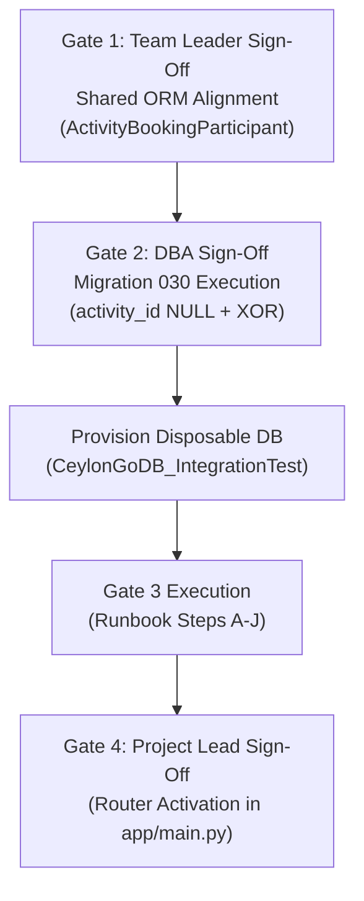

# Gate 3 QA Approval Package
## Disposable SQL Server Integration & Concurrency Verification

**Document Version**: 1.0  
**Date**: 20 November 2026  
**Project**: `CeylonGo-Backend` (`develop` branch)  
**Target Database**: Microsoft SQL Server 2025 (`CeylonGoDB_IntegrationTest`)  
**Responsible Approvers**: QA Lead / Database Coordinator  
**Readiness Status**: **READY FOR QA PROVISIONING**  
**Execution Status**: **BLOCKED (Awaiting Gate 1 & Gate 2 Sign-Off)**  
**Recommendation**: **APPROVE TEST DESIGN & PROCEED TO PROVISIONING UPON GATES 1 & 2 COMPLETION**  

---

## 1. Executive Summary

This proposal presents the comprehensive Gate 3 Integration and Concurrency Testing Package for CeylonGo Module 04 (Eco-Tourism). 

Gate 3 is the critical bridge between static unit test verification and live endpoint activation. It proves that CeylonGo's distributed locking (`sp_getapplock`), slot capacity invariants, and transaction rollbacks operate flawlessly against a real Microsoft SQL Server engine without risk to production or shared development data.

### Status Highlights
- **Architecture & Safety Design**: 100% complete and verified fail-closed.
- **Existing Integration Tests**: 3 tests reviewed in `tests/test_eco_sqlserver_integration.py` (currently skipped safely).
- **Expanded Concurrency Suite**: 5 additional concurrency, rollback, and cross-module tests specified.
- **Runbook**: 10-step operational runbook (Steps A–J) fully documented.
- **Current Live DB Integrity**: Zero writes executed against `CeylonGoDB`; all 487 regression unit tests passing.

---

## 2. Gate Dependencies & Preconditions

Before Gate 3 test execution can commence, the following dependency chain must be satisfied:

1. **Gate 1 Sign-Off (Backend Team Leader)**:
   - Approval of `docs/proposals/gate_1_shared_orm_approval_package.md`.
   - Modifies `app/models/activity_booking.py` to eliminate phantom column `id_or_passport`.
2. **Gate 2 Sign-Off (Database Coordinator)**:
   - Approval of `docs/proposals/gate_2_migration_030_approval_package.md`.
   - Authorizes execution of `migrations/030_make_activity_slots_activity_id_nullable.sql`.
3. **Disposable Database Provisioning**:
   - DBA provisions `CeylonGoDB_IntegrationTest` with restricted user `ceylongo_test_runner`.
   - Applies Migrations 001–030 to disposable database only.

---

## 3. Database Safety Architecture & Fail-Closed Guards

To guarantee that tests can **never** connect to or mutate `CeylonGoDB`, Gate 3 enforces a dual-layer guard:

1. **URL Inspection Guard**:
   `app.core.database_guard.verify_safe_integration_database(target_db)` parses the database name prior to engine instantiation. Any connection string targeting `CeylonGoDB`, `master`, `tempdb`, `model`, `msdb`, or empty values immediately triggers `DatabaseSafetyError`.
2. **Runtime Session Guard**:
   Every database session checkout executes `SELECT DB_NAME();` and verifies the active database matches `APPROVED_INTEGRATION_DATABASES = frozenset({"ceylongodb_integrationtest", "ceylongodb_disposable_qa"})`.
3. **Outbound Traffic Suppression**:
   `SMTP_HOST=""` and mocked payment webhooks prevent accidental real-world side effects.
4. **Session Rollback Guarantee**:
   All test fixtures wrap sessions in `session.rollback()` and `session.close()` inside `finally:` blocks.

---

## 4. Test Suite Inventory & Coverage

### A. Core Integration Tests (Existing in `tests/test_eco_sqlserver_integration.py`)
1. `test_sqlserver_sp_getapplock_acquisition_and_release`: Validates synchronous lock acquisition and release codes (0/1).
2. `test_sqlserver_concurrent_applock_mutual_exclusion`: Validates that conflicting concurrent transactions are mutually excluded and timeout appropriately.
3. `test_sqlserver_conditional_capacity_oversell_barrier`: Validates atomic arithmetic update barrier (`capacity - reserved_count >= :p`).

### B. Expanded Concurrency Tests (Ready for Implementation)
4. `test_sqlserver_atomic_booking_creation_and_participant_persistence`: Validates multi-table insert and foreign key compliance.
5. `test_sqlserver_transaction_rollback_on_participant_error`: Validates full rollback when participant constraints are violated.
6. `test_sqlserver_concurrent_booking_race_condition_last_seat`: Validates race condition resolution when 2 threads compete for 1 remaining place.
7. `test_sqlserver_concurrent_booking_cancellation_race`: Validates atomic state transition preventing double-cancellation.
8. `test_sqlserver_module_03_and_module_04_slot_coexistence`: Validates XOR constraint `CK_activity_slots_parent_target`.

---

## 5. Risk Assessment & Mitigations

| Risk | Severity | Mitigation |
|---|:---:|---|
| Accidental execution against `CeylonGoDB` | Critical | Dual-layer fail-closed guard; test login denied access to `CeylonGoDB`. |
| Flaky tests under concurrent CI load | Medium | Configurable lock timeout threshold (`timeout_ms=5000`); pooled connections. |
| Lingering test data after run | Low | Transaction rollback per test; cleanup script in Step J of runbook. |
| Incompatible schema in disposable DB | High | Step D verifies `activity_id IS_NULLABLE = 'YES'` before running tests. |

---

## 6. Approvals & Sign-Off Authorization

By signing below, the QA Lead and Database Coordinator approve the safety architecture, test design, and runbook for Gate 3, authorizing the provisioning of `CeylonGoDB_IntegrationTest` once Gates 1 and 2 are ratified.

- **QA Lead**: ___________________________  Date: ______________  
  *(Approves Test Design, Concurrency Assertions, and QA Runbook)*

- **Database Coordinator**: ___________________________  Date: ______________  
  *(Approves Disposable Database Provisioning & Credential Isolation)*

---

## 7. Next Actions

1. Present Gate 1, Gate 2, and Gate 3 packages to team leadership.
2. Await formal approval of Gate 1 (Backend Team Leader) and Gate 2 (Database Coordinator).
3. Upon approval, execute Step A (Provision `CeylonGoDB_IntegrationTest`) and Step D (Apply M001–M030 to disposable DB).
4. Run Steps E through J of the QA Runbook.
5. Submit final Gate 3 results package to Project Lead for Gate 4 activation approval.
