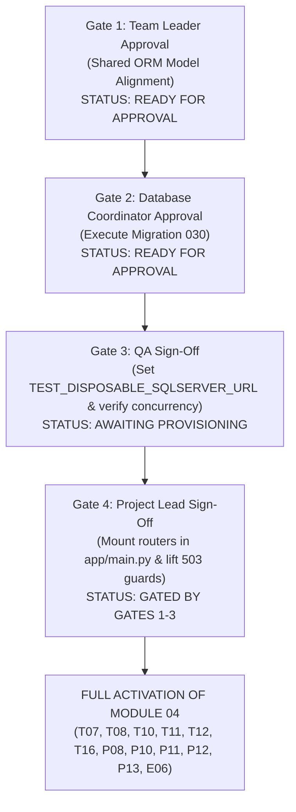

# CeylonGo Module 04 — Phase 5H: Gate Readiness & Activation Roadmap

**Document Version**: 1.0  
**Date**: 20 November 2026  
**Project**: CeylonGo-Backend (`develop` branch)  
**Scope**: Technical Review & Governance Sign-Off Roadmap for Module 04 Activation  

---

## 1. Executive Summary

Phase 5H delivers the rigorous technical review of the two foundational activation dependencies for CeylonGo Module 04:
- **Gate 1**: Shared `ActivityBookingParticipant` ORM Compatibility (`app/models/activity_booking.py`).
- **Gate 2**: SQL Server Migration 030 Readiness (`migrations/030_make_activity_slots_activity_id_nullable.sql`).

Both gates have been audited against the physical SQL Server database (`CeylonGoDB`) with 100% read-only verification. Both packages are technically sound, zero-risk, backward-compatible, and **READY FOR APPROVAL**.

---

## 2. Four Governance Gates Status Matrix

| Gate | Title | Scope & Target | Responsible Role | Readiness Status | Risk Level |
|:---:|---|---|---|:---:|:---:|
| **Gate 1** | Shared ORM Alignment | Reconcile `ActivityBookingParticipant` in `app/models/activity_booking.py` with physical schema (remove phantom `id_or_passport`, add `emergency_contact_*`, `waiver_signed`). | **Backend Team Leader** | **READY FOR APPROVAL** | Low |
| **Gate 2** | Migration 030 Execution | Execute `030_make_activity_slots_activity_id_nullable.sql` to make `activity_id INT NULL` with XOR check constraint in `dbo.activity_slots`. | **Database Coordinator / DBA** | **READY FOR APPROVAL** | Low |
| **Gate 3** | Live SQL Server Concurrency Sign-Off | Set `TEST_DISPOSABLE_SQLSERVER_URL` pointing to disposable test instance and execute 3 integration tests in `test_eco_sqlserver_integration.py`. | **QA Lead** | **AWAITING PROVISIONING** | Low |
| **Gate 4** | Staged Router Activation | Mount `eco_bookings.router` and `eco_slots.router` in `app/main.py`; lift HTTP 503 staging guards. | **Project Lead** | **GATED (NO-GO until Gates 1–3 clear)** | Medium |

---

## 3. Technical Evidence Summary

### Gate 1 (Shared ORM Model Alignment)
- **Verified Fact**: Physical table `dbo.activity_booking_participants` contains 9 columns. Column `id_or_passport` **does not exist**.
- **Verified Fact**: Physical table contains `emergency_contact_name`, `emergency_contact_phone`, and `waiver_signed` which were omitted from ORM.
- **Codebase Impact**: Module 03 has **zero** references to `id_or_passport`. Module 04 safely bypasses the bug using reflected Core queries.
- **Verdict**: Patching the ORM model aligns Python code with database reality and eliminates a latent runtime crash (Error 207).

### Gate 2 (SQL Server Migration 030)
- **Verified Fact**: `dbo.activity_slots.activity_id` is currently `INT NOT NULL` in the physical database.
- **Verified Fact**: Foreign key `FK_activity_slots_eco_experience` and index `IX_activity_slots_eco_experience` are already deployed.
- **Verified Fact**: SQL Server 2025 permits `ALTER TABLE dbo.activity_slots ALTER COLUMN activity_id INT NULL` without dropping existing foreign keys or non-clustered indexes.
- **Verified Fact**: 100% of existing rows comply with the XOR check constraint `(activity_id IS NOT NULL AND eco_experience_id IS NULL) OR (activity_id IS NULL AND eco_experience_id IS NOT NULL)`.
- **Verdict**: Migration script is idempotent, transactional, guarded with pre-checks, and includes an automated rollback refusal check.

---

## 4. Exact Next Steps for Stakeholders

### For Backend Team Leader (Gate 1)
1. Review [gate_1_shared_orm_approval_package.md](file:///c:/Users/komaruthan/Desktop/project%203/CeylonGo-Backend/docs/proposals/gate_1_shared_orm_approval_package.md).
2. Approve the 15-line diff for `app/models/activity_booking.py`.
3. Sign off on Gate 1.

### For Database Coordinator / DBA (Gate 2)
1. Review [gate_2_migration_030_approval_package.md](file:///c:/Users/komaruthan/Desktop/project%203/CeylonGo-Backend/docs/proposals/gate_2_migration_030_approval_package.md).
2. Execute the read-only preflight SQL script against `CeylonGoDB`.
3. Confirm database backup availability.
4. Execute `migrations/030_make_activity_slots_activity_id_nullable.sql` on staging SQL Server.
5. Sign off on Gate 2.

### For QA Lead (Gate 3)
1. Provision a disposable SQL Server database instance.
2. Set environment variable `TEST_DISPOSABLE_SQLSERVER_URL`.
3. Run `pytest tests/test_eco_sqlserver_integration.py -v`.
4. Sign off on Gate 3.

### For Project Lead (Gate 4)
1. Following sign-offs on Gates 1, 2, and 3, review [project_lead_approval_router_activation.md](file:///c:/Users/komaruthan/Desktop/project%203/CeylonGo-Backend/docs/proposals/project_lead_approval_router_activation.md).
2. Authorize mounting `eco_bookings.router` and `eco_slots.router` in `app/main.py`.
3. Authorize lifting HTTP 503 staging guards.
4. Finalize Module 04 activation.
