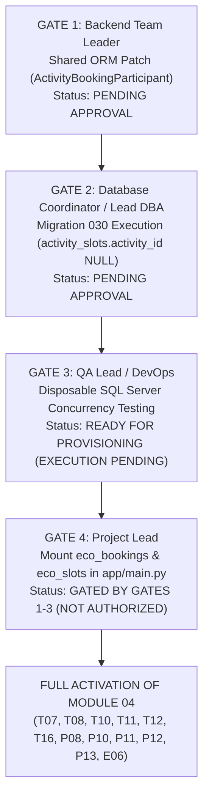

# Phase 5L: Final Gate Handoff & Governance Approval Package

**Document Version**: 1.0  
**Date**: 20 November 2026  
**Project**: `CeylonGo-Backend` (`develop` branch)  
**Target Environment**: Microsoft SQL Server 2025 (`CeylonGoDB`)  
**Scope**: Pre-Approval Technical Readiness Package for Gate 1, Gate 2, and Gate 3  
**Overall Status**: **TECHNICAL PREPARATION COMPLETE — ALL APPROVALS PENDING**  

---

## 1. Executive Summary & Four-Gate Governance Roadmap

This document serves as the formal handoff package for team leadership to review, authorize, and sequence the activation of CeylonGo Module 04 (Eco-Tourism).



---

## 2. Gate 1: Shared ORM Model Alignment

### A. Gate Summary & Governance Details
- **Gate Title**: Shared `ActivityBookingParticipant` ORM Compatibility Alignment
- **Responsible Approval Owner**: **Backend Team Leader**
- **Approval Status**: **PENDING APPROVAL**
- **Readiness Recommendation**: **READY FOR APPROVAL**
- **Target File**: `app/models/activity_booking.py` (lines 144–198)
- **Detailed Package**: `docs/proposals/gate_1_shared_orm_approval_package.md`

### B. Technical Evidence & Problem Statement
- **Physical Reality in SQL Server (`dbo.activity_booking_participants`)**:
  - `id`: `INT NOT NULL IDENTITY`
  - `activity_booking_id`: `INT NOT NULL`
  - `full_name`: `NVARCHAR(150) NOT NULL`
  - `age`: `INT NULL`
  - `emergency_contact_name`: `NVARCHAR(150) NULL`
  - `emergency_contact_phone`: `NVARCHAR(30) NULL`
  - `special_requirements`: `NVARCHAR(1000) NULL`
  - `waiver_signed`: `BIT NOT NULL DEFAULT ((0))`
  - `created_at`: `DATETIME2 NOT NULL`
- **Discrepancies in Current ORM**:
  - Defines phantom column `id_or_passport: Mapped[str | None] = mapped_column(Unicode(50))` which **does not exist** in physical SQL Server, causing SQL Server **Error 207** on ORM queries.
  - Missing physical operational columns: `emergency_contact_name`, `emergency_contact_phone`, `waiver_signed`.
  - Column length mismatch on `special_requirements` (`Unicode(500)` vs physical `NVARCHAR(1000)`).
- **Module 03 Impact**:
  - Comprehensive audit confirms Module 03 services and routers reference only `ActivityBooking.participants` (integer count). Zero references exist to `id_or_passport` or `ActivityBookingParticipant` throughout Module 03.
  - **Verdict**: Patch introduces **zero breaking changes** to Module 03.

### C. Proposed Patch Diff
```diff
--- a/app/models/activity_booking.py
+++ b/app/models/activity_booking.py
@@ -165,4 +165,8 @@ class ActivityBookingParticipant(Base):
-    id_or_passport: Mapped[str | None] = mapped_column(
-        Unicode(50),
-        nullable=True,
-    )
+    emergency_contact_name: Mapped[str | None] = mapped_column(
+        Unicode(150),
+        nullable=True,
+    )
+    emergency_contact_phone: Mapped[str | None] = mapped_column(
+        Unicode(30),
+        nullable=True,
+    )
@@ -171,3 +175,3 @@ class ActivityBookingParticipant(Base):
     special_requirements: Mapped[str | None] = mapped_column(
-        Unicode(500),
+        Unicode(1000),
         nullable=True,
     )
+    waiver_signed: Mapped[bool] = mapped_column(
+        Boolean,
+        default=False,
+        nullable=False,
+    )
```

### D. Actions Permitted After Approval
1. Apply the git patch to `app/models/activity_booking.py`.
2. Run Module 03 activity tests (`pytest tests/test_activities.py`).
3. Run Module 04 eco booking tests (`pytest tests/test_eco_booking_service.py`).

### E. Rollback Procedure
Revert changes to `app/models/activity_booking.py` using `git checkout app/models/activity_booking.py`.

---

## 3. Gate 2: SQL Server Migration 030 Execution

### A. Gate Summary & Governance Details
- **Gate Title**: `dbo.activity_slots.activity_id` Nullability & XOR Constraint
- **Responsible Approval Owner**: **Database Coordinator / Lead DBA**
- **Approval Status**: **PENDING APPROVAL**
- **Readiness Recommendation**: **READY FOR APPROVAL**
- **Target Script**: `migrations/030_make_activity_slots_activity_id_nullable.sql`
- **Target Database**: Microsoft SQL Server (`CeylonGoDB`)
- **Detailed Package**: `docs/proposals/gate_2_migration_030_approval_package.md`

### B. Technical Evidence & Preflight Results
- **Current Column State**: `activity_id` is physically `INT NOT NULL`. `eco_experience_id` is `INT NULL`.
- **Existing Rows XOR Compatibility**: Read-only query confirms **0 rows** violate the upcoming constraint `(activity_id IS NOT NULL AND eco_experience_id IS NULL) OR (activity_id IS NULL AND eco_experience_id IS NOT NULL)`.
- **Dependency Safety**: SQL Server 2025 permits `ALTER TABLE dbo.activity_slots ALTER COLUMN activity_id INT NULL` without dropping foreign key `FK_activity_slots_activity` or index `IX_activity_slots_activity_time`.
- **Transaction Wrap**: Recommended execution with atomic transaction block (`SET XACT_ABORT ON; BEGIN TRANSACTION ... COMMIT TRANSACTION`).
- **Idempotency**: All batches contain `IF EXISTS / IF NOT EXISTS` checks.

### C. Actions Permitted After Approval
1. Lead DBA executes `migrations/030_make_activity_slots_activity_id_nullable.sql` against `CeylonGoDB`.
2. Execute post-migration validation query to verify `IS_NULLABLE = 'YES'` and constraint `CK_activity_slots_parent_target` is active.

### D. Rollback Procedure
Documented in migration lines 105–132:
- Refuses rollback if any rows exist where `activity_id IS NULL` to prevent silent data loss.
- Drops constraint `CK_activity_slots_parent_target`.
- Restores `ALTER TABLE dbo.activity_slots ALTER COLUMN activity_id INT NOT NULL`.

---

## 4. Gate 3: Disposable SQL Server Integration & Concurrency Verification

### A. Gate Summary & Governance Details
- **Gate Title**: Isolated SQL Server Concurrency Testing Harness
- **Responsible Approval Owner**: **QA Lead / DevOps Lead**
- **Approval Status**: **PENDING PROVISIONING (EXECUTION PENDING)**
- **Readiness Recommendation**: **READY FOR QA PROVISIONING**
- **Target Test Suite**: `tests/test_eco_sqlserver_integration.py`
- **Safety Suite**: `tests/test_eco_sqlserver_test_safety.py` (18 passed unit tests)
- **Detailed Package**: `docs/proposals/gate_3_qa_approval_package.md`

### B. Technical Evidence & Safety Protections Implemented
- **Dual-Layer Fail-Closed Protection**:
  1. *Static Layer*: `validate_disposable_sqlserver_url` parses URL and ODBC strings, rejecting `CeylonGoDB`, system databases (`master`, `tempdb`, `model`, `msdb`), unknown databases, and credential leakage before engine creation.
  2. *Runtime Layer*: `attach_runtime_database_guard` listens on SQLAlchemy connection pool checkout, executing `SELECT DB_NAME();` on raw DBAPI cursor and immediately closing connections that fail allowlist matching.
- **Fail-Safe Skip Invariant**: When `TEST_DISPOSABLE_SQLSERVER_URL` is unset, `pytest.mark.skipif` safely skips all integration tests (0 executions against `CeylonGoDB`).
- **Explicit Failure Invariant**: When configured with an unsafe URL, tests fail explicitly with `DatabaseSafetyError` before engine instantiation.
- **Runbook**: 10-step operational runbook (Steps A–J) in `docs/verification/gate_3_qa_execution_runbook.md`.

### C. Actions Permitted After Approval
1. DBA provisions dedicated database `[CeylonGoDB_IntegrationTest]` with restricted login `ceylongo_test_runner`.
2. Apply Migrations 001–030 to disposable database only.
3. Export `TEST_DISPOSABLE_SQLSERVER_URL` in QA environment.
4. Execute QA Runbook (Steps E–J).

---

## 5. Strict Safe Execution Order

```
[STEP 1] Backend Team Leader reviews and approves Gate 1 package.
         --> Apply ORM patch to app/models/activity_booking.py.
         --> Verify unit tests pass.

[STEP 2] Database Coordinator reviews and approves Gate 2 package.
         --> Apply Migration 030 to CeylonGoDB.
         --> Verify physical column nullability and XOR constraint.

[STEP 3] DBA provisions disposable database [CeylonGoDB_IntegrationTest].
         --> Apply Migrations 001-030 to disposable database.
         --> Configure TEST_DISPOSABLE_SQLSERVER_URL in QA test runner.
         --> Run Gate 3 integration & concurrency test suite.
         --> Compile Gate 3 QA Sign-Off Package.

[STEP 4] Project Lead reviews Gates 1, 2, and 3 completion packages.
         --> Authorize Gate 4 router mounting in app/main.py.
         --> Lift HTTP 503 staging guards.
         --> FULL ACTIVATION OF MODULE 04 ECO-TOURISM.
```
