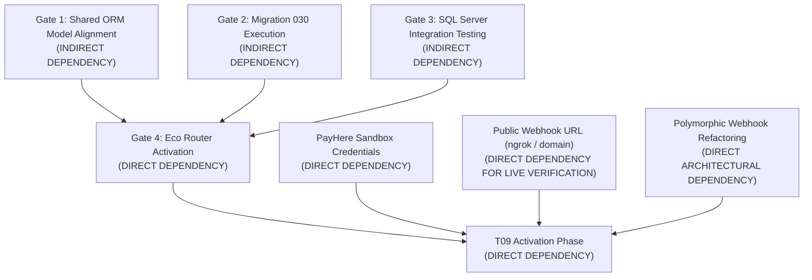

# T09: PayHere Online Payment Unblocking & Implementation Plan

**Document Version**: 1.0  
**Date**: 20 November 2026  
**Project**: `CeylonGo-Backend` (`develop` branch)  
**Requirement**: **T09 — Eco-Tourism Online Payment via PayHere**  
**Approval Owners**: Backend Team Leader / Project Lead  
**Readiness Status**: **BLOCKED — UNBLOCKING PLAN FORMULATED**  

---

## 1. Executive Summary

Requirement **T09 (Eco-Tourism Online Payment via PayHere)** has been classified as **BLOCKED** throughout Phases 1–5 because the backend architecture was constrained to `pay_at_location` to protect financial stability while booking lifecycles were being finalized.

This proposal establishes the exact dependency matrix, architectural refactoring, risk controls, and 5-stage roadmap required to safely unblock and activate T09.

---

## 2. Dependency Matrix (Direct vs. Indirect)



### A. Direct Dependencies (Must be resolved specifically for T09)
1. **Gate 4 (Booking Router Activation)**: Online checkout initiation cannot operate on unmounted or 503-guarded booking routes.
2. **Polymorphic Refactoring of `app/routers/payments.py`**:
   `POST /api/v1/payments/payhere/notify` must be refactored to inspect `BookingReference.module_type`. When `module_type == 'activity'`, it must update `ActivityBooking`, not `Booking` (Homestay).
3. **Lift Service Restriction in `app/services/eco_booking_service.py`**:
   Remove lines 181–189 that raise `ECO_ONLINE_PAYMENT_UNSUPPORTED`, allowing `payment_method='online'`.
4. **PayHere Sandbox Credentials**: Valid `PAYHERE_MERCHANT_ID` and `PAYHERE_MERCHANT_SECRET` must be configured in `.env`.
5. **Project Lead & Payment Integration Owner Sign-Off**: Formal authorization to process financial gateway callbacks.

### B. Indirect Dependencies (Foundational Database Integrity)
1. **Gate 1 (Shared ORM Alignment)**: Ensures participant entities can be persisted without SQL Server Error 207.
2. **Gate 2 (Migration 030)**: Ensures `dbo.activity_slots` can store Eco slots (`activity_id=NULL`) upon which bookings depend.
3. **Gate 3 (SQL Server Integration Testing)**: Verifies `sp_getapplock` and transaction rollback under concurrency.

### C. Non-Dependencies (Zero Action Needed)
- **Database Schema Changes**: **NONE**. Tables `dbo.payment_transactions`, `dbo.payment_refunds`, `dbo.booking_references`, and `dbo.activity_bookings` already have all required columns and constraints.

---

## 3. What Can Be Implemented Independently (Without Activating Payments)

The following components can be developed and unit-tested with mocks safely today without touching live databases or enabling financial payments:

1. **Author `app/services/eco_payment_service.py`**:
   - Helper to prepare PayHere checkout payload for an `ActivityBooking`.
   - Generates order reference, validates booking status (`pending`), and builds checkout parameters.
2. **Polymorphic IPN Dispatcher**:
   - Function `process_payhere_ipn(db, form_data)` that cleanly switches on `booking_ref.module_type` (`homestay` vs `activity`).
3. **Automated Mock-Based Unit Tests**:
   - `tests/test_eco_payhere_integration.py` testing signature validation, tampered amounts, status mapping, and duplicate IPN idempotency against SQLite / mocks.

---

## 4. Five-Stage Implementation Sequence to Unblock T09

### STAGE 1: Prerequisite Gates Completion
- Backend Team Leader approves Gate 1 (`docs/proposals/gate_1_shared_orm_approval_package.md`).
- Database Coordinator approves Gate 2 (`docs/proposals/gate_2_migration_030_approval_package.md`).
- QA Lead completes Gate 3 integration verification on disposable SQL Server.

### STAGE 2: Polymorphic Payment Webhook Refactoring
- Update `app/routers/payments.py` to support `module_type='activity'`:
  ```python
  if booking_ref.module_type == "activity":
      activity_booking = db.query(ActivityBooking).filter(ActivityBooking.id == booking_ref.target_booking_id).first()
      # Update activity_booking.payment_status = 'paid'
      # Dispatch Eco notifications
  elif booking_ref.module_type == "homestay":
      # Existing homestay logic
  ```
- Add merchant ID validation: `if merchant_id != payhere_service.merchant_id: raise HTTPException(400)`.

### STAGE 3: Eco Booking Service Enablement
- In `app/services/eco_booking_service.py`:
  - Permit `payload.payment_method in ('pay_at_location', 'online')`.
  - For `online`, set initial `payment_status = 'unpaid'` and `booking_status = 'pending'`.
- Implement `POST /api/v1/eco-bookings/{id}/initiate-payment` in `app/routers/eco_bookings.py`.

### STAGE 4: Automated Testing & Verification
- Execute `tests/test_eco_payhere_integration.py` (14 test scenarios).
- Verify IPN signature validation, duplicate delivery, and capacity release on payment failure.
- Run full Eco regression suite to ensure zero cross-module impact.

### STAGE 5: Gate 4 Router Mount & Activation
- Project Lead authorizes mounting `eco_bookings.router` in `app/main.py`.
- Configure PayHere sandbox credentials and verify live end-to-end checkout.
- Transition **T09** from **BLOCKED** to **COMPLETE**.

---

## 5. Risk Assessment & Mitigations

| Risk | Severity | Mitigation Strategy |
|---|:---:|---|
| Breaking Module 02 Homestay Webhooks | Critical | Retain existing homestay branch untouched; switch strictly on `booking_ref.module_type == 'activity'`. |
| Webhook Replay / Duplicate Injection | High | Acquire `sp_getapplock` on `booking_reference` during webhook execution; verify `tx.gateway_transaction_id` uniqueness. |
| Amount or Currency Spoofing | High | Strict Decimal comparison against `activity_booking.total_price` and `currency == 'LKR'`. |
| Incomplete Transaction Rollback | High | Wrap multi-table updates (`PaymentTransaction` + `ActivityBooking` + `Notification`) in an atomic transaction block. |
