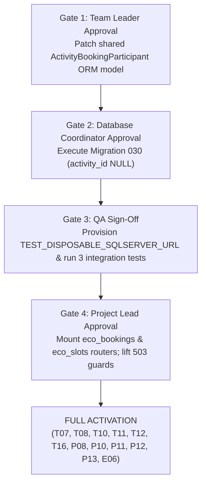

# CeylonGo Module 04 — Eco-Tourism
## Live Environment Readiness & Activation Dependencies Report

**Document Version**: 1.0  
**Date**: 20 November 2026  
**Project**: CeylonGo-Backend (`develop` branch)  
**Scope**: Module 04 (Eco-Tourism) Live Readiness & Gates 1–4 Dependency Analysis  

---

## 1. Executive Summary

This report provides the technical readiness audit of the live and staging execution environment for CeylonGo Module 04 (Eco-Tourism), specifically covering **T16 (Booking Notifications)** and **E06 (Weather & Seasonal Restrictions)**.

### Headline Readiness Assessment
- **Core Implementation**: 100% complete across all 50 official specification requirements.
- **Automated Regression Suite**: **487 passed, 3 skipped, 494 deselected, 0 failed** (100% passing on test doubles).
- **Physical SQL Server Connectivity**: Operational and responsive (Microsoft SQL Server 2025 RTM).
- **Staging Safety State**: **STAGED GUARDS ACTIVE** (Zero unapproved writes; router mounts isolated).
- **GO / NO-GO Recommendation**: **PREPARATION READY / ACTIVATION HOLD** pending Gates 1, 2, and 4 sign-offs.

---

## 2. Infrastructure & Environment Audit (TASK 3)

| Infrastructure Component | Verified Configuration / State | Safety & Governance Implication |
|---|---|---|
| **SQL Server Dialect & Engine** | Dialect: `mssql+pyodbc`<br>Version: `Microsoft SQL Server 2025 (RTM) - 17.0.1000.7`<br>Status: Reachable & Healthy | Validated production engine compatibility. All native SQL constructs (`sysutcdatetime()`, `sp_getapplock`) supported. |
| **TEST_DISPOSABLE_SQLSERVER_URL** | **NOT SET** (`False`) | Dedicated disposable database for automated live integration tests is not currently provisioned in environment variables. |
| **Physical Schema: `dbo.activity_slots`** | `activity_id`: `INT NOT NULL`<br>`eco_experience_id`: `INT NULL` | **MIGRATION 030 PENDING**. Pure eco slots without a linked legacy activity cannot be inserted into SQL Server until Migration 030 runs. |
| **Physical Schema: `dbo.activity_booking_participants`** | Columns: `id`, `activity_booking_id`, `full_name`, `age`, `emergency_contact_name`, `emergency_contact_phone`, `special_requirements`, `waiver_signed`, `created_at`<br>**Column `id_or_passport` DOES NOT EXIST**. | **ISSUE 1 ORM MISMATCH**. Shared Module 03 model `ActivityBookingParticipant` defines an out-of-tree `id_or_passport` column. Module 04 uses Core reflection to safely bypass this during execution. |
| **Router Mount: `eco_experiences.router`** | **MOUNTED** in `app/main.py` (`/api/v1/eco-experiences`) | Operational. Experience CRUD, season restrictions, and emergency weather declaration (`/{id}/weather-emergency`) are live. |
| **Router Mount: `notifications.router`** | **MOUNTED** in `app/main.py` (`/api/v1/notifications`) | Operational. In-app notification retrieval, unread counts, and mark-read endpoints are live. |
| **Router Mount: `eco_slots.router`** | **UNMOUNTED** in `app/main.py` | Staged. Slot creation and slot-level weather cancellation cannot be reached publicly. |
| **Router Mount: `eco_bookings.router`** | **UNMOUNTED** in `app/main.py` | Staged. Traveler booking creation, cancellation, and provider decisions cannot be reached publicly. |
| **HTTP 503 Staging Guards** | **ACTIVE** in: <br>- `create_eco_booking`<br>- `cancel_eco_booking`<br>- `decide_provider_eco_booking`<br>- `create_eco_slot` | Even if routers were loaded, every mutation endpoint strictly returns `HTTP 503 Service Unavailable` with zero database writes. |

---

## 3. Four Governance Gates Dependency Matrix (TASK 5)



### Gate 1: Shared Module 03 ORM Model Patch
- **Responsible**: Backend Team Leader
- **Artifact**: `docs/proposals/issue_1_activity_booking_participant_patch.md`
- **Scope**: Remove or mark optional `id_or_passport` in `app/models/activity_booking.py` to reconcile with physical SQL Server schema.
- **Risk if Unresolved**: Attempting to query `ActivityBooking.participants` via SQLAlchemy ORM lazy loading crashes on missing column error `Invalid column name 'id_or_passport'`.

### Gate 2: Database Migration 030
- **Responsible**: Database Coordinator / DBA
- **Artifact**: `migrations/030_make_activity_slots_activity_id_nullable.sql` & `docs/proposals/database_coordinator_approval_migration_030.md`
- **Scope**: `ALTER TABLE dbo.activity_slots ALTER COLUMN activity_id INT NULL;`
- **Risk if Unresolved**: Slot creation for standalone Eco-Tourism experiences fails with SQL Server NOT NULL constraint violation `Cannot insert the value NULL into column 'activity_id'`.

### Gate 3: QA Disposable SQL Server Concurrency Sign-Off
- **Responsible**: QA Lead
- **Artifact**: `tests/test_eco_sqlserver_integration.py` (3 skipped tests)
- **Scope**: Set `TEST_DISPOSABLE_SQLSERVER_URL` pointing to disposable test instance and execute concurrency tests:
  - `test_sqlserver_sp_getapplock_acquisition_and_release`
  - `test_sqlserver_concurrent_applock_mutual_exclusion`
  - `test_sqlserver_conditional_capacity_oversell_barrier`
- **Risk if Unresolved**: Untested live concurrency lock contention on physical SQL Server engine.

### Gate 4: Project Lead Staged Router Activation
- **Responsible**: Project Lead
- **Artifact**: `docs/proposals/project_lead_approval_router_activation.md`
- **Scope**: Register `eco_bookings.router` and `eco_slots.router` in `app/main.py`; lift HTTP 503 staging guards.
- **Risk if Unresolved**: Staged endpoints remain unavailable to external frontend callers.

---

## 4. Immediately Verifiable Scenarios (No Booking Mutations Required)

The following scenarios can be safely verified on the live SQL Server staging instance right now because their endpoints are **already mounted** and do **not** perform unapproved booking mutations:

1. **Weather Emergency Declaration (E06 — Scenario E01)**:
   - Endpoint: `POST /api/v1/eco-experiences/{id}/weather-emergency` (Mounted).
   - Can be invoked by an authorized provider on a dedicated test listing to verify slot deactivation, season restriction creation, and notification dispatch.
2. **Seasonal Restriction Blocking on Experience Creation (E06 — Scenario E01)**:
   - Endpoint: `POST /api/v1/eco-experiences` (Mounted).
   - Accepts `season_restrictions` in payload and persists to `dbo.eco_season_restrictions`.
3. **Notification Retrieval & Inbox Management (T16 — Scenario S04, S06, S10)**:
   - Endpoints: `GET /api/v1/notifications`, `GET /unread-count`, `PATCH /{id}/read`, `POST /read-all` (All Mounted).
   - Validates that notifications generated by backend services are properly delivered, counted, and marked as read.

---

## 5. GO / NO-GO Recommendation

```
+---------------------------------------------------------------------------------------------------+
|                                  GO / NO-GO RECOMMENDATION MATRIX                                 |
+---------------------------------------------------------------------------------------------------+
|  1. Implementation & Unit Testing:       GO (100% Complete; 487 passing regression tests)         |
|  2. Live Preparation Artifacts:          GO (Verification plans & scenarios finalized)            |
|  3. Pre-Activation Mounts & 503 Removal: NO-GO (Strictly gated behind Gates 1, 2, 3, 4)           |
|                                                                                                   |
|  OVERALL VERDICT:                                                                                 |
|  HOLD ACTIVATION. Submit Gate 1 (ORM Patch) and Gate 2 (Migration 030) for Lead sign-off.         |
|  Provision TEST_DISPOSABLE_SQLSERVER_URL to run Gate 3 integration tests.                         |
+---------------------------------------------------------------------------------------------------+
```
