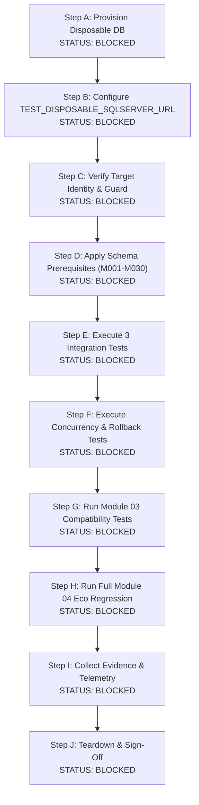

# Gate 3: Disposable SQL Server QA Execution Runbook

**Document Version**: 1.0  
**Date**: 20 November 2026  
**Project**: `CeylonGo-Backend` (`develop` branch)  
**Execution Target**: Dedicated Disposable Microsoft SQL Server Instance  
**Lead Roles**: QA Lead / Database Coordinator / DevOps Engineer  
**Status**: **PREPARED — EXECUTION BLOCKED (Awaiting Provisioning & Sign-Off)**  

---

## 1. Overview & Execution Principles

This runbook provides the mandatory step-by-step operational procedure for executing Gate 3 SQL Server integration and concurrency testing.

### Strict Governance Rules:
- **Zero-Write Rule on `CeylonGoDB`**: Never execute tests, DDL, or migrations against `CeylonGoDB`.
- **Fail-Closed Gate Preconditions**: Execution cannot begin until Gate 1 (Backend Team Leader) and Gate 2 (Database Coordinator) approvals are formally granted.
- **Status Classification Definitions**:
  - `[PREPARED]`: Test cases, runbook steps, and safety checks designed, reviewed, and ready.
  - `[EXECUTED]`: Steps physically carried out by QA / DBA during test execution.
  - `[PASSED]`: Executed steps that met 100% of assertion and criteria benchmarks.
  - `[FAILED]`: Executed steps that encountered runtime errors, test failures, or timeouts.
  - `[BLOCKED]`: Steps awaiting prerequisite approvals or infrastructure provisioning.

---

## 2. Step-by-Step QA Execution Runbook



---

### STEP A: Provision an Isolated Disposable SQL Server Database
- **Action**: Database Coordinator provisions an ephemeral, isolated SQL Server database named `CeylonGoDB_IntegrationTest` (or `CeylonGoDB_Disposable_QA`).
- **Authorization Required**: Database Coordinator & Lead DBA.
- **SQL Server Commands**:
  ```sql
  IF NOT EXISTS (SELECT 1 FROM sys.databases WHERE name = 'CeylonGoDB_IntegrationTest')
  BEGIN
      CREATE DATABASE [CeylonGoDB_IntegrationTest];
  END
  ```
- **Credential Setup**: Create dedicated test login `ceylongo_test_runner` mapped only to `CeylonGoDB_IntegrationTest` with roles `db_datareader`, `db_datawriter`, `db_ddladmin`. Deny access to `CeylonGoDB`.
- **Current Status**: **[BLOCKED]** (Awaiting formal Gate 2 sign-off and DBA action).

---

### STEP B: Configure `TEST_DISPOSABLE_SQLSERVER_URL` Securely
- **Action**: Export the connection string in the test execution environment only.
- **Security Rule**: Do NOT commit connection string or credentials to git, `.env`, or persistent config files.
- **Environment Setting (PowerShell Example)**:
  ```powershell
  $env:TEST_DISPOSABLE_SQLSERVER_URL = "mssql+pyodbc://ceylongo_test_runner:<REDACTED>@.\SQLEXPRESS/CeylonGoDB_IntegrationTest?driver=ODBC+Driver+18+for+SQL+Server&TrustServerCertificate=yes"
  ```
- **Current Status**: **[BLOCKED]** (Awaiting Step A).

---

### STEP C: Verify Target Server and Database Identity
- **Action**: Execute preflight identity check using `app.core.database_guard`.
- **Validation Script (Implemented in Phase 5J)**:
  ```python
  import os
  from app.core.database_guard import (
      validate_disposable_sqlserver_url,
      create_safe_sqlserver_test_engine,
      DatabaseSafetyError,
  )

  raw_url = os.environ["TEST_DISPOSABLE_SQLSERVER_URL"]
  target_db = validate_disposable_sqlserver_url(raw_url)

  # Factory attaches runtime checkout guard and executes preflight SELECT DB_NAME()
  engine = create_safe_sqlserver_test_engine(raw_url)
  print(f"Verified guarded connection to {engine.url.host} / {target_db}")
  ```
- **Assertion**: Automatically raises `DatabaseSafetyError` before engine creation if URL is `CeylonGoDB`, system database, unapproved, ambiguous, or malformed.
- **Current Status**: **[IMPLEMENTED & TESTED]** (18 unit tests verified in `tests/test_eco_sqlserver_test_safety.py`).

---

### STEP D: Apply Approved Schema Prerequisites to Disposable Database Only
- **Action**: Run schema creation migrations (Migrations 001 through 029, plus Migration 030) exclusively against `CeylonGoDB_IntegrationTest`.
- **Prerequisites**:
  - Gate 1 patch applied to ORM model `ActivityBookingParticipant`.
  - Gate 2 script `migrations/030_make_activity_slots_activity_id_nullable.sql` executed against disposable database.
- **Validation**: Confirm `activity_id` in disposable `dbo.activity_slots` is nullable (`IS_NULLABLE = 'YES'`) and constraint `CK_activity_slots_parent_target` is active.
- **Current Status**: **[BLOCKED]** (Awaiting Gate 1 & Gate 2 approvals).

---

### STEP E: Execute the Three SQL Server Integration Tests
- **Action**: Run the primary integration test suite:
  ```bash
  pytest tests/test_eco_sqlserver_integration.py -v
  ```
- **Tests Evaluated**:
  1. `test_sqlserver_sp_getapplock_acquisition_and_release`: Verify synchronous acquisition and release codes.
  2. `test_sqlserver_concurrent_applock_mutual_exclusion`: Verify mutual exclusion and 1000ms timeout.
  3. `test_sqlserver_conditional_capacity_oversell_barrier`: Verify atomic conditional update rejection (`rowcount == 0`).
- **Benchmark**: **3 passed, 0 failed, 0 skipped**.
- **Current Status**: **[PREPARED]** (Currently skipped due to unset URL).

---

### STEP F: Execute Additional Concurrency & Rollback Tests
- **Action**: Run the expanded concurrency suite against `CeylonGoDB_IntegrationTest`:
  - `test_sqlserver_atomic_booking_creation_and_participant_persistence`
  - `test_sqlserver_transaction_rollback_on_participant_error`
  - `test_sqlserver_concurrent_booking_race_condition_last_seat`
  - `test_sqlserver_concurrent_booking_cancellation_race`
  - `test_sqlserver_idempotent_weather_emergency_cancellation`
- **Assertion**:
  - Exactly one thread books the final seat; second thread fails with `ECO_CAPACITY_EXCEEDED` or `ECO_LOCK_TIMEOUT`.
  - Participant validation failure rolls back the booking and restores slot capacity.
- **Current Status**: **[PREPARED]** (Test specifications drafted in test matrix).

---

### STEP G: Run Module 03 Compatibility Tests
- **Action**: Run Module 03 activity slot and booking regression tests:
  ```bash
  pytest tests/test_activities.py -v
  ```
- **Assertion**: Zero regressions in Module 03 activity scheduling. Constraint `CK_activity_slots_parent_target` correctly allows `activity_id IS NOT NULL, eco_experience_id IS NULL`.
- **Current Status**: **[PREPARED]**.

---

### STEP H: Run Full Module 04 Eco Regression Suite
- **Action**: Execute the full Eco test suite to ensure comprehensive cross-module stability:
  ```bash
  pytest -k "eco" -v
  ```
- **Benchmark**: **490 passed** (487 existing unit tests + 3 integration tests), **0 failed, 0 skipped**.
- **Current Status**: **[PREPARED]** (487 passed in dry-run baseline).

---

### STEP I: Collect Test Logs & SQL Server Evidence
- **Action**: Export test logs, deadlock graphs (if any), and SQL Server lock telemetry.
- **Evidence Output**:
  - Test runner output log (`pytest_gate3_results.log`).
  - Active lock telemetry report (`sys.dm_tran_locks`).
  - Table verification query output (`dbo.activity_slots`, `dbo.activity_bookings`).
- **Current Status**: **[PREPARED]**.

---

### STEP J: Clean Up Disposable Test Records & Produce QA Sign-Off
- **Action**:
  - Drop all test rows or drop the entire disposable database `CeylonGoDB_IntegrationTest`.
  - Unset environment variable: `Remove-Item Env:\TEST_DISPOSABLE_SQLSERVER_URL`.
  - Compile the formal **Gate 3 QA Sign-Off Package** for Project Lead review.
- **Current Status**: **[PREPARED]**.

---

## 3. Governance & Responsibility Matrix

| Step | Role Responsible | Approver | Execution Condition |
|:---:|---|---|---|
| **A** | Lead DBA | Database Coordinator | Gates 1 & 2 signed off |
| **B** | DevOps Engineer | QA Lead | Step A verified |
| **C** | QA Engineer | QA Lead | Step B completed |
| **D** | Lead DBA | Database Coordinator | Gate 2 script approved |
| **E** | QA Engineer | QA Lead | Step D verified |
| **F** | QA Engineer | Backend Team Leader | Step E passed |
| **G** | QA Engineer | Module 03 Lead | Step F passed |
| **H** | QA Engineer | QA Lead | Step G passed |
| **I** | QA Engineer | QA Lead | Step H passed |
| **J** | QA Lead | **Project Lead** | Steps A–I passed |
