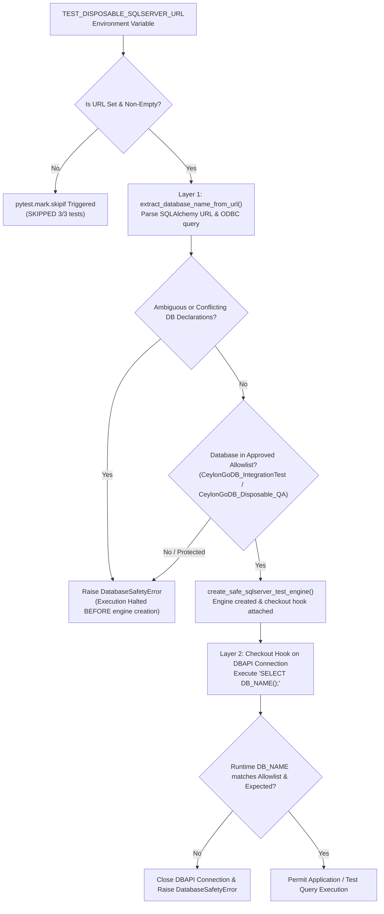

# Gate 3: SQL Server Integration Test Safety Hardening Implementation

**Document Version**: 1.0  
**Date**: 20 November 2026  
**Project**: `CeylonGo-Backend` (`develop` branch)  
**Target Module**: `app/core/database_guard.py` & `tests/test_eco_sqlserver_integration.py`  
**Test Suite**: `tests/test_eco_sqlserver_test_safety.py`  
**Status**: **IMPLEMENTED & VERIFIED (Zero Database Mutation)**  

---

## 1. Executive Summary & Objective

Phase 5J implements and verifies fail-closed database safety protections for the disposable SQL Server integration test suite. Prior to this phase, `tests/test_eco_sqlserver_integration.py` relied solely on `pytest.mark.skipif` when `TEST_DISPOSABLE_SQLSERVER_URL` was unset, but lacked defense-in-depth protections if an operator configured an unsafe URL pointing to `CeylonGoDB` or an unapproved database.

The implementation introduces:
1. **Static URL & ODBC Connection String Validation**: Prevents engine creation if the target database is `CeylonGoDB`, a system database, unapproved, ambiguous, or malformed.
2. **Credential Sanitization**: Prevents passwords and credentials from leaking into error messages or exception strings.
3. **Runtime `DB_NAME()` Checkout Hook**: Attaches a low-level checkout event listener to the SQLAlchemy connection pool, executing `SELECT DB_NAME();` directly on the physical connection before any application/test query can execute.
4. **Automated Unit Test Suite**: 18 comprehensive unit tests in `tests/test_eco_sqlserver_test_safety.py` covering all edge cases using mocks/fakes with zero connection to real SQL Server.

---

## 2. Implemented Guard Architecture



---

## 3. Allowed and Protected Database Specifications

### A. Approved Disposable Database Allowlist
Strictly limited to:
- `CeylonGoDB_IntegrationTest` (case-insensitive)
- `CeylonGoDB_Disposable_QA` (case-insensitive)

```python
APPROVED_INTEGRATION_DATABASES: frozenset[str] = frozenset({
    "ceylongodb_integrationtest",
    "ceylongodb_disposable_qa",
})
```

### B. Explicitly Protected Databases (Always Rejected)
- `CeylonGoDB` (Production & primary development database)
- `master` (SQL Server system database)
- `tempdb` (SQL Server system database)
- `model` (SQL Server system database)
- `msdb` (SQL Server system database)

```python
PROTECTED_DATABASES: frozenset[str] = frozenset({
    "ceylongodb",
    "master",
    "tempdb",
    "model",
    "msdb",
})
```

---

## 4. URL & ODBC Connection String Parsing Behavior

Function: `extract_database_name_from_url(raw_url: str | None) -> str` in `app/core/database_guard.py`.

1. **Missing or Empty URL**:
   Raises `DatabaseSafetyError: Target database connection URL is unspecified or empty.`
2. **Malformed URLs**:
   Caught by `make_url` parser; raises `DatabaseSafetyError: Malformed database connection URL: '<sanitized>'`.
3. **Multi-Source Extraction**:
   - Inspects URL path (`url_obj.database`).
   - Inspects direct query parameters (`?database=...` or `?db=...`).
   - Parses ODBC connection strings (`?odbc_connect=...`) by splitting on `;` and extracting `DATABASE=` and `DB=` tokens.
4. **Conflicting Parameter Rejection**:
   - If an ODBC string contains multiple conflicting `DATABASE=` tokens, raises `DatabaseSafetyError`.
   - If URL path specifies `DB_A` and ODBC connection string specifies `DB_B`, raises `DatabaseSafetyError: Ambiguous database selection with conflicting database declarations: url_path='DB_A', odbc_connect='DB_B'.`
5. **Credential Masking**:
   Any URL formatted into error messages is sanitized via `sanitize_url_for_logging`, masking `user:password@` as `user:***@` and `PWD=secret;` as `PWD=***;`.

---

## 5. Runtime Database Identity Verification

Function: `attach_runtime_database_guard(engine: Engine, ...) -> None` in `app/core/database_guard.py`.

- Hook: `@event.listens_for(engine, "checkout")`.
- Execution: Direct execution via `dbapi_connection.cursor()` with query `SELECT DB_NAME();`.
  - **Zero Recursion**: Operates directly on the raw DBAPI cursor, bypassing SQLAlchemy session/connection recursion.
  - **Immediate Termination**: If the active database is empty, targets `CeylonGoDB`, targets a system database, does not match `APPROVED_INTEGRATION_DATABASES`, or does not match `expected_db`, the hook executes `dbapi_connection.close()` and raises `DatabaseSafetyError`.
  - **Connection Disposal**: Prevents the poisoned connection from executing application queries or returning cleanly to the pool.

---

## 6. Test Suite Coverage (18 Focused Unit Tests)

Located in `tests/test_eco_sqlserver_test_safety.py`:

| # | Test Name | Purpose / Assertion | Result |
|:---:|---|---|:---:|
| 1 | `test_safety_01_missing_test_url` | `None` URL raises `DatabaseSafetyError` | **PASSED** |
| 2 | `test_safety_02_empty_test_url` | Empty/whitespace string raises `DatabaseSafetyError` | **PASSED** |
| 3 | `test_safety_03_valid_allowlisted_databases` | `CeylonGoDB_IntegrationTest` & `CeylonGoDB_Disposable_QA` accepted | **PASSED** |
| 4 | `test_safety_04_case_insensitive_allowlist_matching` | Lowercase/uppercase casing variants accepted | **PASSED** |
| 5 | `test_safety_05_protected_ceylongodb_rejection` | `CeylonGoDB` in standard or ODBC URL raises Live DB Violation | **PASSED** |
| 6 | `test_safety_06_sqlserver_system_database_rejection` | `master`, `tempdb`, `model`, `msdb` rejected | **PASSED** |
| 7 | `test_safety_07_unknown_database_rejection` | Unknown databases (`ProductionDB`, `TestDB`, etc.) rejected | **PASSED** |
| 8 | `test_safety_08_missing_database_component` | Missing database segment in URL or ODBC string fails closed | **PASSED** |
| 9 | `test_safety_09_malformed_sqlalchemy_url` | Invalid URL syntax raises sanitized `DatabaseSafetyError` | **PASSED** |
| 10 | `test_safety_10_odbc_connection_string_with_database_parameter` | Correctly resolves `DATABASE=` and `DB=` in ODBC query | **PASSED** |
| 11 | `test_safety_11_odbc_conflicting_database_parameters` | Conflicting internal ODBC `DATABASE=` tokens rejected | **PASSED** |
| 12 | `test_safety_12_conflicting_database_declarations` | URL path vs ODBC query conflict rejected | **PASSED** |
| 13 | `test_safety_13_no_fallback_to_database_url` | Never falls back to `DATABASE_URL` or `DB_NAME` in `.env` | **PASSED** |
| 14 | `test_safety_14_runtime_dbname_mismatch` | Runtime `DB_NAME()` mismatch against expected URL database rejected | **PASSED** |
| 15 | `test_safety_15_runtime_protected_database_rejection` | Runtime `DB_NAME()` returning `CeylonGoDB` closed & rejected | **PASSED** |
| 16 | `test_safety_16_engine_session_cleanup_on_guard_failure` | DBAPI connection `close()` explicitly called on guard failure | **PASSED** |
| 17 | `test_safety_17_no_database_connection_for_rejected_urls` | `create_engine` never called for rejected URLs | **PASSED** |
| 18 | `test_safety_18_no_credential_leakage_in_errors_or_logs` | Passwords masked in URL and ODBC strings; zero credential leakage | **PASSED** |

---

## 7. Remaining Limitations & QA Provisioning Requirements

1. **Live SQL Server Testing Still Blocked**:
   Physical execution against `CeylonGoDB_IntegrationTest` remains blocked until:
   - Gate 1 approval (Backend Team Leader sign-off on `ActivityBookingParticipant`).
   - Gate 2 approval (Database Coordinator sign-off on Migration 030).
   - DBA provisions `CeylonGoDB_IntegrationTest` with dedicated user `ceylongo_test_runner`.
2. **Active Testing Environment**:
   When provisioned, test runner must be invoked with:
   ```powershell
   $env:TEST_DISPOSABLE_SQLSERVER_URL = "mssql+pyodbc://ceylongo_test_runner:<PASSWORD>@localhost/CeylonGoDB_IntegrationTest?driver=ODBC+Driver+18+for+SQL+Server&TrustServerCertificate=yes"
   pytest tests/test_eco_sqlserver_integration.py -v
   ```
   If `$env:TEST_DISPOSABLE_SQLSERVER_URL` points to `CeylonGoDB`, the guard immediately raises `DatabaseSafetyError` and tests fail without modifying the database.
