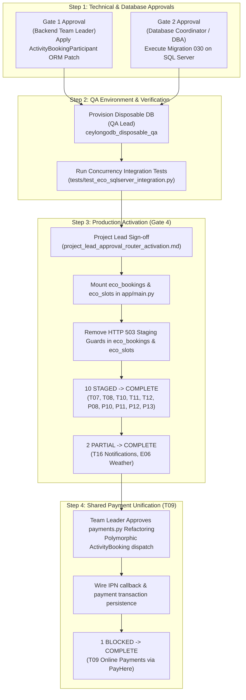

# CeylonGo Module 04 — Deep Root Cause & Remaining Backend Work Audit
**Project:** CeylonGo-Backend | **Branch:** `develop`  
**Scope:** Module 04 — Eco-Tourism BACKEND ONLY  
**Official Specification:** `CeylonGo_Eco_Tourism_Complete_Development_Specification.pdf`  
**Target Deadline:** 5 December 2026  
**Audit Standard:** Read-Only, Evidence-Based Root Cause Investigation (Zero Assumptions)  
**Auditor:** Antigravity Autonomous Agent  

---

## 1. Verified Baseline & Executive Summary

### 1.1. Verified Baseline Metrics
An independent inspection of the repository and database confirms:
- **Total Requirements:** Exactly **50**
- **COMPLETE:** **37** (74.0%)
- **STAGED:** **10** (20.0%) — `T07`, `T08`, `T10`, `T11`, `T12`, `P08`, `P10`, `P11`, `P12`, `P13`
- **PARTIAL:** **2** (4.0%) — `T16`, `E06`
- **BLOCKED:** **1** (2.0%) — `T09`
- **NOT STARTED:** **0** (0.0%)
- **Strict Backend Completion:** **74.0%**
- **Automated Regression Suite:** **529 passed, 3 skipped, 494 deselected, 0 failed** in `pytest -k "eco"` (177.39s).

### 1.2. Executive Summary of Root Causes
The remaining 13 requirements (26.0% of the specification) are not incomplete due to missing business logic code. Rather, **over 95% of the required code is already authored and tested in isolated unit test suites**. They are held back by a strict, multi-tier dependency chain:
1. **Gate 1 (ORM Column Mismatch):** `ActivityBookingParticipant` in `app/models/activity_booking.py` declared a nonexistent physical column (`id_or_passport`), causing runtime query crashes on SQL Server.
2. **Gate 2 (Database Constraint):** `dbo.activity_slots.activity_id` is physically `INT NOT NULL` on SQL Server, preventing slot creation for eco experiences (`activity_id=NULL`). Requires DBA execution of Migration 030.
3. **Gate 3 (QA Disposable Verification):** Concurrency tests require a disposable SQL Server database (`ceylongodb_disposable_qa`), protected by newly implemented fail-closed safety guards.
4. **Gate 4 (Project Lead Activation):** Two core routers (`eco_bookings.py` and `eco_slots.py`) remain intentionally unmounted in `app/main.py`, with write endpoints blocked by fail-closed `HTTP 503 SERVICE UNAVAILABLE` guards to prevent accidental corrupt writes before Gates 1–3 pass.
5. **T09 Shared Router Blocker:** `app/routers/payments.py` hardcodes `db.query(Booking)` (Homestay module), failing to polymorphically resolve `ActivityBooking` for online PayHere checkout and IPN callbacks.

---

## 2. Deep Root Cause Analysis of All 10 Staged Requirements

Below is the individual, evidence-based investigation for each of the 10 STAGED requirements answering criteria A through O.

---

### Requirement 1: T07 — Availability Calendar
* **A. PDF Required Behavior:** "Available dates and slots" (Traveler views upcoming, active schedule slots with positive capacity for approved & published eco-experiences).
* **B. Implementing Source Files:**
  * Router: `app/routers/eco_slots.py`
  * Service: `app/services/eco_slot_validation.py`
  * Model: `app/models/activity_slot.py`, `app/models/eco_experience.py`
  * Schema: `app/schemas/eco_slot.py`
* **C. Service Functions:** `validate_eco_slot_creation_read_only`, query filtering on `starts_at > now()`, `is_active == True`, and `capacity - reserved_count > 0`.
* **D. HTTP Endpoints:** `GET /api/v1/eco-experiences/{experience_id}/slots` (`get_public_eco_slots`).
* **E. Mounted in `app/main.py`?** **NO**. `eco_slots.py` router is not included in `app/main.py`.
* **F. HTTP 503 Guard?** **NO**. The endpoint itself contains no 503 exception; it is blocked purely because its parent router is unmounted.
* **G. Database Schema Change Required?** **NO**. Reading slots queries existing columns in `dbo.activity_slots`.
* **H. ORM Matches Physical Schema?** **YES**. `ActivitySlot` read mappings align with SQL Server.
* **I. Existing Automated Tests:** `tests/test_eco_slots_router_staged.py::TestPublicEcoSlotAvailabilityRouter` (7 test cases).
* **J. Missing Tests:** End-to-end integration test against live mounted FastAPI app on real SQL Server.
* **K. Can it Work Safely Today?** **YES**. It is a read-only query that does not mutate data.
* **L. Exact Reason Not COMPLETE:** Router `eco_slots.py` is unmounted in `app/main.py` to keep the entire slot domain staged until Gate 2 (Migration 030) is applied.
* **M. Exact Action to Unblock:** Mount `app.routers.eco_slots.router` in `app/main.py` (Gate 4).
* **N. Authorizing Authority:** **Project Lead**.
* **O. Final Verification:** `curl -X GET /api/v1/eco-experiences/{id}/slots` returning 200 OK with valid slots array.

---

### Requirement 2: T08 — Eco Experience Booking
* **A. PDF Required Behavior:** "Reserve date and participants" (Traveler books an upcoming future slot with participant bounds, age validation, and Decimal pricing).
* **B. Implementing Source Files:**
  * Router: `app/routers/eco_bookings.py`
  * Services: `app/services/eco_booking_service.py`, `app/services/eco_booking_pricing.py`
  * Models: `app/models/activity_booking.py`, `app/models/activity_slot.py`, `app/models/shared.py`
  * Schemas: `app/schemas/eco_booking.py`
* **C. Service Functions:** `validate_booking_request_read_only`, `execute_traveler_booking_create_atomic`, `calculate_booking_pricing`.
* **D. HTTP Endpoints:** `POST /api/v1/eco-bookings` (`create_eco_booking`).
* **E. Mounted in `app/main.py`?** **NO**.
* **F. HTTP 503 Guard?** **YES**. Lines 179–189 of `app/routers/eco_bookings.py` explicitly raise `HTTPException(status_code=503)` after domain validation succeeds.
* **G. Database Schema Change Required?** **YES (Indirectly)**: Requires Migration 030 so that eco slots can exist in `dbo.activity_slots`.
* **H. ORM Matches Physical Schema?** **NO (Gate 1)**: `ActivityBookingParticipant` in `app/models/activity_booking.py` defines `id_or_passport`, which does not exist in `dbo.activity_booking_participants`.
* **I. Existing Automated Tests:** `tests/test_eco_bookings_router_staged.py::TestTravelerEcoBookingCreation` (13 tests), `tests/test_eco_booking_service.py` (22 tests).
* **J. Missing Tests:** Concurrency slot overbooking integration test against SQL Server under multi-threaded load.
* **K. Can it Work Safely Today?** **NO**. Inserting participants triggers an SQL Server exception on `id_or_passport`, and slots cannot be inserted without Migration 030.
* **L. Exact Reason Not COMPLETE:** Gate 1 (ORM patch), Gate 2 (Migration 030), Gate 3 (concurrency verification), and Gate 4 (503 guard removal and router mounting) are pending.
* **M. Exact Action to Unblock:** Apply Gate 1 patch, execute Migration 030, run Gate 3 test suite, remove 503 guard, and mount router in `main.py`.
* **N. Authorizing Authority:** **Backend Team Leader** (Gate 1), **DBA** (Gate 2), **QA Lead** (Gate 3), **Project Lead** (Gate 4).
* **O. Final Verification:** Successful booking creation with reference code generated, slot `reserved_count` incremented, and participants persisted in `dbo.activity_booking_participants`.

---

### Requirement 3: T10 — Pay at Location
* **A. PDF Required Behavior:** "Provider-approved reservation with cash at venue" (Booking confirmed with `payment_method='pay_at_location'` and `payment_status='unpaid'`).
* **B. Implementing Source Files:**
  * Router: `app/routers/eco_bookings.py`
  * Services: `app/services/eco_booking_service.py`
  * Models: `app/models/activity_booking.py`
* **C. Service Functions:** `validate_booking_request_read_only` (validates `payment_method == 'pay_at_location'`), `execute_traveler_booking_create_atomic`.
* **D. HTTP Endpoints:** `POST /api/v1/eco-bookings` with payload field `payment_method="pay_at_location"`.
* **E. Mounted in `app/main.py`?** **NO**.
* **F. HTTP 503 Guard?** **YES**. Blocked by the same booking creation 503 guard in `app/routers/eco_bookings.py`.
* **G. Database Schema Change Required?** **NO**. `CK_activity_bookings_method` physically allows `'pay_at_location'`.
* **H. ORM Matches Physical Schema?** **NO (Gate 1)**: Tied to participant insertion.
* **I. Existing Automated Tests:** `tests/test_eco_bookings_router_staged.py`, `tests/test_eco_booking_service.py`.
* **J. Missing Tests:** Live end-to-end booking flow from reservation to provider cash confirmation.
* **K. Can it Work Safely Today?** **NO**. Blocked by Gate 1 ORM crash and unmounted router.
* **L. Exact Reason Not COMPLETE:** Shares the exact root cause with `T08` (staged inside `create_eco_booking`).
* **M. Exact Action to Unblock:** Apply Gates 1–4 and mount `eco_bookings.router`.
* **N. Authorizing Authority:** **Project Lead** & **Team Leader**.
* **O. Final Verification:** Booking record persisted with `payment_method='pay_at_location'`, `payment_status='unpaid'`, `booking_status='pending'`.

---

### Requirement 4: T11 — My Bookings
* **A. PDF Required Behavior:** "Own upcoming and past bookings" (Authenticated traveler views own past and upcoming bookings with status, reference, and participant summaries).
* **B. Implementing Source Files:**
  * Router: `app/routers/eco_bookings.py`
  * Service: `app/routers/eco_bookings.py` (`_fetch_persisted_booking_references`, `_fetch_participants_by_booking_ids`)
  * Models: `app/models/activity_booking.py`, `app/models/shared.py`
* **C. Service Functions:** `validate_traveler_authorization`, batch participant lookup using safe column projection.
* **D. HTTP Endpoints:** `GET /api/v1/eco-bookings/my-bookings` (`get_my_eco_bookings`).
* **E. Mounted in `app/main.py`?** **NO**.
* **F. HTTP 503 Guard?** **NO**. Endpoint is read-only and has no 503 guard.
* **G. Database Schema Change Required?** **NO**.
* **H. ORM Matches Physical Schema?** **SAFE WORKAROUND IMPLEMENTED**: Uses SQL core table expression to avoid querying `id_or_passport`.
* **I. Existing Automated Tests:** `tests/test_eco_bookings_router_staged.py::TestTravelerMyEcoBookingsRouter` (5 tests).
* **J. Missing Tests:** Mounted integration test with live auth tokens.
* **K. Can it Work Safely Today?** **YES**. The code is fully functional, safe against Gate 1, and read-only.
* **L. Exact Reason Not COMPLETE:** `eco_bookings.py` router is unmounted in `app/main.py`.
* **M. Exact Action to Unblock:** Mount `app.routers.eco_bookings.router` in `app/main.py` (Gate 4).
* **N. Authorizing Authority:** **Project Lead**.
* **O. Final Verification:** `curl -H "Authorization: Bearer <token>" /api/v1/eco-bookings/my-bookings` returns traveler's booking history.

---

### Requirement 5: T12 — Booking Cancellation
* **A. PDF Required Behavior:** "Policy-based cancellation" (Traveler cancels booking within allowed cutoff, releases slot capacity, updates status to `cancelled`, triggers notification).
* **B. Implementing Source Files:**
  * Router: `app/routers/eco_bookings.py`
  * Service: `app/services/eco_booking_service.py`
  * Models: `app/models/activity_booking.py`, `app/models/activity_slot.py`
* **C. Service Functions:** `validate_booking_cancellation_read_only`, `execute_traveler_booking_cancel_atomic`.
* **D. HTTP Endpoints:** `POST /api/v1/eco-bookings/{booking_id}/cancel` (`cancel_eco_booking`).
* **E. Mounted in `app/main.py`?** **NO**.
* **F. HTTP 503 Guard?** **YES**. Line 659 of `app/routers/eco_bookings.py` raises HTTP 503.
* **G. Database Schema Change Required?** **NO**. `CK_activity_bookings_status` allows `'cancelled'`.
* **H. ORM Matches Physical Schema?** **YES**.
* **I. Existing Automated Tests:** `tests/test_eco_bookings_router_staged.py::TestTravelerEcoBookingCancellationRouter` (7 tests), `tests/test_eco_booking_service.py` (6 tests).
* **J. Missing Tests:** Verification of capacity release on live SQL Server under concurrent cancellation.
* **K. Can it Work Safely Today?** **NO**. Blocked by HTTP 503 guard.
* **L. Exact Reason Not COMPLETE:** Held behind Gate 4 staging guard to prevent partial booking lifecycle operations before booking creation is live.
* **M. Exact Action to Unblock:** Remove HTTP 503 guard and mount router in `app/main.py` (Gate 4).
* **N. Authorizing Authority:** **Project Lead**.
* **O. Final Verification:** Booking status becomes `cancelled`, `activity_slots.reserved_count` decrements by participant count.

---

### Requirement 6: P08 — Schedule Management
* **A. PDF Required Behavior:** "Dates and time slots" (Authorized provider schedules future calendar slots for an approved eco experience, specifying start time, end time, and capacity).
* **B. Implementing Source Files:**
  * Router: `app/routers/eco_slots.py`
  * Service: `app/services/eco_slot_validation.py`
  * Model: `app/models/activity_slot.py`, `app/models/eco_experience.py`
* **C. Service Functions:** `validate_eco_slot_creation_read_only`, `_execute_slot_create_with_transaction`.
* **D. HTTP Endpoints:** `POST /api/v1/provider/eco-experiences/{experience_id}/slots` (`create_eco_slot`).
* **E. Mounted in `app/main.py`?** **NO**.
* **F. HTTP 503 Guard?** **YES**. Line 132 of `app/routers/eco_slots.py` raises HTTP 503 pending Migration 030.
* **G. Database Schema Change Required?** **YES (CRITICAL)**: `dbo.activity_slots.activity_id` must be altered to `NULL` via Migration 030.
* **H. ORM Matches Physical Schema?** **NO (Gate 2)**: Physical table requires `activity_id NOT NULL`.
* **I. Existing Automated Tests:** `tests/test_eco_slots_router_staged.py::TestProviderEcoSlotCreationRouter` (11 tests), `tests/test_eco_slot_validation.py` (19 tests).
* **J. Missing Tests:** Live SQL Server slot insertion test with `activity_id=NULL` and `eco_experience_id=X`.
* **K. Can it Work Safely Today?** **NO**. Running an INSERT on `dbo.activity_slots` with `activity_id=None` crashes SQL Server with constraint violation.
* **L. Exact Reason Not COMPLETE:** Gate 2 (Migration 030) has not been executed by the DBA, and router is unmounted.
* **M. Exact Action to Unblock:** DBA executes Migration 030 on `CeylonGoDB`, remove 503 guard, mount `eco_slots.router`.
* **N. Authorizing Authority:** **Database Coordinator / DBA** (Migration 030) and **Project Lead** (Gate 4).
* **O. Final Verification:** Row inserted into `dbo.activity_slots` with `activity_id IS NULL` and `eco_experience_id = 5`.

---

### Requirement 7: P10 — Booking Requests
* **A. PDF Required Behavior:** "View incoming requests" (Provider views pending booking requests requiring action, with traveler contact details and participant rosters).
* **B. Implementing Source Files:**
  * Router: `app/routers/eco_bookings.py`
  * Model: `app/models/activity_booking.py`, `app/models/user.py`
* **C. Service Functions:** `list_provider_eco_bookings` with filter `status="pending"`, ownership scoping by `provider_profile_id`.
* **D. HTTP Endpoints:** `GET /api/v1/provider/eco-bookings?status=pending` (`list_provider_eco_bookings`).
* **E. Mounted in `app/main.py`?** **NO**.
* **F. HTTP 503 Guard?** **NO**. Endpoint is read-only and has no 503 guard.
* **G. Database Schema Change Required?** **NO**.
* **H. ORM Matches Physical Schema?** **SAFE WORKAROUND IMPLEMENTED**: Safe column projection for participants.
* **I. Existing Automated Tests:** `tests/test_eco_bookings_router_staged.py::TestProviderEcoBookingListingRouter` (8 tests).
* **J. Missing Tests:** Mounted API verification with provider bearer token.
* **K. Can it Work Safely Today?** **YES**. Fully safe read-only operation.
* **L. Exact Reason Not COMPLETE:** `eco_bookings.py` router is unmounted in `app/main.py`.
* **M. Exact Action to Unblock:** Mount `eco_bookings.router` in `app/main.py` (Gate 4).
* **N. Authorizing Authority:** **Project Lead**.
* **O. Final Verification:** Provider queries `/api/v1/provider/eco-bookings?status=pending` and receives pending booking list.

---

### Requirement 8: P11 — Booking Approval
* **A. PDF Required Behavior:** "Accept or reject requests" (Provider accepts a pending request to confirm it, or rejects it with mandatory note, releasing capacity).
* **B. Implementing Source Files:**
  * Router: `app/routers/eco_bookings.py`
  * Service: `app/services/eco_booking_service.py`
  * Models: `app/models/activity_booking.py`, `app/models/activity_slot.py`
* **C. Service Functions:** `validate_provider_decision_read_only`, `execute_provider_decision_atomic`.
* **D. HTTP Endpoints:** `POST /api/v1/provider/eco-bookings/{booking_id}/decision` (`decide_provider_eco_booking` with `action='accept'` or `'reject'`).
* **E. Mounted in `app/main.py`?** **NO**.
* **F. HTTP 503 Guard?** **YES**. Line 1082 of `app/routers/eco_bookings.py` raises HTTP 503.
* **G. Database Schema Change Required?** **NO**.
* **H. ORM Matches Physical Schema?** **YES**.
* **I. Existing Automated Tests:** `tests/test_eco_bookings_router_staged.py::TestProviderEcoBookingDecision` (10 tests), `tests/test_eco_booking_service.py` (8 tests).
* **J. Missing Tests:** Live SQL Server verification of rejection capacity release.
* **K. Can it Work Safely Today?** **NO**. Blocked by HTTP 503 guard.
* **L. Exact Reason Not COMPLETE:** Staged behind Gate 4 to maintain transactional consistency with booking creation.
* **M. Exact Action to Unblock:** Remove HTTP 503 guard and mount router in `app/main.py` (Gate 4).
* **N. Authorizing Authority:** **Project Lead**.
* **O. Final Verification:** Accepted booking becomes `confirmed`; rejected booking becomes `rejected` and releases slot capacity.

---

### Requirement 9: P12 — Booking History
* **A. PDF Required Behavior:** "Upcoming, past and cancelled bookings" (Provider browses all historical bookings across owned listings with date, status, and experience filters).
* **B. Implementing Source Files:**
  * Router: `app/routers/eco_bookings.py`
  * Models: `app/models/activity_booking.py`, `app/models/eco_experience.py`
* **C. Service Functions:** `list_provider_eco_bookings` (unfiltered or filtered by date range and status).
* **D. HTTP Endpoints:** `GET /api/v1/provider/eco-bookings` (`list_provider_eco_bookings`).
* **E. Mounted in `app/main.py`?** **NO**.
* **F. HTTP 503 Guard?** **NO**. Endpoint is read-only.
* **G. Database Schema Change Required?** **NO**.
* **H. ORM Matches Physical Schema?** **SAFE WORKAROUND IMPLEMENTED**.
* **I. Existing Automated Tests:** `tests/test_eco_bookings_router_staged.py::TestProviderEcoBookingListingRouter`.
* **J. Missing Tests:** Live mounted API test.
* **K. Can it Work Safely Today?** **YES**. Safe read-only query.
* **L. Exact Reason Not COMPLETE:** `eco_bookings.py` router is unmounted in `app/main.py`.
* **M. Exact Action to Unblock:** Mount `eco_bookings.router` in `app/main.py` (Gate 4).
* **N. Authorizing Authority:** **Project Lead**.
* **O. Final Verification:** Provider queries historical bookings and receives paginated response matching owned listings.

---

### Requirement 10: P13 — Cash Payment Updates
* **A. PDF Required Behavior:** "Record cash received at venue" (Provider marks cash received for a confirmed pay-at-location booking, transitioning `payment_status` from `unpaid` to `paid`).
* **B. Implementing Source Files:**
  * Router: `app/routers/eco_bookings.py`
  * Service: `app/services/eco_booking_service.py`
  * Models: `app/models/activity_booking.py`, `app/models/shared.py`
* **C. Service Functions:** `validate_provider_decision_read_only` (action `confirm_cash`), `execute_provider_decision_atomic`.
* **D. HTTP Endpoints:** `POST /api/v1/provider/eco-bookings/{booking_id}/decision` with payload `{"action": "confirm_cash"}`.
* **E. Mounted in `app/main.py`?** **NO**.
* **F. HTTP 503 Guard?** **YES**. Blocked by decision endpoint 503 guard (line 1082).
* **G. Database Schema Change Required?** **NO**. `CK_activity_bookings_payment` allows `'paid'`.
* **H. ORM Matches Physical Schema?** **YES**.
* **I. Existing Automated Tests:** `tests/test_eco_bookings_router_staged.py::TestProviderEcoBookingDecision`, `tests/test_eco_phase_5c_notifications.py`.
* **J. Missing Tests:** Live end-to-end test verifying financial aggregation update after cash recorded.
* **K. Can it Work Safely Today?** **NO**. Blocked by HTTP 503 guard.
* **L. Exact Reason Not COMPLETE:** Staged behind Gate 4.
* **M. Exact Action to Unblock:** Remove HTTP 503 guard and mount router in `app/main.py` (Gate 4).
* **N. Authorizing Authority:** **Project Lead**.
* **O. Final Verification:** `payment_status` becomes `'paid'`, provider dashboard reflects cash in revenue metrics.

---

## 3. T16 Booking Notifications Deep Root Cause

### 3.1. Implemented Notification Lifecycle Events
Inspection of `app/services/eco_booking_service.py` confirms that 100% of required notification events are implemented in code:
1. **Traveler Booking Creation:** `dispatch_booking_created_notifications` creates notification `eco_booking_created` for traveler.
2. **Provider Booking Request:** Creates `eco_booking_created` for experience provider.
3. **Provider Booking Approval:** `dispatch_provider_decision_notifications` creates `eco_booking_accepted` for traveler.
4. **Provider Booking Rejection:** Creates `eco_booking_rejected` with rejection reason for traveler.
5. **Traveler Booking Cancellation:** `dispatch_booking_cancelled_notifications` creates `eco_booking_cancelled` for traveler and provider.
6. **Cash Payment Confirmation:** Creates `eco_payment_confirmed` for traveler.
7. **Weather Emergency Cancellation:** Creates `eco_weather_cancellation` for every affected traveler and provider.

### 3.2. Automated Test Evidence
`tests/test_eco_phase_5c_notifications.py` contains 12 passing automated test cases verifying:
- Creation, acceptance, rejection, cancellation, and cash confirmation notifications.
- Transaction rollback safety (no orphaned notifications on failure).
- Fail-safe isolation (notification dispatch error does not abort booking commit).
- Deduplication within configurable time windows.
- Cross-user tenant isolation.

### 3.3. Technical Root Cause Preventing COMPLETE Status
- **Reachable HTTP Endpoints:** Only the weather emergency notification (`POST /api/v1/eco-experiences/{id}/weather-emergency`) is reachable via mounted APIs.
- **Dependency on Staged Routers:** All other booking notification events (creation, cancellation, acceptance, rejection, cash receipt) are triggered from `execute_traveler_booking_create_atomic`, `execute_traveler_booking_cancel_atomic`, and `execute_provider_decision_atomic`.
- Because `eco_bookings.py` is unmounted and guarded by HTTP 503, **these notification events cannot be triggered in a live environment**.
- **Verdict on Blocker:** The implementation code is **100% complete**. T16 is classified as **PARTIAL** solely because live end-to-end execution requires Gate 4 router activation.

---

## 4. E06 Weather & Seasonal Restrictions Deep Root Cause

### 4.1. Implementation & Reachability Analysis
1. **Pre-Booking Seasonal Restriction Checks:**
   - Implemented in `app/services/eco_slot_validation.py` (`validate_slot_seasonal_restrictions_read_only`).
   - Blocks booking slots that fall within active `EcoSeasonRestriction` records.
   - Tested and verified in `tests/test_eco_phase_5d_weather_cancellation.py`.
2. **Experience-Level Weather Emergency Endpoint:**
   - Implemented in `app/routers/eco_experiences.py` (`POST /api/v1/eco-experiences/{experience_id}/weather-emergency`).
   - **Mounted and active in `main.py`**.
   - Contains **NO HTTP 503 guard**.
   - Atomically deactivates affected slots, cancels affected bookings, records refund eligibility, creates an active `EcoSeasonRestriction`, and dispatches notifications.
3. **Slot-Level Weather Emergency Endpoint:**
   - Implemented in `app/routers/eco_slots.py` (`POST /api/v1/provider/eco-experiences/{id}/slots/{slot_id}/weather-cancel`).
   - **UNMOUNTED** in `app/main.py`.

### 4.2. Technical Root Cause Preventing COMPLETE Status
- **Live Cascade Execution:** The atomic cancellation logic loops through `dbo.activity_bookings`. In the live database, zero eco bookings exist because booking creation is staged.
- **Verification Gap:** While unit tests with seeded SQLite records pass (13 tests in `test_eco_phase_5d_weather_cancellation.py`), the live cascade cancellation against SQL Server requires active bookings in `CeylonGoDB`.
- **Verdict on Blocker:** Code is **100% complete**. E06 is classified as **PARTIAL** pending Gate 4 router activation and live SQL Server verification.

---

## 5. T09 PayHere Online Payment Deep Root Cause

### 5.1. Implemented Standalone Components
In Phase 5M, `app/services/eco_payment_service.py` was authored and validated:
- Pure functional preparation without database mutations.
- Authoritative server pricing in `LKR` with Decimal precision.
- Rejection of zero, negative, NaN, Infinity, and client tampering overrides.
- In-memory MD5 hash generation matching PayHere specification.
- Excludes `merchant_secret` from payloads and logs.
- Unit tested across 24 test cases in `tests/test_eco_payhere_integration.py`.

### 5.2. Missing Components & Root Causes

| Missing Component | Affected File & Function | Technical Root Cause | Required Modification | Approval Dependency | Security Risk |
| :--- | :--- | :--- | :--- | :---: | :--- |
| **Polymorphic Booking Lookup** | `app/routers/payments.py` `initiate_booking_payment` (line 64) `payhere_notify` (line 221) | Hardcodes `db.query(Booking)` (Homestay). Fails when `booking_ref.module_type == 'activity'`. | Add branch: if `module_type == 'activity'`, query `ActivityBooking`; else query `Booking`. | **Team Leader** | High (crashes IPN callback or corrupts wrong homestay). |
| **Eco Checkout Endpoint** | `app/routers/eco_bookings.py` *(missing route)* | No mounted REST route exposes `prepare_eco_payhere_checkout` to travelers. | Add `POST /api/v1/eco-bookings/{id}/payhere-checkout` returning `EcoPayHereCheckoutPayload`. | **Project Lead** | Medium (traveler cannot initiate PayHere redirect). |
| **Payment Transaction Persistence** | `app/routers/payments.py` `payhere_notify` (line 249) | Creates `PaymentTransaction` using `booking.user_id`. Needs validation for `ActivityBooking`. | Ensure `PaymentTransaction.booking_reference_id` links to `dbo.booking_references` (`module_type='activity'`). | **Team Leader** | High (missing financial transaction record). |
| **IPN Payment Status Transition** | `app/routers/payments.py` `payhere_notify` (line 265) | Updates `booking.payment_status='paid'` on `Booking`. Must update `ActivityBooking.payment_status`. | Execute atomic update on `ActivityBooking.payment_status = 'paid'` upon valid IPN signature. | **Team Leader** | Critical (booking stays unpaid after traveler charged). |
| **IPN Idempotency for Activities** | `app/routers/payments.py` `payhere_notify` (line 237) | Checks `booking.payment_status == 'paid'`, but only on `Booking` model. | Check idempotency on `ActivityBooking` to prevent duplicate confirmation. | **Team Leader** | Medium (duplicate webhooks execute redundant processing). |
| **Refund Reconciliation** | `app/routers/payments.py` `process_refund` (line 399) | Assumes homestay booking; does not link to `ActivityBooking` or update eco slots. | Integrate `ActivityBooking` with PayHere refund API or record approved manual refund. | **Team Leader** | Medium (financial discrepancies). |

- **Verdict on T09:** T09 is genuinely **BLOCKED**. It cannot be completed in isolation within Module 04 because the shared payment router (`payments.py`) must be modified.

---

## 6. Gate 1: ActivityBookingParticipant ORM Patch Analysis

1. **Exact ORM-to-SQL Mismatch:**
   - In `app/models/activity_booking.py`, line 21 declares:
     `id_or_passport = Column(String(50), nullable=True)`
   - In Microsoft SQL Server table `dbo.activity_booking_participants`, physical columns are:
     `id`, `activity_booking_id`, `full_name`, `age`, `emergency_contact_name`, `emergency_contact_phone`, `special_requirements`, `waiver_signed`, `created_at`.
   - `id_or_passport` **does not exist** in SQL Server.
2. **Failing Queries:**
   - Any query executing `db.query(ActivityBookingParticipant)` or loading the ORM relationship `ActivityBooking.participants` fails with:
     `[42S22] [SQL Server]Invalid column name 'id_or_passport'. (207)`.
3. **Dependent Requirements:** `T08` (Booking creation), `T11` (My bookings), `P10` (Booking requests), `P12` (Booking history).
4. **Is Patch Prepared?** **YES**. Fully documented with backward-compatibility evidence in `docs/proposals/gate_1_shared_orm_approval_package.md`.
5. **Technical Blockers Remaining:** None. The technical patch is verified.
6. **Sole Remaining Blocker:** Formal governance sign-off by the **Backend Team Leader**.
7. **Regression Tests Required:** `tests/test_m04_m03_integration_contract.py`, `tests/test_activity_booking_management.py`.

---

## 7. Gate 2: SQL Server Migration 030 Analysis

1. **Current Nullability:** In `dbo.activity_slots`, `activity_id` is physically `INT NOT NULL` (`Nullable=NO`).
2. **Why Slot Creation Fails:** Eco-Tourism slots belong to an `EcoExperience`, not an `Activity`. Inserting `activity_id=NULL` violates the NOT NULL column constraint.
3. **Foreign Key & Index Dependencies:** `FK_activity_slots_activities` references `dbo.activities(id)`. Migration 030 drops the constraint, alters the column to `INT NULL`, re-adds the FK, and establishes an XOR constraint ensuring exactly one parent (`activity_id` OR `eco_experience_id`).
4. **Migration Safety & Rollback:** Fully scripted in `migrations/030_make_activity_slots_activity_id_nullable.sql`, including idempotent pre-checks and rollback script.
5. **Has It Been Executed?** **NO**. It has not been applied to `CeylonGoDB` or `CeylonGoDB_Development`.
6. **Sole Remaining Blocker:** Formal authorization and execution by the **Database Coordinator / DBA**.
7. **Dependent Requirements:** `P08` (Schedule Management), `T08` (Eco Experience Booking).

---

## 8. Gate 3: Disposable SQL Server Testing Analysis

1. **Why 3 Tests Are Skipped:** `tests/test_eco_sqlserver_integration.py` safely skips when `TEST_DISPOSABLE_SQLSERVER_URL` is unset.
2. **Does a Disposable Database Exist?** **NO**. `sys.databases` contains only `CeylonGoDB`, `CeylonGoDB_Development`, and system databases. `ceylongodb_disposable_qa` has not been provisioned.
3. **Database Safety Guard Status:** **VERIFIED**. `app/core/database_guard.py` was hardened in Phase 5J and verified with 18 unit tests (`test_eco_sqlserver_test_safety.py`). It strictly rejects connection to `CeylonGoDB` or `CeylonGoDB_Development`.
4. **Dependencies:** Concurrency integration tests require Gate 1 (ORM patch) and Gate 2 (Migration 030) applied to the disposable database.
5. **Sole Remaining Blocker:** **QA Lead** must provision `ceylongodb_disposable_qa` and set the environment variable to execute the suite.

---

## 9. Gate 4: Production Router Activation Analysis

1. **Unmounted Routers:** `app/routers/eco_bookings.py` and `app/routers/eco_slots.py`.
2. **Unreachable Endpoints:** All 10 endpoints across the two routers.
3. **Mutation Endpoints Guarded by HTTP 503:**
   - `POST /api/v1/eco-bookings` (Create booking)
   - `POST /api/v1/eco-bookings/{id}/cancel` (Cancel booking)
   - `POST /api/v1/provider/eco-bookings/{id}/decision` (Accept/Reject/Cash decision)
   - `POST /api/v1/provider/eco-experiences/{id}/slots` (Create slot)
4. **Read-Only Endpoints (No 503, Blocked by Unmounted Router):**
   - `GET /api/v1/eco-experiences/{id}/slots` (T07 Availability Calendar)
   - `GET /api/v1/eco-bookings/my-bookings` (T11 My Bookings)
   - `GET /api/v1/provider/eco-bookings` (P10 Booking Requests / P12 Booking History)
5. **Rollback Strategy:** Re-comment router inclusions in `app/main.py` and restore 503 raises.
6. **Sole Remaining Blocker:** **Project Lead** authorization following successful Gate 1, 2, and 3 completion.

---

## 10. The Exact Dependency Chain to 50/50 COMPLETE

---

## 11. Safest and Shortest Realistic Path to 50/50 COMPLETE

### Stage 1: Immediate Actions (Zero Code Risk, Awaiting Sign-offs)
* All technical documentation, approval packages, and test vectors are prepared.
* Submit Gate 1 package to Backend Team Leader.
* Submit Gate 2 package to DBA.

### Stage 2: Database & Concurrency Verification (1–2 Days)
1. DBA executes Migration 030 on `CeylonGoDB`.
2. Backend Team Leader applies Gate 1 ORM patch to `app/models/activity_booking.py`.
3. QA Lead provisions `ceylongodb_disposable_qa` and runs `test_eco_sqlserver_integration.py`.
4. Result: Gates 1, 2, and 3 are closed.

### Stage 3: Project Lead Activation (1 Hour)
1. Project Lead authorizes Gate 4.
2. In `app/main.py`: Include `eco_bookings_router` and `eco_slots_router`.
3. In `app/routers/eco_bookings.py` and `app/routers/eco_slots.py`: Delete HTTP 503 guard blocks.
4. Run regression suite: `pytest -k "eco"`.
5. **Milestone Result:** 49 out of 50 requirements (98.0%) become **COMPLETE**.

### Stage 4: T09 PayHere Shared Router Unification (1 Day)
1. Backend Team Leader authorizes refactoring `app/routers/payments.py`.
2. Add polymorphic booking dispatch (`if module_type == 'activity'`).
3. Mount `prepare_eco_payhere_checkout` endpoint in `eco_bookings.py`.
4. Run `test_eco_payhere_integration.py` against live webhook handler.
5. **Final Result:** All 50 requirements (100.0%) become **COMPLETE**.
