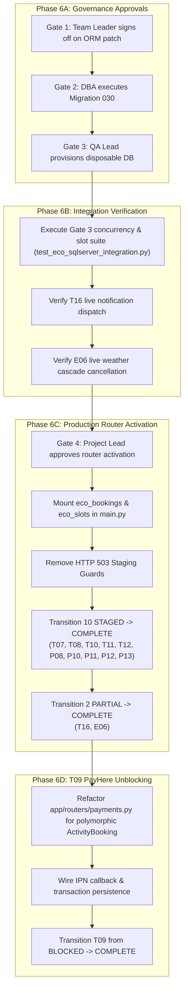

# CeylonGo Module 04 — Remaining Work Plan
**Target Specification:** `CeylonGo_Eco_Tourism_Complete_Development_Specification.pdf`  
**Current Baseline:** 37 COMPLETE (74.0%), 10 STAGED (20.0%), 2 PARTIAL (4.0%), 1 BLOCKED (2.0%), 0 NOT STARTED (0.0%)  
**Remaining Requirements:** 13 Requirements (`T07`, `T08`, `T09`, `T10`, `T11`, `T12`, `T16`, `P08`, `P10`, `P11`, `P12`, `P13`, `E06`)  
**Target Completion Date:** Prior to 5 December 2026  

---

## 1. Actionable Remaining Requirements Breakdown

| Req ID | Requirement Name | Priority | Exact Missing Work | Files to Modify | Complexity | Approval Dependency | Test Requirements |
| :---: | :--- | :---: | :--- | :--- | :---: | :---: | :--- |
| **P08** | Schedule Management | **P0** | 1. Apply Migration 030 (`activity_slots.activity_id` nullable) 2. Remove HTTP 503 guard 3. Mount `eco_slots.router` | `app/routers/eco_slots.py` `app/main.py` | Medium | **C** (DBA) **E** (Project Lead) | `test_eco_slots_router_staged.py` on real SQL Server |
| **T07** | Availability Calendar | **P0** | 1. Mount `eco_slots.router` in `app/main.py` 2. Verify public slot retrieval on active eco listings | `app/main.py` | Low | **E** (Project Lead) | `test_eco_slots_router_staged.py` |
| **T08** | Eco Experience Booking | **P0** | 1. Apply Gate 1 ORM patch 2. Apply Gate 2 Migration 030 3. Pass Gate 3 concurrency tests 4. Remove 503 guard & mount router | `app/models/activity_booking.py` `app/routers/eco_bookings.py` `app/main.py` | High | **B** (Team Lead) **C** (DBA) **D** (QA Lead) **E** (Project Lead) | `test_eco_bookings_router_staged.py`, `test_eco_sqlserver_integration.py` |
| **T10** | Pay at Location | **P0** | 1. Remove HTTP 503 guard on `create_eco_booking` 2. Verify booking creation with `payment_method='pay_at_location'` | `app/routers/eco_bookings.py` | Low | **E** (Project Lead) | `test_eco_bookings_router_staged.py` |
| **T11** | My Bookings | **P0** | 1. Mount `eco_bookings.router` in `app/main.py` 2. Apply Gate 1 ORM patch to safely re-enable participant querying | `app/models/activity_booking.py` `app/routers/eco_bookings.py` `app/main.py` | Medium | **B** (Team Lead) **E** (Project Lead) | `test_eco_bookings_router_staged.py` |
| **T12** | Booking Cancellation | **P0** | 1. Remove HTTP 503 guard on `cancel_eco_booking` 2. Mount router 3. Verify atomic capacity release on SQL Server | `app/routers/eco_bookings.py` `app/main.py` | Medium | **E** (Project Lead) | `test_eco_bookings_router_staged.py`, `test_eco_booking_service.py` |
| **P10** | Booking Requests | **P0** | 1. Mount `eco_bookings.router` in `app/main.py` 2. Verify provider incoming pending requests retrieval | `app/main.py` | Low | **E** (Project Lead) | `test_eco_bookings_router_staged.py` |
| **P11** | Booking Approval | **P0** | 1. Remove HTTP 503 guard on `decide_provider_eco_booking` 2. Verify accept/reject status transitions on SQL Server | `app/routers/eco_bookings.py` `app/main.py` | Medium | **E** (Project Lead) | `test_eco_bookings_router_staged.py` |
| **P12** | Booking History | **P0** | 1. Mount `eco_bookings.router` in `app/main.py` 2. Verify provider historical booking queries | `app/main.py` | Low | **E** (Project Lead) | `test_eco_bookings_router_staged.py` |
| **P13** | Cash Payment Updates | **P0** | 1. Remove HTTP 503 guard on `record_cash` 2. Verify provider transitions `payment_status` to `'paid'` on SQL Server | `app/routers/eco_bookings.py` `app/main.py` | Low | **E** (Project Lead) | `test_eco_bookings_router_staged.py` |
| **T16** | Booking Notifications | **P1** | 1. Wire live notification dispatch from active booking lifecycle events 2. Verify push/email delivery on disposable database | `app/services/eco_booking_service.py` `app/routers/eco_bookings.py` | Medium | **A** (Immediate prep) **B** (Team Lead) | `test_eco_phase_5c_notifications.py` E2E suite |
| **E06** | Weather Restrictions | **P1** | 1. Mount slot-level weather cancellation route in `eco_slots.py` 2. Verify live cascade cancellation & capacity release | `app/routers/eco_slots.py` `app/services/eco_booking_service.py` | Medium | **A** (Immediate prep) **B** (Team Lead) | `test_eco_phase_5d_weather_cancellation.py` |
| **T09** | Online Payment (PayHere) | **P1** | 1. Refactor `app/routers/payments.py` for polymorphic booking query 2. Mount eco checkout preparation endpoint 3. Handle IPN callbacks for `ActivityBooking` 4. Persist `dbo.payment_transactions` records | `app/routers/payments.py` `app/routers/eco_bookings.py` | High | **B** (Team Lead) **E** (Project Lead) | `test_eco_payhere_integration.py` live flow |

---

## 2. Approval Classification & Separation of Concerns

### Category A: Work That Can Proceed Immediately (No Approval Required)
1. **Pre-authoring Documentation & Verification Packages:** (COMPLETED in Phases 5H–5M).
2. **Deterministic Test Suites:** Writing additional isolated mock unit tests for edge cases or payload validations.
3. **Client Contract Documentation:** Documenting JSON request/response contracts for Angular 21 and Flutter 3 teams.
4. **Preflight SQL Inspection:** Read-only schema and integrity audits.

### Category B: Requires Backend Team Leader Approval
1. **Shared ORM Patch (Gate 1):** Editing `app/models/activity_booking.py` to align `ActivityBookingParticipant` with the physical SQL Server schema.
2. **Shared Payment Router Refactoring:** Updating `app/routers/payments.py` to route `module_type="activity"` to `ActivityBooking` instead of hardcoding `Booking`.
3. **Notification Service Dispatch:** Linking active notification dispatchers to shared platform notification tables.

### Category C: Requires Database Coordinator / DBA Approval
1. **Migration 030 Execution (Gate 2):** Applying `migrations/030_make_activity_slots_activity_id_nullable.sql` on the live `CeylonGoDB` database.
2. **Schema Verification:** Verifying foreign keys, nullability, and index performance on SQL Server.

### Category D: Requires QA Lead or Disposable Database Provisioning
1. **Disposable SQL Server Provisioning (Gate 3):** Creating `ceylongodb_disposable_qa` on SQL Server.
2. **Executing Gate 3 Concurrency Suite:** Setting `TEST_DISPOSABLE_SQLSERVER_URL` and running `test_eco_sqlserver_integration.py` to verify atomic row locking and capacity reservation under concurrent threads.

### Category E: Requires Project Lead Activation Approval
1. **Router Registration (Gate 4):** Mounting `eco_bookings.router` and `eco_slots.router` in `app/main.py`.
2. **Removing HTTP 503 Guards:** Deleting the fail-closed staging exceptions in `app/routers/eco_bookings.py` and `app/routers/eco_slots.py`.
3. **Formal Requirement Transition:** Moving `T07`, `T08`, `T10`, `T11`, `T12`, `P08`, `P10`, `P11`, `P12`, `P13` from **STAGED** to **COMPLETE**.

---

## 3. Recommended Sequential Implementation Order

