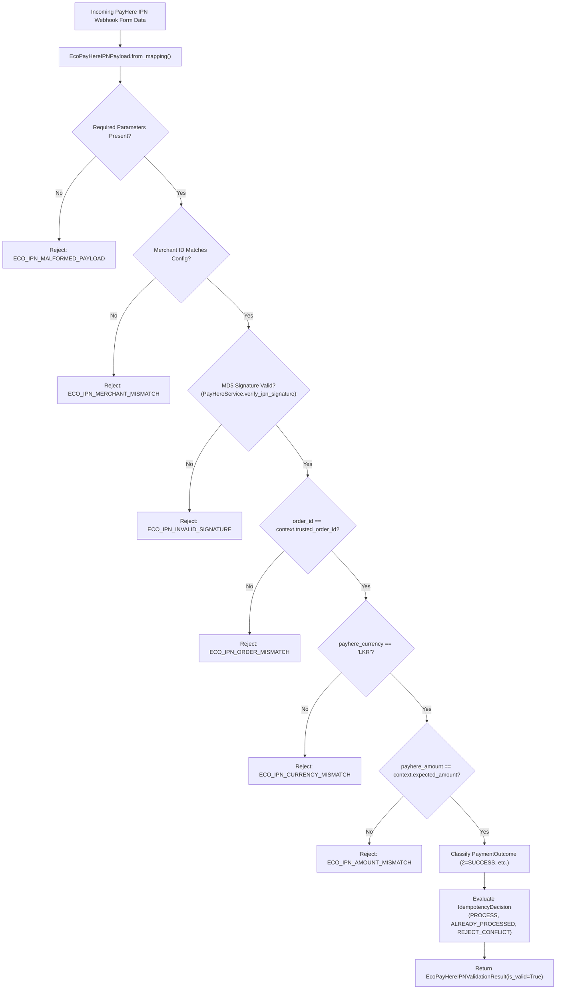

# CeylonGo Module 04 — Phase 5N Implementation Specification
## T09 Standalone PayHere Webhook Security Service

**Project:** CeylonGo-Backend | **Branch:** `develop`  
**Module:** Module 04 — Eco-Tourism (BACKEND ONLY)  
**Target Requirement:** T09 — Eco-Tourism Online Payment via PayHere  
**File Created:** `app/services/eco_payhere_webhook_security.py`  
**Test Suite Created:** `tests/test_eco_payhere_webhook_security.py` (42 tests, 100% passed)  
**Status:** IMPLEMENTED (STANDALONE / SIDE-EFFECT-FREE / UNMOUNTED)  
**Governance State:** T09 remains **BLOCKED** pending Gate 1–4 approvals and shared payment router unification.  

---

## 1. Executive Summary & Design Scope

Phase 5N implemented a robust, side-effect-free, authoritative webhook security validation service for processing incoming PayHere Instant Payment Notification (IPN) callbacks for Module 04 Eco-Tourism bookings.

### Key Architectural Principles:
1. **Zero Shared Code Invasions:**  
   `app/routers/payments.py` and `app/core/payhere.py` remain untouched. Shared homestay payment logic continues running without modification.
2. **Zero Database Mutations:**  
   The validation service is purely functional and operates in memory. No database queries, inserts, updates, or commits are performed.
3. **Zero External Network Calls:**  
   IPN verification is completely offline and deterministic, relying on server-side secrets and cryptographic formulas. No HTTP requests are made to PayHere.
4. **Server-Authoritative Context Injection:**  
   The validation pipeline compares untrusted incoming webhook fields against a trusted server-side context (`TrustedEcoPaymentContext`), preventing client or gateway tampering.
5. **Fail-Closed Security & Credential Redaction:**  
   All invalid merchant IDs, forged signatures, order mismatches, currency mismatches, and tampered amounts trigger sanitized `EcoPayHereWebhookSecurityError` exceptions that never expose merchant credentials or raw sensitive payloads.

---

## 2. Public API & Data Contracts

### 2.1. `TrustedEcoPaymentContext` (Authoritative Server State)
Supplied by a trusted server caller (e.g. from database query of `ActivityBooking` and `BookingReference`):

```python
@dataclass(frozen=True)
class TrustedEcoPaymentContext:
    booking_id: int
    trusted_order_id: str                          # Canonical booking reference (e.g. BK-ECO-20261120-7A9B)
    expected_amount: Decimal                       # Authoritative total price in LKR
    expected_currency: str = "LKR"
    expected_merchant_id: str = ""                 # Server-configured PayHere merchant ID
    current_payment_status: str = "unpaid"         # 'unpaid', 'pending', 'paid', 'refunded'
    existing_gateway_transaction_id: str | None = None # Tracked payment_id if previously processed
```

### 2.2. `EcoPayHereIPNPayload` (Normalized Gateway Input)
Normalized representation of form data received from the PayHere webhook endpoint:

```python
@dataclass(frozen=True)
class EcoPayHereIPNPayload:
    merchant_id: str
    order_id: str
    payment_id: str | None
    payhere_amount: str
    payhere_currency: str
    status_code: str
    md5sig: str
    status_message: str | None = None
    method: str | None = None

    @classmethod
    def from_mapping(cls, data: Mapping[str, Any]) -> "EcoPayHereIPNPayload":
        ...
```

### 2.3. `EcoPayHereIPNValidationResult` (Immutable Output)
Sanitized, immutable result returned to the caller:

```python
@dataclass(frozen=True)
class EcoPayHereIPNValidationResult:
    is_valid: bool
    payment_outcome: PaymentOutcome               # SUCCESS, PENDING, CANCELLED, FAILED, UNKNOWN
    idempotency_decision: IdempotencyDecision     # PROCESS, ALREADY_PROCESSED, REJECT_CONFLICT, IGNORE_NON_SUCCESS
    safe_error_code: str | None = None
    safe_error_message: str | None = None
    trusted_booking_id: int | None = None
    trusted_order_id: str | None = None
    payment_id: str | None = None
    processed_amount: Decimal | None = None
    processed_currency: str | None = None
```

---

## 3. Validation Pipeline Architecture



---

## 4. Key Security & Cryptographic Invariants

### 4.1. Merchant ID Validation
- Rejects missing, empty, or whitespace-only merchant IDs.
- Validates strictly against the server-authoritative merchant ID configuration.
- Never discloses expected IDs or credentials in errors or diagnostic payloads (`ECO_IPN_MERCHANT_MISMATCH`).

### 4.2. PayHere Signature Verification
- Validates MD5 signature format against canonical regex `^[0-9a-fA-F]{32}$`.
- Delegates cryptographic verification to canonical `payhere_service.verify_ipn_signature()`:
  $$\text{ExpectedSig} = \text{MD5}(\text{merchant\_id} + \text{order\_id} + \text{amount} + \text{currency} + \text{status\_code} + \text{MD5}(\text{merchant\_secret}).\text{upper}()).\text{upper}()$$
- Compares calculated signature against incoming `md5sig` in uppercase.

### 4.3. Financial Arithmetic & Anti-Tampering
- Enforces strict Python `Decimal` quantization to 2 decimal places (`Decimal("0.01")`).
- Rejects floating-point `NaN`, `Infinity`, non-numeric text, negative values, and zero (`ECO_INVALID_AMOUNT`).
- Rejects any mismatch between received amount and server-authoritative `expected_amount`.

### 4.4. Pure Idempotency Decision Policy
The pure function `evaluate_idempotency_decision()` provides deterministic handling recommendations:
1. **`PROCESS`:** Outcome is `SUCCESS` and booking is in `unpaid` or `pending` status.
2. **`ALREADY_PROCESSED`:** Outcome is `SUCCESS`, booking is already `paid`, and `payment_id` matches the existing recorded transaction ID. Safe HTTP 200 OK no-op.
3. **`REJECT_CONFLICT`:** Outcome is `SUCCESS`, but booking is already `paid` under a *different* payment ID, or booking is in a terminal non-payable state (`refunded`, `cancelled`, `rejected`).
4. **`IGNORE_NON_SUCCESS`:** Signature is valid, but status code indicates cancellation (`-1`) or failure (`-2`). No financial confirmation should occur.

---

## 5. Production Concurrency & Database Locking Design (Future Integration)

While Phase 5N implements pure decision logic, production webhook processing requires multi-process concurrency safety on Microsoft SQL Server:

```sql
-- 1. Begin atomic transaction
BEGIN TRANSACTION;

-- 2. Acquire exclusive row-level lock on the target ActivityBooking
SELECT id, booking_status, payment_status, total_price, currency 
FROM dbo.activity_bookings WITH (UPDLOCK, ROWLOCK)
WHERE id = @booking_id;

-- 3. Check for existing payment transaction to guarantee idempotency
SELECT id, payment_status, gateway_transaction_id 
FROM dbo.payment_transactions WITH (UPDLOCK, ROWLOCK)
WHERE booking_reference_id = @booking_ref_id AND gateway_name = 'payhere';

-- 4. Update booking and insert transaction atomically
UPDATE dbo.activity_bookings 
SET payment_status = 'paid', updated_at = SYSUTCDATETIME()
WHERE id = @booking_id;

INSERT INTO dbo.payment_transactions (booking_reference_id, user_id, gateway_name, gateway_transaction_id, amount, currency, payment_status, paid_at)
VALUES (@booking_ref_id, @user_id, 'payhere', @payment_id, @amount, 'LKR', 'paid', SYSUTCDATETIME());

COMMIT TRANSACTION;
```

---

## 6. Verification & Test Execution Results

- **Unit Test Suite:** [tests/test_eco_payhere_webhook_security.py](file:///c:/Users/komaruthan/Desktop/project%203/CeylonGo-Backend/tests/test_eco_payhere_webhook_security.py)
- **Tests Executed:** **42 passed in 0.50s** (100% pass rate).
- **Full Eco Regression:** **571 passed, 3 skipped, 494 deselected, 0 failed** in `pytest -k "eco"` (167.61s). Zero regressions.
