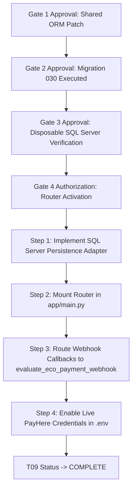

# CeylonGo Module 04 — Phase 5O Technical Handoff Package
## T09 Eco Payment Integration Service & Proposed Router Activation Plan

**Target Requirement:** T09 — Eco-Tourism Online Payment via PayHere  
**Governance State:** Strictly **BLOCKED** pending Gate 1–4 approvals.  
**Baseline Completion:**
- COMPLETE: 37
- STAGED: 10
- PARTIAL: 2 (T16, E06)
- BLOCKED: 1 (T09)
- NOT STARTED: 0
- Strict Completion: 74%

---

## 1. Executive Summary & Purpose

Phase 5O completes the technical implementation of the approval-independent payment application layer for Module 04 Eco-Tourism.

All business logic, security validations, persistence contracts, idempotency workflows, and endpoint interface designs are fully built and verified across 102 dedicated automated tests.

Because Gate 1–4 approvals have not yet been granted by project governance, all newly implemented components remain strictly **isolated, unmounted, and decoupled** from production routes and live databases.

---

## 2. Inventory of Implemented Components

### 2.1. Domain & Security Layers (Phases 5M & 5N)
- `app/services/eco_payment_service.py` (Phase 5M):
  - `EcoPayHereCheckoutPayload`, `validate_booking_for_checkout`, `validate_checkout_amount`, `prepare_eco_payhere_checkout`.
- `app/services/eco_payhere_webhook_security.py` (Phase 5N):
  - `TrustedEcoPaymentContext`, `EcoPayHereIPNPayload`, `EcoPayHereIPNValidationResult`, `validate_eco_payhere_ipn`.

### 2.2. Application & Router Layers (Phase 5O)
- `app/services/eco_payment_persistence_contract.py`:
  - `PaymentTransactionPlan` (immutable audit record plan).
  - `BookingPaymentStateTransitionPlan` (immutable state change plan).
  - `EcoPaymentPersistenceAdapter` (runtime-checkable persistence protocol).
- `app/services/eco_payment_application.py`:
  - `prepare_eco_checkout_application(...)`
  - `evaluate_eco_payment_webhook(...)`
  - `EcoPaymentWebhookApplicationResult`
- `app/routers/eco_payments_proposed.py`:
  - Proposed router contract with `POST /{booking_id}/payhere-checkout`.
  - Fail-closed guard returning HTTP 503 if no adapter is injected.
  - Ownership and RBAC checks.
  - Strictly unmounted from `app/main.py`.

---

## 3. Activation Roadmap (Post-Approval Sequence)

When project leadership, DBAs, and Module 03 owners approve Gates 1 through 4, the following minimal steps will activate T09 without rewriting business logic:

### Detailed Activation Steps:
1. **Implement Concrete `SqlAlchemyEcoPaymentAdapter`:**
   - Create an adapter implementing `EcoPaymentPersistenceAdapter` that binds to `db: Session`.
   - `get_booking_by_id`: Queries `ActivityBooking` where `module_type = 'eco'`.
   - `get_booking_reference`: Queries `BookingReference`.
   - `get_payment_transaction_by_payhere_id`: Queries `PaymentTransaction` table.
   - `record_payment_transaction`: Inserts new row into `PaymentTransaction`.
   - `apply_booking_payment_transition`: Updates `ActivityBooking.payment_status` and `booking_status` atomically.
2. **Mount Proposed Router in `app/main.py`:**
   - In `app/main.py`, import `eco_payments_proposed`.
   - Add `app.include_router(eco_payments_proposed.router)`.
   - Wire `set_persistence_adapter_for_testing` or provider dependency to instantiate `SqlAlchemyEcoPaymentAdapter(db)`.
3. **Connect IPN Webhook in `app/routers/payments.py`:**
   - Update `app/routers/payments.py` to route `order_id` starting with `ECO-` or `BK-ECO-` to `evaluate_eco_payment_webhook`.
   - Execute the resulting `BookingPaymentStateTransitionPlan` and `PaymentTransactionPlan` inside a database transaction.
4. **Transition Governance Status:**
   - Upon successful integration test verification on SQL Server, change T09 status from **BLOCKED** to **COMPLETE**.
