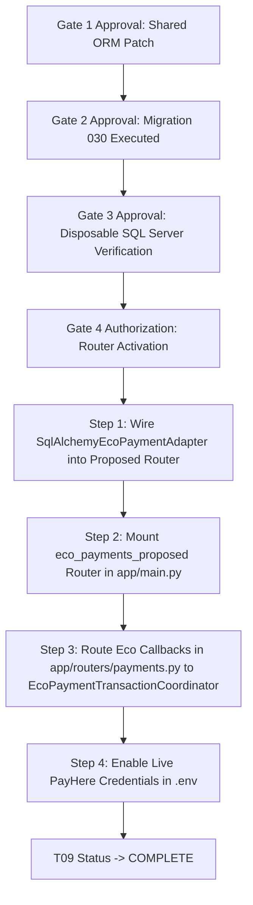

# CeylonGo Module 04 — Phase 5P Technical Handoff Package
## T09 Eco Payment Database Integration & Activation Readiness Plan

**Target Requirement:** T09 — Eco-Tourism Online Payment via PayHere  
**Governance State:** Strictly **BLOCKED** pending Gates 1–4 approvals.  
**Baseline Completion:**
- COMPLETE: 37
- STAGED: 10
- PARTIAL: 2 (T16, E06)
- BLOCKED: 1 (T09)
- NOT STARTED: 0
- Strict Completion: 74%

---

## 1. Executive Summary & Architecture Synthesis

Phase 5P completes the final technical layer of the isolated payment pipeline for Module 04 Eco-Tourism.

With the implementation and test verification of `SqlAlchemyEcoPaymentAdapter` and `EcoPaymentTransactionCoordinator`, all database persistence contracts, row-level idempotency policies, caller-controlled transaction semantics, and provider approval preservation rules are now fully codified in backend code.

All components remain strictly **isolated, unmounted, and decoupled** from production routes and live databases.

---

## 2. Inventory of Implemented Components (Phases 5M–5P)

```
Phase 5M: Domain Checkout Preparation
├── app/services/eco_payment_service.py
└── tests/test_eco_payhere_integration.py (24 tests)

Phase 5N: Standalone Webhook Security Validation
├── app/services/eco_payhere_webhook_security.py
└── tests/test_eco_payhere_webhook_security.py (42 tests)

Phase 5O: Application Layer & Proposed API Contract
├── app/services/eco_payment_persistence_contract.py
├── app/services/eco_payment_application.py
├── app/routers/eco_payments_proposed.py (unmounted)
├── tests/test_eco_payment_application.py (21 tests)
└── tests/test_eco_payments_proposed_router.py (15 tests)

Phase 5P: Database Persistence & Transaction Coordination
├── app/services/eco_payment_sqlalchemy_adapter.py
├── app/services/eco_payment_transaction_coordinator.py
├── tests/test_eco_payment_sqlalchemy_adapter.py (20 tests)
└── tests/test_eco_payment_transaction_coordinator.py (20 tests)
```

**Total T09 Automated Tests:** 142 tests (100% passing).

---

## 3. Activation Roadmap (Post-Approval Sequence)



### Exact Activation Wiring:
1. **Wired Dependency Injection:**
   In `app/routers/eco_payments_proposed.py`, change:
   ```python
   def get_persistence_adapter(db: Annotated[Session, Depends(get_db)]) -> EcoPaymentPersistenceAdapter:
       return SqlAlchemyEcoPaymentAdapter(db)
   ```
2. **Mount Proposed Router in `app/main.py`:**
   ```python
   from app.routers import eco_payments_proposed
   app.include_router(eco_payments_proposed.router)
   ```
3. **Route Webhooks in `app/routers/payments.py`:**
   In `payhere_webhook_listener`:
   ```python
   if order_id.startswith("ECO-") or order_id.startswith("BK-ECO-"):
       adapter = SqlAlchemyEcoPaymentAdapter(db)
       coordinator = EcoPaymentTransactionCoordinator(adapter)
       result = coordinator.process_webhook_payload(dict(form_data))
       if result.success:
           db.commit()
           return {"status": result.status}
       else:
           db.rollback()
           raise HTTPException(status_code=400, detail=result.message)
   ```
4. **Governance Transition:**
   Promote requirement **T09** from **BLOCKED** to **COMPLETE**.
