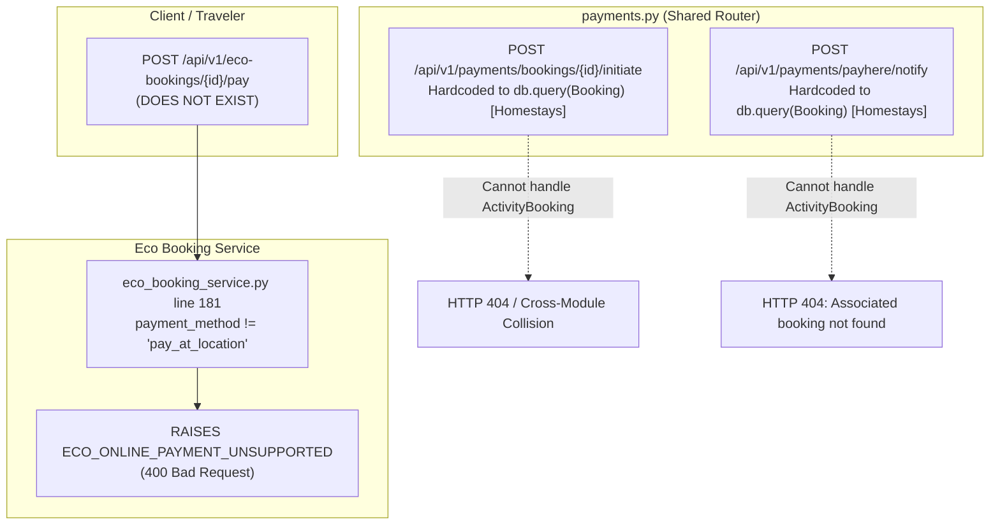

# T09: PayHere Payment Infrastructure Audit

**Document Version**: 1.0  
**Date**: 20 November 2026  
**Project**: `CeylonGo-Backend` (`develop` branch)  
**Requirement**: **T09 — Eco-Tourism Online Payment via PayHere**  
**Current Status**: **BLOCKED**  
**Audit Scope**: Repository Code Inspection, Router Audits, Shared Module Dependencies, and Physical Database Schema Verification  

---

## 1. Executive Summary

Requirement **T09** specifies that travelers must be able to complete online payments for confirmed Eco-Tourism bookings via the PayHere payment gateway. Currently, T09 is classified as **BLOCKED** in the official 50-requirement matrix.

This read-only audit identifies the exact architectural, router, data model, and security landscape governing online payments in the CeylonGo repository.

### Key Audit Findings
1. **Core Gateway Service Exists**: `PayHereService` (`app/core/payhere.py`) is fully implemented with MD5 checkout hash generation and IPN signature validation.
2. **Physical SQL Server Schema is 100% Ready**: Tables `dbo.payment_transactions`, `dbo.payment_refunds`, `dbo.booking_references`, and `dbo.activity_bookings` already support `payment_method='online'` and `module_type='activity'` via active check constraints. **Zero database migrations are required for T09.**
3. **Severe Router Coupling (The Core Blocker)**: The existing payment router (`app/routers/payments.py`) is hardcoded exclusively to Module 02 Homestay bookings (`db.query(Booking)`). Any attempt to process an Eco-Tourism or Activity booking through `payments.py` crashes with HTTP 404 or causes database cross-module corruption.
4. **Deliberate Service-Level Block**: `app/services/eco_booking_service.py` explicitly raises `ECO_ONLINE_PAYMENT_UNSUPPORTED` when `payment_method != 'pay_at_location'`.
5. **Missing Initiation & Webhook Handlers**: There is currently no endpoint to initiate online payments for Eco bookings, and the PayHere IPN webhook listener does not handle `ActivityBooking` updates or notifications.

---

## 2. Existing Payment Infrastructure Inventory

| Component | Repository File Path | Shared With | Operational Status | T09 Reuse Potential |
|---|---|---|---|:---:|
| **Gateway Helper** | `app/core/payhere.py` | Homestay, Sponsored Campaigns | **ACTIVE** | **100% Reusable** |
| **Payment Router** | `app/routers/payments.py` | Homestay (Module 02) | **MOUNTED** | **Needs Polymorphic Refactoring** |
| **Payment Schemas** | `app/schemas/payment.py` | Homestay, Admin | **ACTIVE** | **100% Reusable** |
| **Shared Models** | `app/models/shared.py` | All Modules | **ACTIVE** | **100% Reusable** |
| **Booking Models** | `app/models/activity_booking.py` | Module 03 & Module 04 | **ACTIVE** | **Ready for Online Payments** |
| **Eco Booking Service** | `app/services/eco_booking_service.py` | Module 04 | **UNMOUNTED / GUARDED** | **Blocks Online Payments** |
| **Eco Bookings Router** | `app/routers/eco_bookings.py` | Module 04 | **UNMOUNTED / GUARDED** | **Blocks Online Payments** |

---

## 3. Router & Endpoint Audit: Mounted vs Unmounted

All payment endpoints are defined in `app/routers/payments.py` under prefix `/api/v1/payments` and are mounted in `app/main.py`:

```python
# app/main.py lines 132-133
app.include_router(notifications_router)
app.include_router(payments_router)
```

### Analysis of Mounted Endpoints in `payments.py`:
1. `POST /api/v1/payments/bookings/{booking_id}/initiate`:
   - Hardcoded to `db.query(Booking).filter(Booking.id == booking_id).first()`.
   - Queries `db.query(Homestay).filter(Homestay.id == booking.homestay_id)`.
   - **Result for Eco Bookings**: Completely non-functional for `ActivityBooking`.
2. `POST /api/v1/payments/payhere/notify` (IPN Webhook Listener):
   - Receives PayHere form POST (`order_id`, `payment_id`, `payhere_amount`, `md5sig`, `status_code`).
   - Resolves `BookingReference` by `booking_reference == order_id`.
   - Hardcoded: `booking = db.query(Booking).filter(Booking.id == booking_ref.target_booking_id).first()`.
   - Queries `homestay = db.query(Homestay).filter(Homestay.id == booking.homestay_id)`.
   - **Result for Eco Bookings**: If an Eco booking reference (`module_type='activity'`) arrives, it attempts to load `Booking` (Homestay), resulting in `HTTP 404: Associated booking not found` or corrupting an unrelated homestay booking with matching ID.
3. `GET /api/v1/payments/bookings/{booking_id}/status`:
   - Hardcoded to `BookingReference.module_type == "homestay"`.
4. `POST /api/v1/payments/bookings/{booking_id}/request-refund`:
   - Hardcoded to `BookingReference.module_type == "homestay"`.
5. `POST /api/v1/payments/admin/refunds/{refund_id}/process`:
   - Admin status update (`approved`, `rejected`, `completed`). Operates on `dbo.payment_refunds` directly. **Reusable across all modules.**
6. `GET /api/v1/payments/provider/earnings` & `/settlements`:
   - Hardcoded filter: `BookingReference.module_type == "homestay"`.

---

## 4. Physical SQL Server Schema Truth (Live Database Evidence)

A read-only inspection of Microsoft SQL Server (`CeylonGoDB`) confirms that the database layer was already designed to support online activity and eco bookings:

### A. `dbo.activity_bookings` Constraints
- `CK_activity_bookings_method`:
  ```sql
  ([payment_method]='pay_at_location' OR [payment_method]='online')
  ```
  Both `'pay_at_location'` and `'online'` are physically allowed.
- `CK_activity_bookings_payment`:
  ```sql
  ([payment_status]='failed' OR [payment_status]='refunded' OR [payment_status]='refund_pending' OR [payment_status]='paid' OR [payment_status]='pending' OR [payment_status]='unpaid')
  ```
  All lifecycle states (`unpaid`, `pending`, `paid`, `refund_pending`, `refunded`, `failed`) are permitted.

### B. `dbo.booking_references` Constraints
- `CK_booking_references_type`:
  ```sql
  ([module_type]='artisan_reservation' OR [module_type]='rental_vehicle' OR [module_type]='activity' OR [module_type]='tour_guide' OR [module_type]='homestay')
  ```
  Eco bookings are registered with `module_type='activity'` by contract.

### C. `dbo.payment_transactions` & `dbo.payment_refunds` Constraints
- `CK_payment_transactions_status`:
  ```sql
  ([payment_status]='cancelled' OR [payment_status]='refunded' OR [payment_status]='failed' OR [payment_status]='completed' OR [payment_status]='pending')
  ```
- `CK_payment_refunds_status`:
  ```sql
  ([refund_status]='rejected' OR [refund_status]='failed' OR [refund_status]='processed' OR [refund_status]='pending')
  ```

**Verdict on Physical Schema**:
The SQL Server tables and constraints are **100% compatible and complete**. No DDL migrations or schema modifications are required to enable T09.

---

## 5. Architectural Gap Analysis: Why T09 is Blocked



1. **Service Block**: `app/services/eco_booking_service.py` line 181 intentionally rejects `payment_method='online'`.
2. **Missing Eco Initiation Route**: There is no router or endpoint that receives an Eco booking ID and returns PayHere checkout parameters.
3. **Monomorphic Webhook**: `payments.py:221` assumes every `BookingReference` points to `dbo.bookings` (Homestays), ignoring `module_type`.
4. **Missing Notification Dispatch**: `payments.py` only dispatches homestay notifications referencing `homestay.name`.
