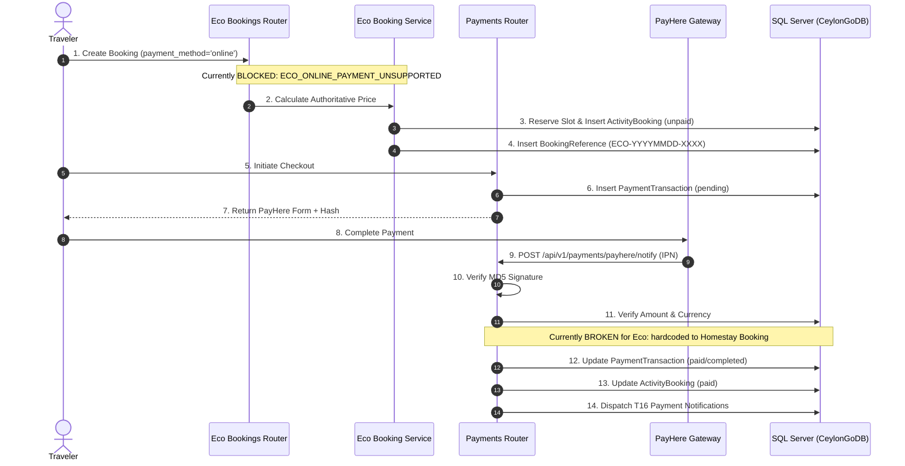

# T09: Eco-Tourism Payment Lifecycle Traceability Matrix

**Document Version**: 1.0  
**Date**: 20 November 2026  
**Project**: `CeylonGo-Backend` (`develop` branch)  
**Requirement**: **T09 — Eco-Tourism Online Payment via PayHere**  
**Audit Scope**: End-to-End Online Payment Lifecycle Traceability & Code Evidence  

---

## 1. Lifecycle Overview & State Machine

---

## 2. Fourteen-Step Traceability Matrix

| Step # | Operational Step Description | Classification | Code Evidence & Technical Analysis |
|:---:|---|:---:|---|
| **1** | **Traveler creates an Eco booking** | **BLOCKED** | Implemented for `pay_at_location` in `app/services/eco_booking_service.py` (`execute_traveler_booking_create_atomic`), but **explicitly blocked** for `online` payment in lines 181–189: `if payload.payment_method != "pay_at_location": raise EcoBookingServiceError(code="ECO_ONLINE_PAYMENT_UNSUPPORTED")`. |
| **2** | **Backend calculates authoritative booking amount** | **IMPLEMENTED** | Server-side Decimal pricing implemented in `app/services/eco_booking_pricing.py` (`calculate_eco_booking_price`). Evaluates base rates, tiers, and seasonal surcharges with strict 2-decimal arithmetic. |
| **3** | **Backend generates unique payment/order reference** | **IMPLEMENTED** | Implemented in `app/services/eco_booking_service.py` (`format_eco_booking_reference`). Generates canonical `ECO-YYYYMMDD-XXXX` persisted in `dbo.booking_references` with `module_type='activity'`. |
| **4** | **Backend creates pending payment record** | **MISSING** | No code in Module 04 creates an initial `PaymentTransaction` record. In Homestays, this is created during `/initiate` (`app/routers/payments.py:120–129`), but no corresponding Eco logic exists. |
| **5** | **Backend prepares PayHere checkout initiation** | **MISSING** | `PayHereService.generate_checkout_hash` exists in `app/core/payhere.py:24–37`, but no endpoint exists to invoke it for an `ActivityBooking`. Homestay endpoint `/bookings/{id}/initiate` rejects non-homestays. |
| **6** | **Traveler completes payment through PayHere** | **NOT APPLICABLE** | External user interaction on PayHere's hosted payment gateway (`https://sandbox.payhere.lk/pay/checkout`). |
| **7** | **PayHere sends server-to-server notification** | **IMPLEMENTED** | Webhook endpoint exists at `POST /api/v1/payments/payhere/notify` in `app/routers/payments.py:171–178`. |
| **8** | **Backend validates webhook authenticity** | **IMPLEMENTED** | Validates PayHere MD5 signature in `app/routers/payments.py:196–207` using `payhere_service.verify_ipn_signature()`. |
| **9** | **Backend verifies booking reference, amount, and currency** | **PARTIAL** | Amount and currency validation exists in `payments.py:228–234`, but is **broken for Eco bookings** because line 221 queries `db.query(Booking)` (Homestay), failing to resolve `ActivityBooking`. |
| **10** | **Backend records payment success or failure** | **PARTIAL** | Upsert of `PaymentTransaction` is implemented in `payments.py:242–264`, but sets `payment_status='paid'` (which conflicts with physical SQL Server check constraint `CK_payment_transactions_status` requiring `'completed'`). |
| **11** | **Booking payment state is updated atomically** | **MISSING** | `payments.py:265` updates `Booking.payment_status = 'paid'`. There is **zero code** to update `ActivityBooking.payment_status` or synchronize `ActivitySlot` states. |
| **12** | **Traveler and provider receive notifications** | **MISSING** | Notifications dispatched in `payments.py:282–304` are hardcoded to `Homestay` and homestay owner user IDs. No notification is dispatched to Eco traveler or Eco provider. |
| **13** | **Duplicate webhook delivery handled idempotently** | **PARTIAL** | `payments.py:237–238` checks `if booking.payment_status == 'paid': return {'status': 'already_processed'}`. However, it lacks transaction-level lock protection (`sp_getapplock`), leaving a race condition window for simultaneous duplicate deliveries. |
| **14** | **Cancellation and refund handling reconciled** | **PARTIAL** | `app/services/eco_booking_service.py` creates pending `PaymentRefund` records during emergency cancellations, but gateway refund execution is manual and has no automated PayHere API reconciliation. |

---

## 3. Summary of Status Classifications

- **IMPLEMENTED**: 4 steps (Steps 2, 3, 7, 8)
- **PARTIAL**: 4 steps (Steps 9, 10, 13, 14)
- **MISSING**: 4 steps (Steps 4, 5, 11, 12)
- **BLOCKED**: 1 step (Step 1)
- **NOT APPLICABLE**: 1 step (Step 6)

**Conclusion**: The core gateway calculations and database tables exist, but the routing and service connection points between PayHere IPN and `ActivityBooking` are completely unbuilt.
