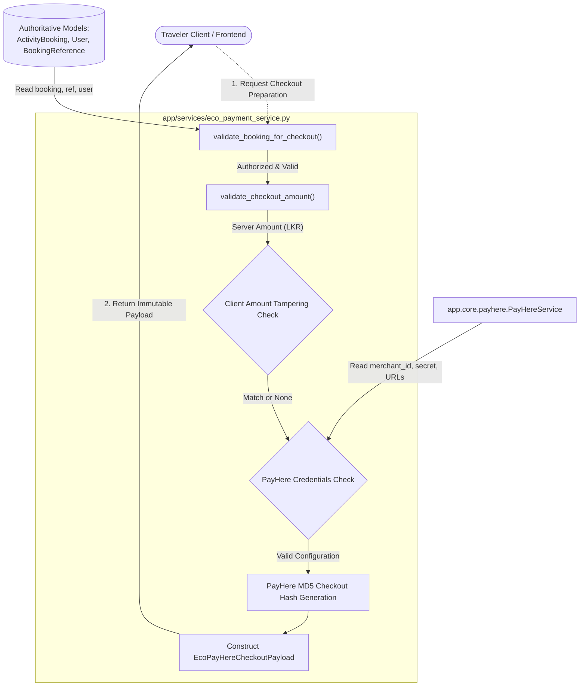

# T09 Standalone PayHere Payment Preparation Service Design
**Module 04 — Eco-Tourism (CeylonGo-Backend)**  
**Target Requirement:** T09 — Eco-Tourism Online Payment via PayHere  
**File Location:** `app/services/eco_payment_service.py`  
**Status:** IMPLEMENTED (STANDALONE / SIDE-EFFECT-FREE / UNMOUNTED)  
**Governance State:** T09 remains **BLOCKED** pending Gate 1, Gate 2, Gate 3, Gate 4 approvals and shared router unification.

---

## 1. Executive Summary & Design Principles

The `eco_payment_service.py` provides an isolated, side-effect-free, authoritative checkout preparation service for Module 04 Eco-Tourism bookings (`ActivityBooking`). It prepares immutable payloads for PayHere redirect checkouts while strictly respecting system governance and integrity boundaries.

### Core Architectural Guarantees:
1. **Zero Shared Code Invasions:**  
   `app/routers/payments.py` and `app/core/payhere.py` remain completely untouched. Shared homestay payment flows continue operating without interference.
2. **Zero Database Mutations:**  
   The service performs pure functional validation and data transformation. No database sessions are committed, flushed, or mutated during preparation.
3. **Zero External Network Calls:**  
   Checkout preparation is completely offline and deterministic. No HTTP requests or external API calls are made to PayHere endpoints.
4. **Authoritative Server Pricing:**  
   Total amount and currency are extracted directly from the authoritative database model (`booking.total_price`, `booking.currency`). Client-supplied amounts cannot dictate transaction totals and any conflicting override attempts are rejected.
5. **Fail-Closed Validation:**  
   Any invalid booking lifecycle state, unauthorized traveler identity, missing booking reference, non-positive amount, non-LKR currency, or missing merchant credential immediately raises a structured `EcoPaymentServiceError`.
6. **Credential Containment:**  
   The PayHere `merchant_secret` is utilized solely in-memory for MD5 hashing and is never exposed in output payloads, string representations, or log messages.

---

## 2. Component Architecture & Data Flow



---

## 3. Data Types & Interfaces

### 3.1. `EcoPaymentServiceError`
Custom exception class providing structured, machine-readable error codes and sanitized diagnostic details.

```python
class EcoPaymentServiceError(ValueError):
    def __init__(
        self,
        code: str,
        message: str,
        details: dict[str, Any] | None = None,
    ) -> None:
        super().__init__(message)
        self.code = code
        self.message = message
        self.details = details or {}
```

#### Standard Error Catalog:
| Error Code | Trigger Condition |
| :--- | :--- |
| `ECO_BOOKING_NOT_FOUND` | Booking model is `None`. |
| `ECO_UNAUTHORIZED` | Current user context is missing / unauthenticated. |
| `ECO_PAYMENT_UNAUTHORIZED` | User is not the booking owner and does not possess the `admin` role. |
| `ECO_BOOKING_CANCELLED` | Booking status is `'cancelled'`. |
| `ECO_BOOKING_REJECTED` | Booking status is `'rejected'`. |
| `ECO_INVALID_BOOKING_STATUS` | Booking status is not in allowlist `{'pending', 'confirmed'}` (e.g. `'completed'`). |
| `ECO_INVALID_PAYMENT_METHOD` | Payment method is not `'online'` (e.g. `'pay_at_location'`). |
| `ECO_PAYMENT_ALREADY_PAID` | Payment status is `'paid'`. |
| `ECO_INVALID_PAYMENT_STATUS` | Payment status is not in allowlist `{'unpaid', 'pending'}` (e.g. `'refund_pending'`, `'refunded'`). |
| `ECO_BOOKING_REFERENCE_MISSING` | `BookingReference` record is `None` or its reference code is empty/whitespace. |
| `ECO_UNSUPPORTED_CURRENCY` | Currency is not strictly `'LKR'`. |
| `ECO_INVALID_AMOUNT` | Amount is `None`, non-numeric, `NaN`, infinite, zero, or negative. |
| `ECO_AMOUNT_TAMPERING_REJECTED` | Client-submitted amount override differs from server `total_price`. |
| `ECO_PAYHERE_CONFIG_MISSING` | `merchant_id` or `merchant_secret` is missing or blank in configuration. |

### 3.2. `EcoPayHereCheckoutPayload`
Immutable frozen dataclass containing the exact parameter set required by the PayHere redirect gateway.

```python
@dataclass(frozen=True)
class EcoPayHereCheckoutPayload:
    booking_id: int
    booking_reference: str
    merchant_id: str
    checkout_url: str
    order_id: str
    items: str
    amount: Decimal
    currency: str
    hash: str
    first_name: str
    last_name: str
    email: str
    phone: str | None
    return_url: str
    cancel_url: str
    notify_url: str
```

---

## 4. Financial Calculation & Tamper Resistance

### 4.1. Precision & Arithmetic Invariants
- Uses Python `Decimal` quantized to two decimal places (`Decimal("0.01")`).
- Rejects floating-point representations with `NaN`, `Infinity`, or exponent overflows.
- Rejects zero or negative amounts (`amount <= Decimal("0.00")`).
- Strictly limits accepted currency to `LKR`.

### 4.2. Client Amount Tampering Guard
While frontend clients may pass pricing contexts for validation, the checkout payload calculation is strictly derived from `booking.total_price`. If a client passes `client_amount_override` that differs by even 1 cent from `booking.total_price`, the request fails immediately with `ECO_AMOUNT_TAMPERING_REJECTED`.

---

## 5. PayHere Hash Generation Invariant

Hash generation reuses `PayHereService.generate_checkout_hash()`, adhering strictly to PayHere's official specification:

$$\text{SecretHash} = \text{MD5}(\text{merchant\_secret}).\text{upper}()$$
$$\text{RawString} = \text{merchant\_id} + \text{order\_id} + \text{amount\_formatted} + \text{currency} + \text{SecretHash}$$
$$\text{CheckoutHash} = \text{MD5}(\text{RawString}).\text{upper}()$$

Where:
- `order_id` is the authoritative booking reference string (e.g., `BK-ECO-20261120-7A9B`).
- `amount_formatted` is formatted strictly to 2 decimal places (e.g., `12500.00`).
- `currency` is `LKR`.
- Result is an uppercase 32-character hexadecimal string.

---

## 6. Security & Credential Isolation

1. **Merchant Secret Protection:**
   The `merchant_secret` is never a field in `EcoPayHereCheckoutPayload`, preventing accidental exposure in REST API responses or serialization formats.
2. **String Representation Cleansing:**
   `str(payload)` and `repr(payload)` contain only public transaction metadata.
3. **RBAC Enforcement:**
   Only the traveler who booked the experience (`booking.user_id == current_user.id`) or an authenticated user with `admin` role can initiate checkout preparation.

---

## 7. Operational Status

The standalone payment service is fully implemented in `app/services/eco_payment_service.py` and covered by automated tests. It remains unmounted from FastAPI routers and inactive in production endpoints until Gate 1, Gate 2, Gate 3, and Gate 4 are formally approved.
