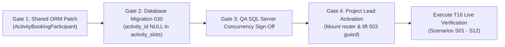

# CeylonGo Module 04 — Traveler T16: Booking Notifications
## Live End-to-End Verification Plan

**Document Version**: 1.0  
**Date**: 20 November 2026  
**Project**: CeylonGo-Backend (`develop` branch)  
**Requirement**: **T16 — Booking Notifications**  
**Authoritative Specification**: `CeylonGo_Eco_Tourism_Complete_Development_Specification.pdf` (17 November 2026)  
**Current Baseline**: PARTIAL (Implementation complete; verified on test doubles; live verification gated)  

---

## 1. Overview & Objectives

Requirement **T16 (Booking Notifications)** mandates automated, reliable, transactionally atomic, and private in-app notifications throughout the complete lifecycle of Eco-Tourism bookings.

This verification plan defines the rigorous, step-by-step procedures to validate all **12 T16 booking notification scenarios** against a live Microsoft SQL Server database environment once Phase 4D activation occurs.

### Safety & Governance Mandates
1. **Pre-Activation Execution**: No staged endpoints are called or live writes executed until Gates 1–4 are formally signed off.
2. **Strict Privacy & Isolation**: Notifications must never leak between travelers or unrelated providers.
3. **Idempotency & Deduplication**: Duplicate alerts from retries within the 30-second deduplication window must be suppressed.
4. **Transaction Atomicity**: Notifications must roll back if the accompanying booking mutation rolls back.

---

## 2. Notification Data Model & Retrieval Infrastructure

Notifications in CeylonGo are persisted to physical table `dbo.notifications` and consumed via mounted endpoints:

### Database Model (`dbo.notifications`)
- `id` (INT, PK, IDENTITY)
- `user_id` (INT, FK -> `dbo.users.id`, Indexed)
- `title` (NVARCHAR(150), NOT NULL)
- `message` (NVARCHAR(1000), NOT NULL)
- `notification_type` (NVARCHAR(50), NOT NULL, Indexed)
- `link_url` (NVARCHAR(500), NULLABLE)
- `is_read` (BIT, NOT NULL, DEFAULT 0)
- `read_at` (DATETIME2, NULLABLE)
- `created_at` (DATETIME2, NOT NULL, sysutcdatetime())

### Mounted Retrieval Endpoints (Active in `app/main.py`)
- `GET /api/v1/notifications`: List current user's notifications (paginated, unread filter).
- `GET /api/v1/notifications/unread-count`: Unread notification count for badge counters.
- `PATCH /api/v1/notifications/{id}/read`: Mark notification as read.
- `POST /api/v1/notifications/read-all`: Mark all notifications as read.

---

## 3. End-to-End Verification Scenarios (12 Scenarios)

| # | Scenario | Triggering Endpoint & Method | Caller Role | Target Notification Recipient | Expected `notification_type` | Expected Content & Invariants |
|---|---|---|---|---|---|---|
| **S01** | Traveler creates Eco booking | `POST /api/v1/eco-bookings` | `traveler` | Traveler (`user_id`) | `eco_booking_created` | Title: `Booking Request Submitted: {title}`<br>Message: references `ECO-YYYYMMDD-XXXX`, participant count.<br>Link: `/my-bookings` |
| **S02** | Provider receives booking request | `POST /api/v1/eco-bookings` | `traveler` | Provider (`ProviderProfile.user_id`) | `eco_booking_created` | Title: `New Booking Request: {title}`<br>Message: participant count, slot date/time, reference.<br>Link: `/provider/eco-bookings` |
| **S03** | Provider approves booking | `POST /api/v1/provider/eco-bookings/{id}/decision`<br>(`action="accept"`) | `provider` | Traveler (`ActivityBooking.user_id`) | `eco_booking_accepted` | Title: `Booking Confirmed: {title}`<br>Message: confirmation notice.<br>Link: `/my-bookings` |
| **S04** | Traveler receives approval notification | `GET /api/v1/notifications` | `traveler` | Traveler | `eco_booking_accepted` | Unread count increments by 1; notification contains link `/my-bookings`. |
| **S05** | Provider rejects booking | `POST /api/v1/provider/eco-bookings/{id}/decision`<br>(`action="reject"`, note $\ge 5$ chars) | `provider` | Traveler (`ActivityBooking.user_id`) | `eco_booking_rejected` | Title: `Booking Declined: {title}`<br>Message: includes mandatory provider rejection note.<br>Link: `/my-bookings` |
| **S06** | Traveler receives rejection notification | `GET /api/v1/notifications` | `traveler` | Traveler | `eco_booking_rejected` | Rejection reason visible; slot capacity released in database. |
| **S07** | Traveler cancels booking | `POST /api/v1/eco-bookings/{id}/cancel`<br>(reason $\ge 5$ chars) | `traveler` | Traveler (`ActivityBooking.user_id`) | `eco_booking_cancelled` | Title: `Booking Cancelled: {title}`<br>Message: successful cancellation notice.<br>Link: `/my-bookings` |
| **S08** | Provider receives cancellation alert | `POST /api/v1/eco-bookings/{id}/cancel` | `traveler` | Provider (`ProviderProfile.user_id`) | `eco_booking_cancelled` | Title: `Booking Cancelled: {title}`<br>Message: includes traveler's cancellation reason.<br>Link: `/provider/eco-bookings` |
| **S09** | Provider confirms cash receipt | `POST /api/v1/provider/eco-bookings/{id}/decision`<br>(`action="confirm_cash"`) | `provider` | Traveler (`ActivityBooking.user_id`) | `eco_payment_confirmed` | Title: `Cash Payment Recorded: {title}`<br>Message: dynamic currency (`LKR` or `USD`) and exact decimal amount.<br>Link: `/my-bookings` |
| **S10** | Traveler receives cash confirmation | `GET /api/v1/notifications` | `traveler` | Traveler | `eco_payment_confirmed` | Verifies payment status updated to `paid` and amount matches booking total. |
| **S11** | Weather emergency cancels slot | `POST /api/v1/eco-experiences/{id}/weather-emergency` | `provider` | Provider (`ProviderProfile.user_id`) | `eco_weather_cancellation` | Title: `Weather Emergency Restrictions Applied`<br>Message: summary of deactivated slots and cancelled bookings.<br>Link: `/provider/eco-bookings` |
| **S12** | Affected travelers receive emergency alert | `POST /api/v1/eco-experiences/{id}/weather-emergency` | `provider` | All affected Travelers (`b.user_id`) | `eco_weather_cancellation` | Title: `Weather Emergency: Booking Cancelled`<br>Message: hazard explanation, reference, and notice that eligible payments are queued for 100% full refund.<br>Link: `/my-bookings` |

---

## 4. Scenario Execution Specifications

### Scenario S01 & S02: Booking Submission & Bi-Directional Alerting
```bash
# 1. Traveler submits booking request
curl -X POST "https://api.staging.ceylongo.com/api/v1/eco-bookings" \
  -H "Authorization: Bearer $TRAVELER_JWT" \
  -H "Content-Type: application/json" \
  -d '{
    "eco_slot_id": 10501,
    "participants": 2,
    "payment_method": "pay_at_location",
    "participants_roster": [
      {"full_name": "Alice Walker", "age": 28},
      {"full_name": "Bob Walker", "age": 30}
    ]
  }'

# Expected Response: HTTP 201 Created (upon Gate 4 activation; HTTP 503 while staged)
# Expected DB State:
# - dbo.activity_bookings: status = 'pending', payment_status = 'unpaid'
# - dbo.booking_references: module_type = 'activity', status = 'pending'
# - dbo.notifications (Traveler): notification_type = 'eco_booking_created', user_id = $TRAVELER_ID
# - dbo.notifications (Provider): notification_type = 'eco_booking_created', user_id = $PROVIDER_ID
```

### Scenario S03 & S04: Provider Acceptance
```bash
# Provider accepts pending booking
curl -X POST "https://api.staging.ceylongo.com/api/v1/provider/eco-bookings/5001/decision" \
  -H "Authorization: Bearer $PROVIDER_JWT" \
  -H "Content-Type: application/json" \
  -d '{"action": "accept"}'

# Expected Response: HTTP 200 OK
# Expected DB State:
# - dbo.activity_bookings: status = 'confirmed'
# - dbo.booking_references: status = 'confirmed'
# - dbo.notifications (Traveler): notification_type = 'eco_booking_accepted', user_id = $TRAVELER_ID
```

### Scenario S05 & S06: Provider Rejection
```bash
# Provider rejects booking with explanation
curl -X POST "https://api.staging.ceylongo.com/api/v1/provider/eco-bookings/5002/decision" \
  -H "Authorization: Bearer $PROVIDER_JWT" \
  -H "Content-Type: application/json" \
  -d '{
    "action": "reject",
    "note": "Trail guide is unavailable due to medical emergency."
  }'

# Expected Response: HTTP 200 OK
# Expected DB State:
# - dbo.activity_bookings: status = 'rejected', cancellation_reason = 'Trail guide is unavailable...'
# - dbo.activity_slots: reserved_count decremented by participants
# - dbo.notifications (Traveler): notification_type = 'eco_booking_rejected', user_id = $TRAVELER_ID
```

### Scenario S07 & S08: Traveler Cancellation
```bash
# Traveler cancels within policy deadline
curl -X POST "https://api.staging.ceylongo.com/api/v1/eco-bookings/5001/cancel" \
  -H "Authorization: Bearer $TRAVELER_JWT" \
  -H "Content-Type: application/json" \
  -d '{"reason": "Flight arrived late in Colombo."}'

# Expected Response: HTTP 200 OK
# Expected DB State:
# - dbo.activity_bookings: status = 'cancelled'
# - dbo.activity_slots: reserved_count restored
# - dbo.notifications (Traveler): notification_type = 'eco_booking_cancelled'
# - dbo.notifications (Provider): notification_type = 'eco_booking_cancelled', message contains reason
```

### Scenario S09 & S10: Cash Payment Confirmation (P13 / T10)
```bash
# Provider records cash received at location
curl -X POST "https://api.staging.ceylongo.com/api/v1/provider/eco-bookings/5001/decision" \
  -H "Authorization: Bearer $PROVIDER_JWT" \
  -H "Content-Type: application/json" \
  -d '{"action": "confirm_cash"}'

# Expected Response: HTTP 200 OK
# Expected DB State:
# - dbo.activity_bookings: payment_status = 'paid' (booking_status remains 'confirmed')
# - dbo.booking_references: payment_status = 'paid'
# - dbo.notifications (Traveler): notification_type = 'eco_payment_confirmed', formats dynamic currency
```

### Scenario S11 & S12: Weather Emergency Cancellation (E06)
```bash
# Provider declares emergency closure
curl -X POST "https://api.staging.ceylongo.com/api/v1/eco-experiences/101/weather-emergency" \
  -H "Authorization: Bearer $PROVIDER_JWT" \
  -H "Content-Type: application/json" \
  -d '{
    "hazard_type": "weather_alert",
    "reason": "Tropical storm warning: gale-force winds and flash flooding.",
    "start_date": "2026-12-01",
    "end_date": "2026-12-03"
  }'

# Expected Response: HTTP 200 OK
# Expected DB State:
# - dbo.activity_slots: is_active = 0
# - dbo.activity_bookings: status = 'cancelled'
# - dbo.payment_refunds: refund_status = 'pending' (for paid bookings)
# - dbo.notifications: dispatched to all affected travelers and provider
```

---

## 5. Verification Fixtures & Test Data Matrix

| Fixture Name | User Role | Seeded Data & Properties |
|---|---|---|
| `traveler_user_alpha` | `traveler` | Active user account, clean notification inbox. |
| `traveler_user_beta` | `traveler` | Active user account for cross-user isolation verification. |
| `provider_user_sinharaja` | `provider` | Provider user owning approved Eco Experience. |
| `provider_profile_sinharaja` | `provider_profile` | Approved profile, `provider_type = 'eco_tourism'`. |
| `provider_user_unrelated` | `provider` | Provider user owning unrelated listings (for isolation checks). |
| `exp_rainforest_trek` | `eco_experience` | Approved, published, `min_age = 8`, `max_group_size = 10`. |
| `slot_future_open` | `activity_slot` | Future slot, `capacity = 10`, `reserved_count = 0`, `is_active = 1`. |

---

## 6. Rollback & Cleanup Procedures

To guarantee zero residual artifacts in staging/live environments:
1. **Isolated Test Records**: All seeded test users must carry the email prefix `test_e2e_notif_*@ceylongo.com`.
2. **Transaction Teardown**:
   ```sql
   -- Teardown script for e2e test execution
   DELETE FROM dbo.notifications WHERE user_id IN (SELECT id FROM dbo.users WHERE email LIKE 'test_e2e_notif_%');
   DELETE FROM dbo.payment_refunds WHERE payment_transaction_id IN (SELECT id FROM dbo.payment_transactions WHERE user_id IN (SELECT id FROM dbo.users WHERE email LIKE 'test_e2e_notif_%'));
   DELETE FROM dbo.payment_transactions WHERE user_id IN (SELECT id FROM dbo.users WHERE email LIKE 'test_e2e_notif_%');
   DELETE FROM dbo.booking_references WHERE user_id IN (SELECT id FROM dbo.users WHERE email LIKE 'test_e2e_notif_%');
   DELETE FROM dbo.activity_booking_participants WHERE activity_booking_id IN (SELECT id FROM dbo.activity_bookings WHERE user_id IN (SELECT id FROM dbo.users WHERE email LIKE 'test_e2e_notif_%'));
   DELETE FROM dbo.activity_bookings WHERE user_id IN (SELECT id FROM dbo.users WHERE email LIKE 'test_e2e_notif_%');
   DELETE FROM dbo.activity_slots WHERE eco_experience_id IN (SELECT id FROM dbo.eco_experiences WHERE title LIKE 'TEST_E2E_%');
   DELETE FROM dbo.eco_season_restrictions WHERE eco_experience_id IN (SELECT id FROM dbo.eco_experiences WHERE title LIKE 'TEST_E2E_%');
   DELETE FROM dbo.eco_experiences WHERE title LIKE 'TEST_E2E_%';
   DELETE FROM dbo.provider_profiles WHERE business_name LIKE 'TEST_E2E_%';
   DELETE FROM dbo.users WHERE email LIKE 'test_e2e_notif_%';
   ```

---

## 7. Approval Dependencies & Gate Status



- **Current Status**: Pre-Activation (Preparation Complete).
- **Execution Blocker**: Scenarios S01–S10 require Gate 4 activation (`eco_bookings.router`).
- **Immediately Testable**: Scenarios S11–S12 (Weather Emergency Declaration) can be tested on mounted `eco_experiences.router` without activating booking mutations.
